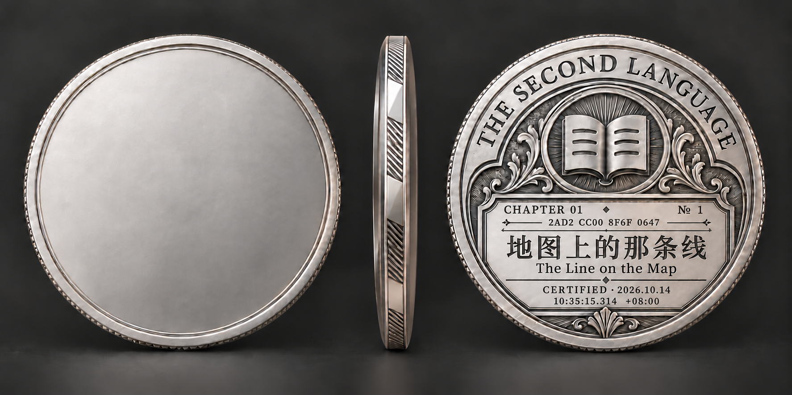

# 双编号身份与币背重排研究 v4

> 历史方案：已由用户最新决定及[SINGLE_IDENTITY_RESEARCH.md](SINGLE_IDENTITY_RESEARCH.md)覆盖。认证顺序编码、顺序分配器及其索引草案全部撤销；当前只保留居中随机身份码。本文仅保留过程证据，不作当前接入依据。

2026-10-14 · 仓库核对基准 main@4d146d0ee74997d4e7ba16b8fa07a039a7af2d1f。本轮是设计工程和接入规格草案，不生成正式证书，不修改产品数据库。

## 结论与实际产物

用户要求：一个十进制认证顺序编号，一个十六进制随机哈希码；允许重新研究编号样式、格式、字体、大小与分布。中文主标题选择继续有效，旧“六位前导零编号”不再是约束。

采用两种互补职责：
- **认证顺序号**：回答“这是第几次首次认证成功”。样张显示 `№ 1`，后续为 `№ 27`、`№ 375`；十进制自然宽度，不补前导零、不按章号推算、不按生成完成顺序编号。
- **随机身份码**：独立、固定、可用于查找该认证身份。样张实际生成 `2AD2CC008F6F0647`，铭文排成 `2AD2 CC00 8F6F 0647`；四位一组、组内正常紧凑字距，分组空格只是视觉分节，不是旧稿逐字拉开。

当前设计建议B。它不是已获得用户最终采用；A也保存作全对象对比。编号内容和认证时间在两图一致，无需为了两种版式创建两个身份。

### A · 上方集中

上层章号与顺序号，次层全宽随机码，后接标题和认证时刻。优点：身份信息集中、识别码较大；不足：上方多了一行与更多水平线，标题区视觉更密。

### B · 标题下方签铭（建议）

章号居中，标题保持主次层级，标题下方用窄铭文带容纳小型顺序号与较小随机码。认证日期与时刻接在下方。视觉判断：上方身份与正文分工更清楚，编号带更像藏书票登记签铭。代码较小，适合数字收藏品放大观看；并未验证40mm实体铸币的可读极限。

## 1. 查证依据与适用范围

### 数字排版

[Monotype / Fonts.com：Proportional vs. Tabular Figures](https://www.myfonts.com/pages/fontscom-learning-fontology-level-3-numbers-proportional-vs-tabular-figures)区分比例数字与纵列对齐用的等宽数字；数字本身的advance width和额外tracking不能混为一谈。

[Microsoft：Latin figures design standards](https://learn.microsoft.com/en-us/typography/develop/character-design-standards/figures)指出比例数字1常比0窄，并强调字形视觉居中与间距关系。币上的静态短序号没有强制按表格列对齐的需求。

因此这里的具体选择是：顺序号用与现有刻银协调的小型齐线衬线数字、自然字宽；长十六进制用更安静、清晰的直立字形，足够笔画厚度；固定整体锚点，不强迫每枚币的字符占满同一宽度。这是本项目设计判断，不是所谓纪念币唯一标准。生图结果不证明实际采用了特定字体或OpenType特性，正式刻字应由可控字体布局实现。

此前刻银原型中的每字扩散说明：仅在提示词里说“收紧65%”并不可靠。本轮取消无意义的前导零、明确代码分组并重新组织整块铭文；不继续只在同一行反复要求AI缩字距。

### 随机标识与唯一性

[RFC 9562 §6.7–6.9](https://www.rfc-editor.org/rfc/rfc9562.html#section-6.9)讨论随机标识、碰撞、局部唯一性及CSPRNG。本文借鉴其生成原则；**本轮16位码不是UUID，不宣称RFC定义了此格式**。UUIDv4的标准全长为128位，结构化32个十六进制数字会显著增加币面负担，不为形式规范牺牲当前设计。

“哈希”本身不产生随机性。本轮明确实现为：系统CSPRNG生成16字节nonce → SHA-256 → 取前8字节 → 16位大写十六进制。可独立用CSPRNG的8字节直接达到同样标识职责；当前用随机来源哈希是为落实用户所说的随机哈希码，不赋予它额外防伪能力。它不哈希可变图稿、不哈希章标题、不只依赖时间戳或递增号。

64位展示码是完整的应用内短身份码，不是偷偷从已有UUID截断后当原主键。现有内部UUID等继续保留；不为这轮设计替换数据库主键。若以后要内容防篡改，应另存相应内容版本的完整摘要；身份码既不是内容摘要，也不是签名、密码或认证凭据。

## 2. 长度取舍与容量核算

以下为独立均匀码的生日碰撞近似 `n(n−1)/(2×2^b)`；概率较小时近似很好。表格是本轮计算，不是直接抄取标准。15000枚只是保守的超大压力场景，**不把15000个词错误等同于15000章或枚币**。

| 大写十六进制位数 | 位数b | 500枚任意一对碰撞近似 | 15000枚任意一对碰撞近似 | 判断 |
|---|---:|---:|---:|---|
| 8 | 32 | 2.90×10^-5 | 2.62×10^-2（近似） | 过短，没有必要省到此程度 |
| 12 | 48 | 4.43×10^-10 | 4.00×10^-7 | 可用但余量较小 |
| 16 | 64 | 6.76×10^-15 | 6.10×10^-12 | 当前平衡选择 |
| 32 | 128 | 3.67×10^-34 | 3.31×10^-31 | 对当前标识用途，版面代价不值得 |

无论概率多低，未来正式系统都应在发行注册表上对随机码设置唯一性约束，冲突重抽且只在成功提交后固定；不靠概率宣称数学保证。4字节码的15000枚碰撞**精确值**约2.585%，表中2.62%是小概率展开的近似，不混用两种值。

## 3. 固定数据与显示规则草案

| 数据 | 本轮样张 | 后续职责 |
|---|---|---|
| 章号 | CHAPTER 01 | 章节身份，不等同通过先后 |
| 十进制顺序 | 1 / № 1 | 首次认证完成顺序，非申请、领取、渲染完成顺序 |
| 随机码原值 | 2AD2CC008F6F0647 | 固定16个0–9/A–F字符 |
| 随机码铭文 | 2AD2 CC00 8F6F 0647 | 仅显示分组；组内无插空格 |
| 原认证时刻 | 2026-10-14T10:35:15.314+08:00 | 保留上一轮样张时刻，不因重排重取时间 |

- 顺序号显示自然长度：1、27、375、15000；不用分母、千分逗号、固定六位补零。保留扩展空间，最长显示长度以真实项目规模再验，不无限缩字。
- 序号应在系列首次通过登记时由服务端原子地分配，使用单一持久分配权威，不能从章号、客户端计数或归档文件条数推算。认证唯一性、序号唯一性、随机码唯一性一起验证；同一章节重复提交或同时提交只产生同一个认证身份。
- 不承诺存储系统永不产生序号空洞；若事务失败、取消等会造成空号，也不能把已发行序号重排补齐。目标是稳定顺序，不是靠重编号维持表面连续。
- 认证顺序按服务端首次通过登记的提交次序定义；同时事件由分配权威定序，不假称可以恢复用户现实操作的绝对微秒先后。
- 并非本轮新增一个公共权威：现有实验 `worker/src/certification-lab.js` 仍为lab表；本机查到首次通过用INSERT OR IGNORE保存created_at/coin_seed。本轮没有把实验记录当正式认证、没有给既有lab记录分配正式顺序号或迁移主键。
- 艺术改稿、纹理升级、领取、再测试不重新生成两个身份字段；未来重做图稿只产生艺术版本。
- 对特别诞生纪念币不伪造“通过第N章”；它的特别身份与普通认证序列是否同域要在接入时另定。当前第一章排版不能擅自给仇视之龙分配第1次认证身份。

## 4. 实际样本与可复核性

本轮样张随机源nonce：`F37628A78E01DB9B4B4301036A1E3273`（设计样本，不是秘密）。
SHA-256：`2AD2CC008F6F0647E37C6EF0F7C93B7F3F37F949E652EAFD249C1057E392EF15`。
取前16个十六进制字符：`2AD2CC008F6F0647`。
二进制随机源与完整摘要保存在[dual-identity-v4.json](dual-identity-v4.json)，可重算核验，避免随手编一串字母冒充真实生成。

序号1与既有认证时刻均用于设计试样，尚未占用发行记录。首次认证时间仍遵守RFC3339的三位小数秒与偏移记录；[原时间说明](inscription-v2.json)。这次换布局不重置旧时刻，也没有将毫秒记录精度解释成经过计量校准的时间准确度。

## 5. 本轮实际边界

- 使用imagegen技能的内置图像编辑，两次完整币上下文设计；[提示词](prompt-set-v4.json)。
- A/B均已目视核对2AD2、CC00、8F6F、0647四组、№ 1、中英文标题、原日期、314毫秒和+08:00。
- 审美上建议B，不替用户宣布最终验收。产品网页尚未正式接入双编号；本轮发布研究和图稿，不声称数据库功能上线。
- 原v1/v2/v3文件不覆盖。当前登记区允许重新排版，仍保护中文主标题方向、原图标、留白正面和刻银设计。没有新增主题绘画、材质特效或三维网格。
- 无新订阅、外部付款、Kaggle/HF/GPU任务。实际新增数据放D盘，发布GitHub供对照。

[完整比较页](index.html) · [原始事实](chapter-facts.json) · [图像清单](manifest.json)

