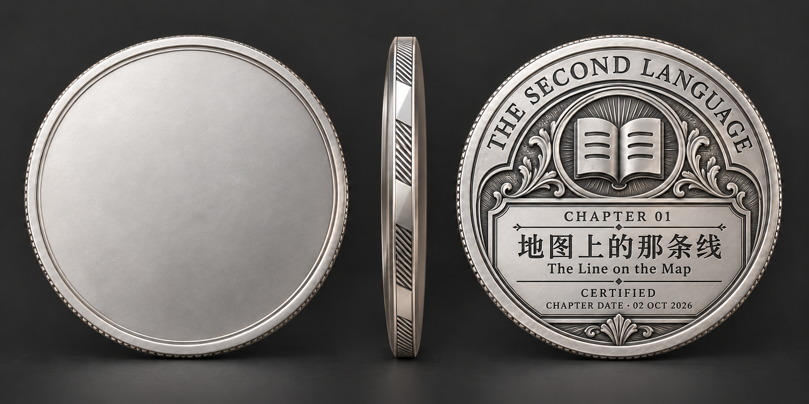
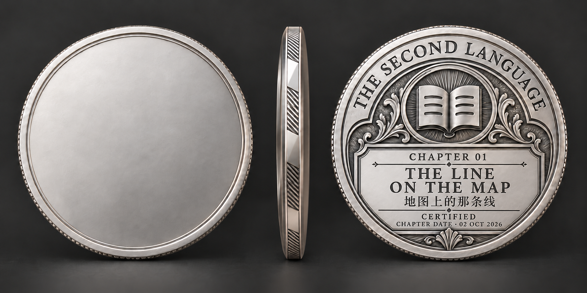

# 第一章真实内容：藏书票式刻银币背观感试样

2026-10-14 · 原始仓库基准 `main@bf4768ff6a1110d72be04622ecf0f019369c1f6d`。

用户重新指定附图中的藏书票刻银方向继续设计。该选择覆盖“全部否决、自己设计”的临时停点，仅为这一方向恢复探索；其他方案没有因此采用。当前暂停币胚全套角度制作，仍按一份币面/币侧/币背的设计投稿方式，进行真实章节信息承载试样。

## 核实的信息

| 信息 | 实际内容 | 来源 |
|---|---|---|
| 章号 | 第1章 | `chapters/2026-10-02/meta.json` |
| 中文章节标题 | 地图上的那条线 | 同上及chapter.json |
| 英文标题 | The Line on the Map | chapter.json第三部分正式标题 |
| 章节日期 | 2026-10-02 | meta.json / chapter.json |
| 主要词汇数量 | 40 | meta.json；本轮不额外挤入币面 |

英文标题直接取自该章正文，没有自行编一个译名。章节digest与完整数据出处见 `chapter-facts.json`。

未取得第一章正式认证日期。本轮是设计观感试样，不创建认证/发币记录；`CERTIFIED`作为版式的静态认证用语，日期明确写为 `CHAPTER DATE · 02 OCT 2026`，不冒充通过日期。

## A：中文主标题 / 英文副标题

保留选定方向的开卷徽记、三行页纹、射线底与刻花、登记框、边缘工艺和银色层次。将章号排成 `CHAPTER 01`；中文原章名为主要识别，英文在下一层。取消全部XXX。正面继续空白，本轮不替第一章设计正面主题。

这版适合以中文原章名快速识别；同一块登记区同时容纳了真实的中英文标题和明确日期。

## B：英文主标题 / 中文副标题

同一完整设计中，仅改变登记框的文字层级：`THE LINE / ON THE MAP`两行作为主标题，中文原章名在下方。整体币体、徽记和材质方向保持，用于比较语言学习系列的英文收藏感与原章名识别。

这版英文更突出，但登记区纵向密度也更高。两版均为真实信息设计试样，未替用户决定最终排版。

## 制作与保存

- 采用内置imagegen，2次生成；完整提示词在 `prompt-set.json`。
- 输入母稿为用户本轮附图，原件存 `assets/selected-direction.png`。没有以此前平板图标版本作为母版。
- 所有改图都作用于完整三视图，未独立生一个新徽记拼回，不用后期代码排字冒充浮雕工艺。
- 产物是AI设计试样，尚未建立对应三维模型；本轮不恢复Kaggle/HF或局部改旧网格。
- 正式龙正面与一轮成型方向不变。这个方向的重新采用是用户决定，两个实际章信息版本的最终选择仍待反馈。
- 本机目录：`D:\CodexStorage\workspaces\ai3d-design-research\chapter-one-coin-study-20261014`。无新订阅/外部付款，图像生成与Codex使用正常额度。

[本机浏览入口](index.html) · [数据核对](chapter-facts.json) · [制作提示词](prompt-set.json)
