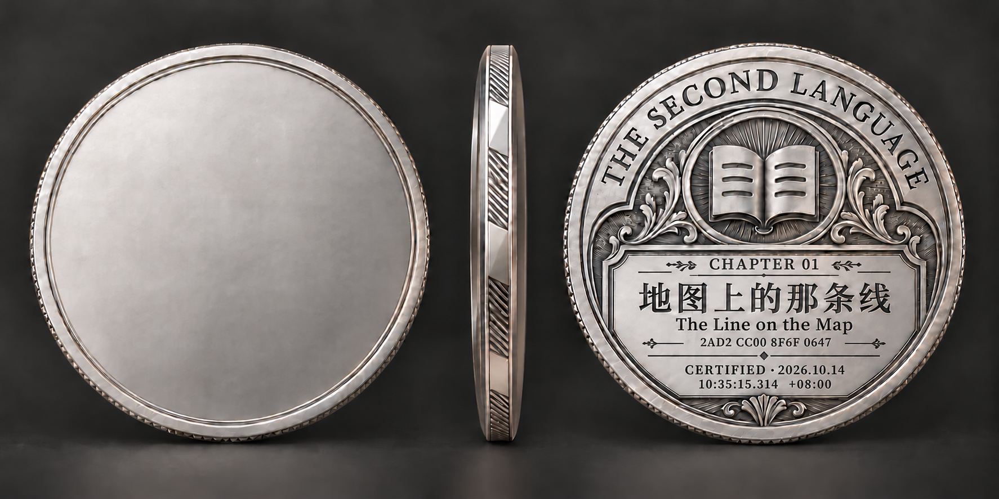
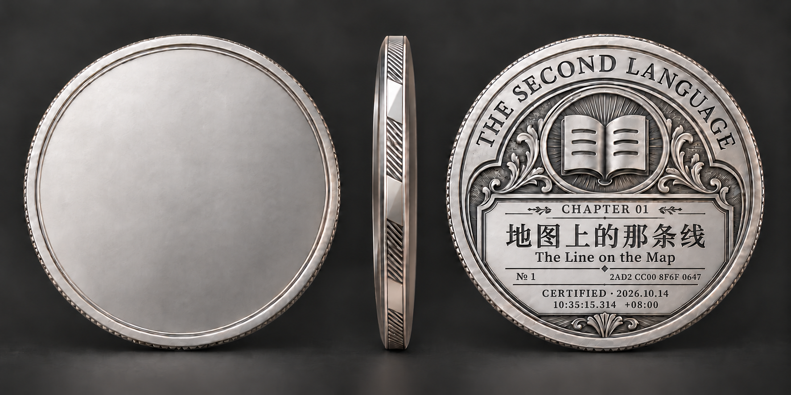
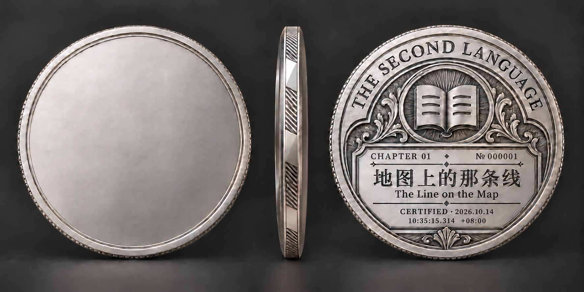
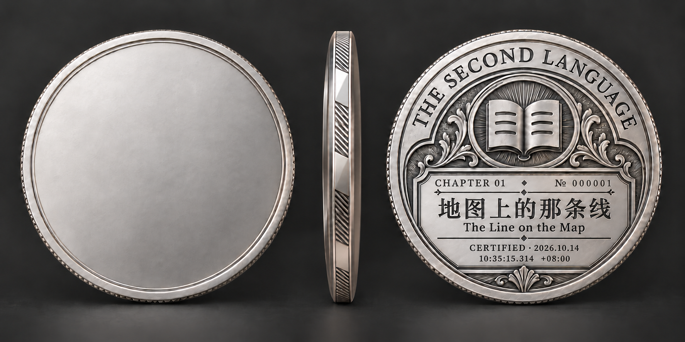
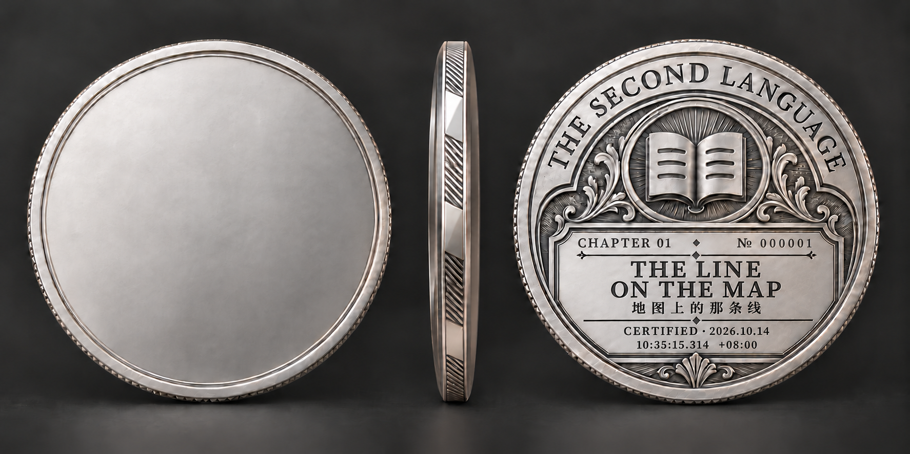

# 第一章认证铭文试样：中文主标题已选定

**币侧正在独立重研：**原图中的diffusion侧缘不再作为结构依据。[币侧工艺研究与三种真实几何试样](https://github.com/Gual-Wells/The-Second-Language/tree/main/research/edge-design-study-2026-10-14)；当前币背与身份铭文保留，待侧缘方案选定后再统一整币视觉。

## 当前方向：单一居中身份码 v5

用户删除认证顺序编码，以A版哈希码样式和B版标题下位置为设计起点。当前只保留居中的 `2AD2 CC00 8F6F 0647`，两侧细饰线；章号与原认证时刻保留。下文v4双编号已撤销，仅为历史过程资料。

**[查看当前稿](index.html)** · **[新研究与接入草案](SINGLE_IDENTITY_RESEARCH.md)** · [当前数据](single-identity-v5.json) · [提示词](prompt-set-v5.json)

## 历史方向：双编号身份重排 v4（已被v5覆盖）

用户要求十进制认证顺序号与十六进制随机哈希码。当前样张使用 `№ 1` 与 `2AD2 CC00 8F6F 0647`，取消旧六位前导零；认证时刻沿用上一轮。已完成A/B完整币设计对照，建议B，待用户审美选择。

**[打开双编号比较页](index.html)** · **[完整研究与接入草案](DUAL_IDENTITY_RESEARCH.md)** · [样本数据](dual-identity-v4.json) · [提示词](prompt-set-v4.json)

以下单编号v3/v2均为过程资料，不再是当前身份方案。

**历史稿：[单编号修订v3](assets/chapter-one-certified-zh-v3.png)。** 用户采用中文主标题版，进一步要求编号连续、紧凑；历史依据见[编号排版研究](NUMBERING_RESEARCH.md)，提示词见[prompt-set-v3.json](prompt-set-v3.json)。英文主标题仅作未采用的历史对比，以下v2均为过程版本。

## 下文为认证铭文v2的过程记录

本轮沿用用户选定的藏书票刻银方向，仅重排章号、独立编号与认证时间。当前两版均为设计试样，尚未建立相应三维模型。

## 当前试样

- 章号：CHAPTER 01。
- 编号：№ 000001。与章号独立；本轮未分配/占用正式发行序列。
- 中文章名：地图上的那条线；英文取自正文：The Line on the Map。
- 认证日期：2026.10.14。
- 认证时刻：10:35:15.314 +08:00。

用户明确允许试样取当前时间。本机实际取时为 `2026-10-14T10:35:15.314+08:00`；两种语言层级使用同一瞬间。这不是第一章历史认证事实，不创建认证或发币记录。

### 中文主标题

### 英文主标题

保持原开卷徽记、三行页纹、射线底、刻花、登记框、侧缘与刻银方向。正面保持空白。此次不制作全套角度，不重新设计主题正面。

## 编号与时间设计

用户最新要求覆盖旧试样：不写ISSUE等说明性标签；不展示章节发布时间。编号用小型“№”与六位数字组成收藏铭刻，不使用总量分母，不暗示限量500枚。六位为当前试排宽度，非数据库上限。

认证铭文在下方分两行：CERTIFIED与日期并列，时分秒及三位毫秒独占次行，数字时区收尾。标题仍是登记框的视觉主体；不把完整机器字符串硬塞进币面。v2当时尚待语言选择，现已由用户明确采用中文主标题版。

数据与显示分开。依据 [RFC 3339 §5.6](https://www.rfc-editor.org/rfc/rfc3339.html#section-5.6)，本轮记录UTC、带偏移本地时间及epoch毫秒；标准允许小数秒和Z/数字偏移。这里选用三位小数秒，完整年份；不编造微秒、纳秒。毫秒位数是记录分辨率，不证明本机时钟具有经过校准的毫秒准确度。显示使用Asia/Shanghai；本次为+08:00。记录保存在[铭文数据](inscription-v2.json)。

后续正式产品应绑定首次认证通过事件，生成/领取/重绘时间不替换该时刻；通过后继续测试也不重复发证。这里只记录设计要求，没有执行产品代码或数据迁移。

## 过程与核验

- 内置imagegen精确对象编辑，两次最终图生成，提示词见[prompt-set-v2.json](prompt-set-v2.json)。前一步未发表的ISSUE版仅是中间排版父本，不是当前采用设计。
- 已逐字目视核对：章号、六位数编号、中英文标题、日期、时分秒、三位毫秒与+08:00；新图无ISSUE、CHAPTER DATE或02 OCT 2026。
- PNG原文件保存并记录散列；未用后期代码排字冒充浮雕，也不把AI设计图当三维模型渲染。
- 历史初稿保留：[中文v1](assets/chapter-one-bilingual-zh.png)、[英文v1](assets/chapter-one-bilingual-en.png)。其CHAPTER DATE处理已经被用户否决并由v2覆盖；仅作可回退过程资料。
- 第一章内容出处仍为[chapter-facts.json](chapter-facts.json)，其中章节日期只保留作来源信息。
- 无新订阅/外部付款，无Kaggle/HF GPU任务；使用正常Codex与内置图像额度。新增实际数据均在D盘。

[浏览入口](index.html) · [图像清单](manifest.json)
