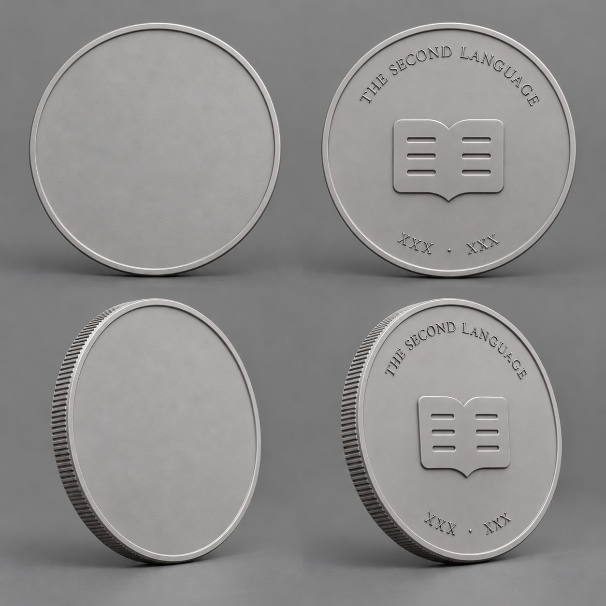
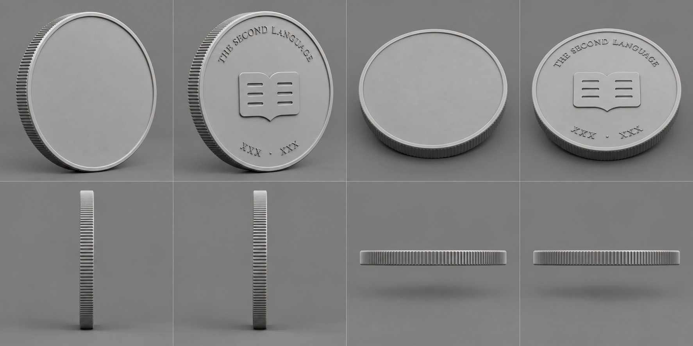
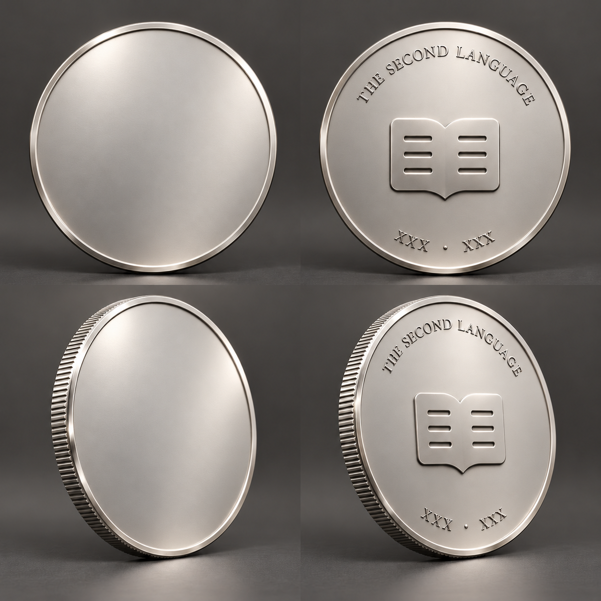
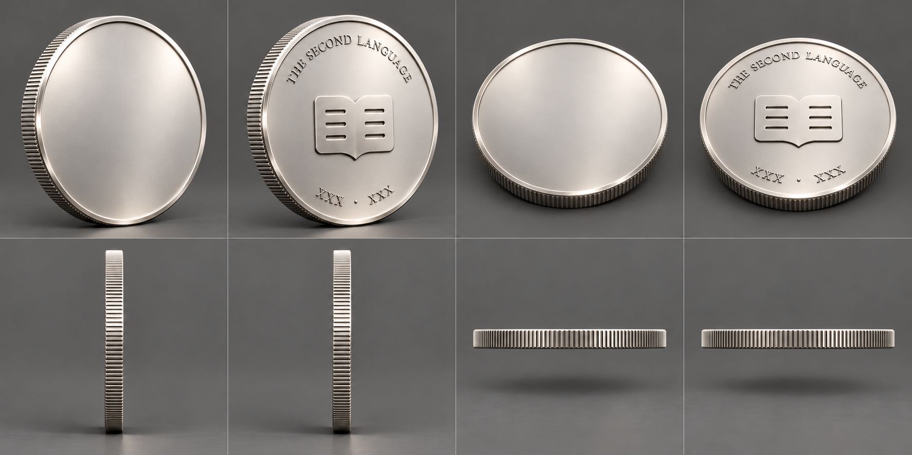
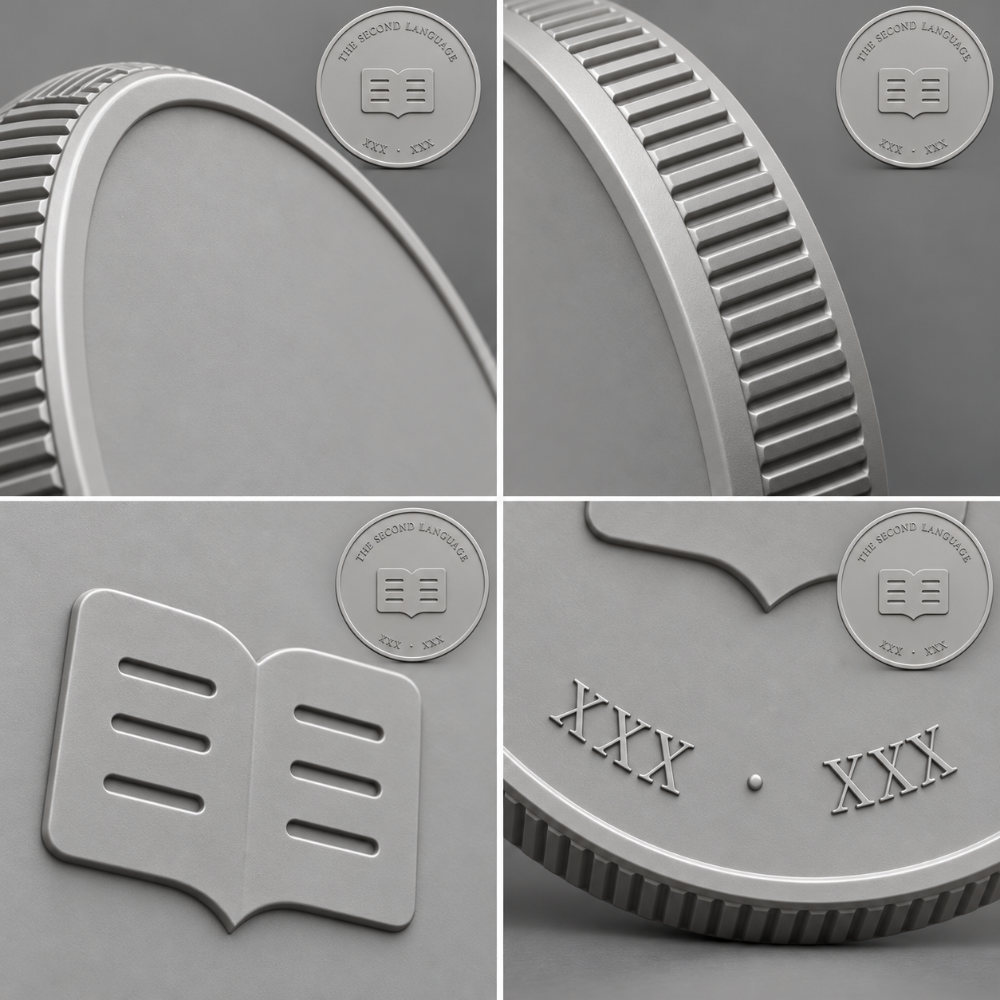

# 第二语言共用币胚：完整稿图探索 v1

2026-10-13 · 制作基准 `main@edd026e98e003dd314eecc0ddf7d399435506d16`。

## 本轮作品

按用户要求：**正面完全留空；背面探索统一系列设计；所有动态发行信息用 `XXX` 占位。**固定系列名 `THE SECOND LANGUAGE` 保留，底部占位为 `XXX · XXX`，没有实际章号、年份、特别发行名称或微小发行编号。

共五张主稿板：白模主视4图、白模补充8图、材质主视4图、材质补充8图和结构近景4图，共28个视图位置。它们是AI制造设计稿，不标为已经存在的三维模型渲染。

本轮采用内置imagegen；实际先以仓库现有开卷图标作为输入形成整币，再对同一完整稿作徽记/文字尺寸与材质微调，最后展开角度。提示词与输入父本保存于 `prompt-set.json`。

### 白模主视：正面、背面与斜视

正面只有制造包边，中央空白；币背以浅浮雕开卷、上弧系列名和下方占位形成层级。第二版收小徽记和文字，保留更从容的负空间。

### 白模补充：左右斜视、上方斜视与四向侧缘

上排：正面左斜、背面左斜、正面上方斜、背面上方斜；下排：左、右、上、下缘。主体是对称、未破损空币胚，因此若干纯侧视自然接近。

### 材质主视：细缎面银色与包边反射

材质第一版的显著锤纹被收敛；现版用更细的缎面field、较亮的包边/浮雕倒角表达制造质感。没有用材质给空白正面加入故事或纹样。

### 材质补充：与白模相应的角度

### 结构近景：包边、侧缘、开卷和占位铭文

每个近景都带完整币背定位，局部是同一作品的观察，不作为单独新设计再拼回整币。

## 设计参数与本次判断

沿用工作规格D40 mm、币身T2.8 mm、窄包边以及浅齿侧缘。它们是图稿的设计目标，不把AI画出的槽数、毫米深度和相机角当成已测制造值。后续真实构建沿用 [币胚工作参数](../coin-base-and-foundation-identity-2026-10-13/coin-base-v0.1.json)。

这套稿先解决清楚的器物形制与背面身份：

- 正面所有主视/斜视均无主题、文字或徽记。
- 币背实际以项目开卷资源转译，不恢复之前无视觉稿的程序书形coupon。
- 可变字段统一 `XXX`，不出现FOUNDATION、F-001、2026或真实章号。
- 白模到材质沿用同一整体形制；图稿有细小生成差异，真实模型以统一规格和采用的整币设计生成。
- 近景的槽深视觉较强，作为细部探索看待；侧缘应在真实构建中保持工作规格的浅槽与圆肩，不复制成尖齿齿轮。
- 完整币胚没有主题发光、粒子或雾气。其效果层为零；主题效果随未来完整主题作品设计，未为空币胚随意添加魔法装饰。

当前是可供用户观看、比较和选择的首轮完整稿图探索，未宣称已取得最终审美采用，也未生成GLB/Blend。仇视之龙正式稿、旧母版和一轮成型重做方向保持；本币胚正面故意没有龙。

## 文件与保存

- 当前主稿：`assets/g-master-v2.png`、`g-angles.png`、`f-master-v2.png`、`f-angles.png`、`g-details.png`。
- 本机初稿留存：`g-master-v1.png`、`f-master-v1.png`；不覆盖当前原件。
- `index.html` 提供本机浏览页，可在同一组机位切换白模/材质并放大原图。
- 图片元数据、散列及制作父本见 `manifest.json`；完整提示词见 `prompt-set.json`。

实际本机目录：`D:\CodexStorage\workspaces\ai3d-design-research\coin-blank-drafts-v1-20261013`。全部图像与稿件实际存D。本轮没有Kaggle/HF作业、新订阅或付款；内置图像生成和Codex工作使用其正常额度，不称为零额度消耗。
