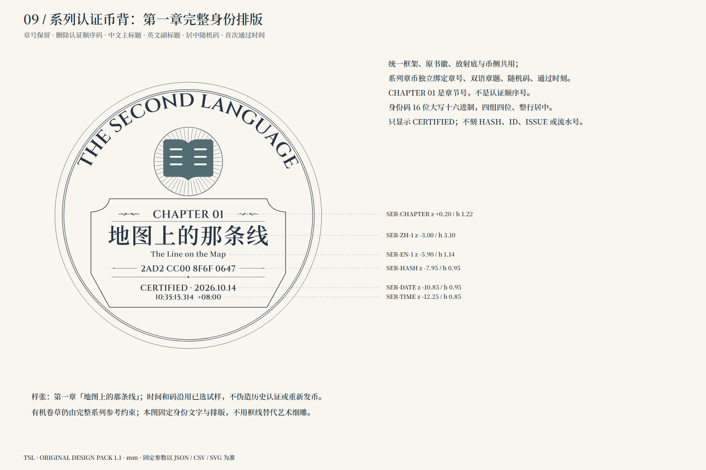
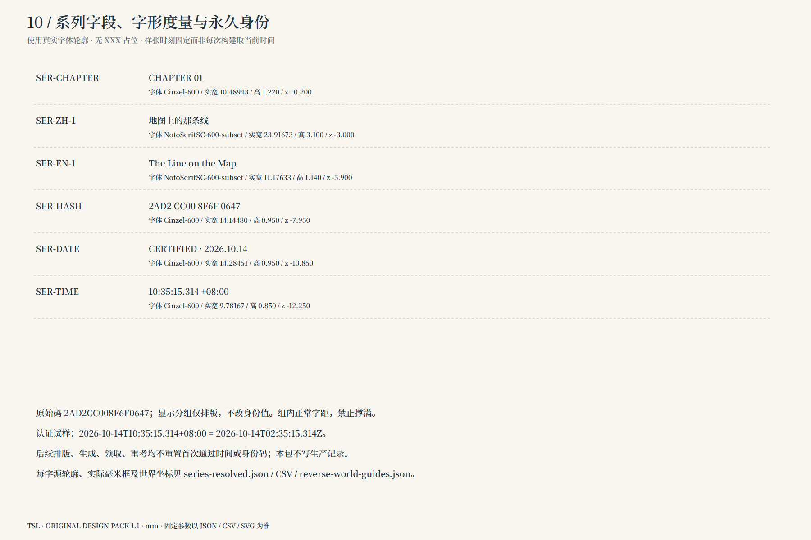
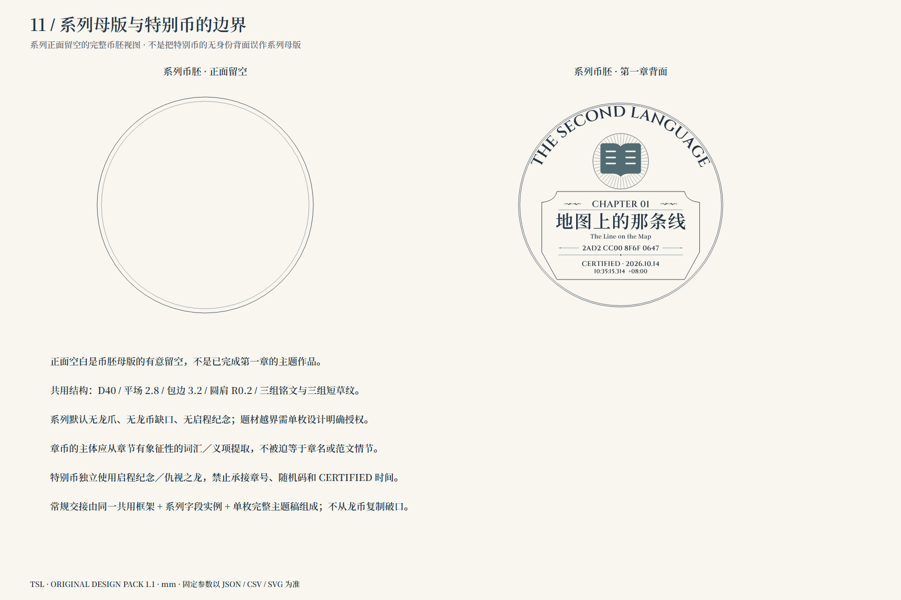

# 第二语言认证币原始设计包 · v1.2 · 2026-10-15

## v1.2 · 已加入实际拟合三维样币

[真实多角度视图](production/index.html) · [制造、重建与边界](production/README.md) · [可编辑Blend](production/outputs/hostile-dragon-fitted-candidate.blend) · [GLB](production/outputs/hostile-dragon-fitted-candidate.glb)

按用户最新指示：先制造参数币胚，再拟合正面、币背与跨缘结构；**币侧严格遵循参数，币背参数图只作数值参考，审美以完整视觉稿为准**。以下旧版图05、背面矢量和固定排版属于参考资料，不能覆盖本轮实际拟合布局；实际布局见`production/outputs/fitting-layout.json`。已交付真实模型及本地可重建源，不代表用户已完成艺术采用。系列认证币入口与身份规范完整保留。

[工作入口](START_HERE.md) · [图稿总览](index.html) · [建模交接](MODEL_HANDOFF.md) · [清理记录](AUDIT.md) · [唯一设计规范](spec/design-spec.json)

v1.1补齐此前遗漏的系列认证币：独立的第一章实例、变量排版、字形与世界坐标、重建和验收。共用币胚、系列币、启动特别币三个入口均在同一包内。

已从当前版本删除八份明显错误的旧稿。保留认可龙正面与用户原图，形成一份修订观感主稿，以及十一份非AI固定设计分解图。固定数据均有SVG/JSON/CSV源文件、字体及许可证、原始曲线、世界坐标导引与可重建脚本。

## 系列认证币 · 已补齐

[系列交接与排版规则](SERIES_HANDOFF.md) · [系列输入](spec/series-sample.json) · [系列完整固定矢量](vectors/series-reverse-fixed-components-mm.svg)

章号、双语章题、居中随机码、首次通过毫秒时刻完整保留；不恢复认证顺序号。第一章身份与时间仍为此前样张，未颁发正式认证。正面是有意留空的币胚，不冒称已完成第一章主题艺术币。

[原先选定的完整系列观感稿](sources/user-blank-reference.png)仅提供艺术方向，旧侧纹不覆盖当前工程规范。图09—11是设计说明，不是删去艺术纹样后的新审美提案。

## 特别币修订观感

观感图不提供精确角度或重复分布真值。以下说明图来自同一数据；新定参数是本轮设计名义值，不伪装原图实测。

## 1. 坐标、零点与正背映射

[SVG源文件](drawings/01-datum-and-orientation.svg)

## 2. 铭文、草纹与留白分区

[SVG源文件](drawings/02-edge-distribution.svg)

## 3. 同一数据生成的四方位侧视

[SVG源文件](drawings/03-four-side-elevations.svg)

## 4. 共用截面与圆肩

[SVG源文件](drawings/04-shared-section.svg)

## 5. 特别币背固定排版

[SVG源文件](drawings/05-reverse-layout.svg)

## 6. 破口、爪与背面对应

[SVG源文件](drawings/06-foundation-overrides.svg)

## 7. 逐字位置与角度

[SVG源文件](drawings/07-glyph-schedule.svg)

## 8. 短草纹母轮廓与控制点

[SVG源文件](drawings/08-foliate-master.svg)

## 直接给建模使用

- [逐字坐标CSV](spec/glyph-placement.csv)：57个字位含空格，毫米边界与角度一一给出。
- [草纹控制点CSV](spec/foliate-control-points.csv)：节点、控制柄与路径ID。
- [整圈轮廓SVG](vectors/edge-layout-mm.svg)、[曲线JSON](vectors/edge-curves.json)、[世界坐标导引](vectors/edge-world-guides.json)。
- [固定币背组件](vectors/reverse-fixed-components-mm.svg)、[币背文字](vectors/reverse-lettering-mm.svg)、[原图标](sources/project-icon.svg)。
- [字体来源与许可证](fonts/font-sources.json)、[数值检查](checks/design-checks.json)、[完整哈希清单](MANIFEST.json)。

v1.2已加入特别币实际三维样币与可重建源；用户最终艺术采用尚未发生。生产应用、数据库和历史模型原件未改。

