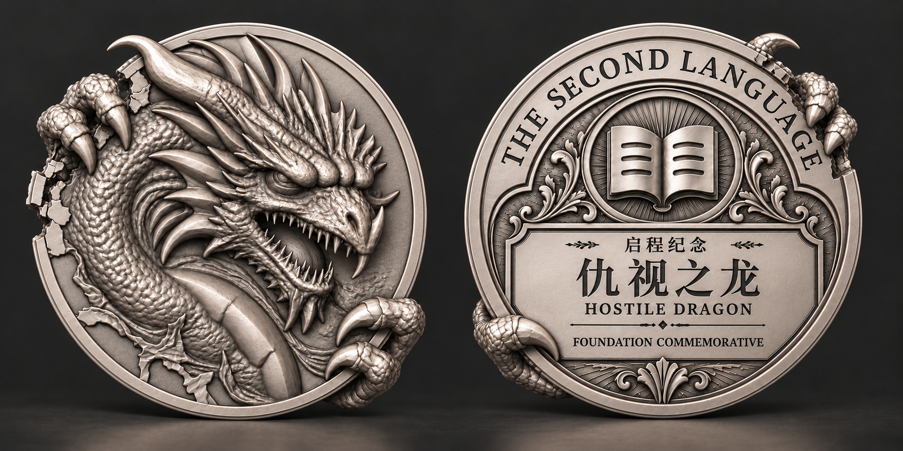
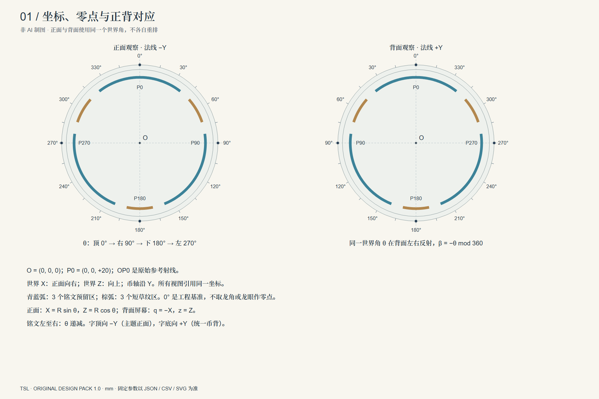
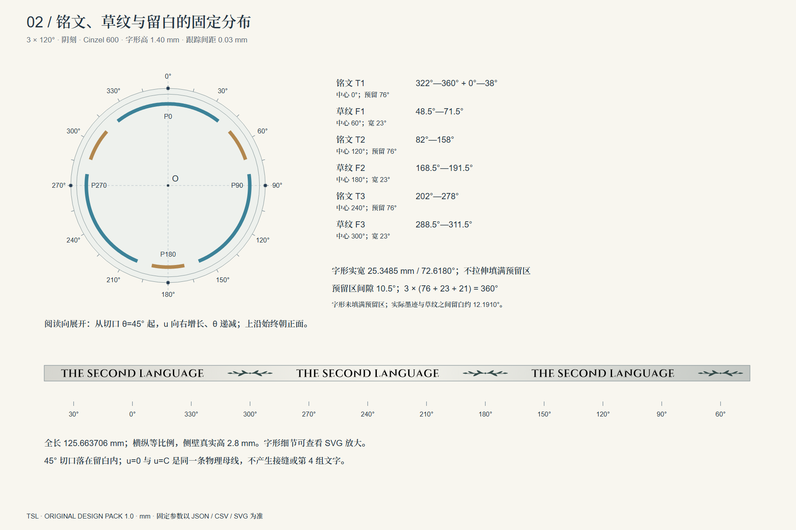
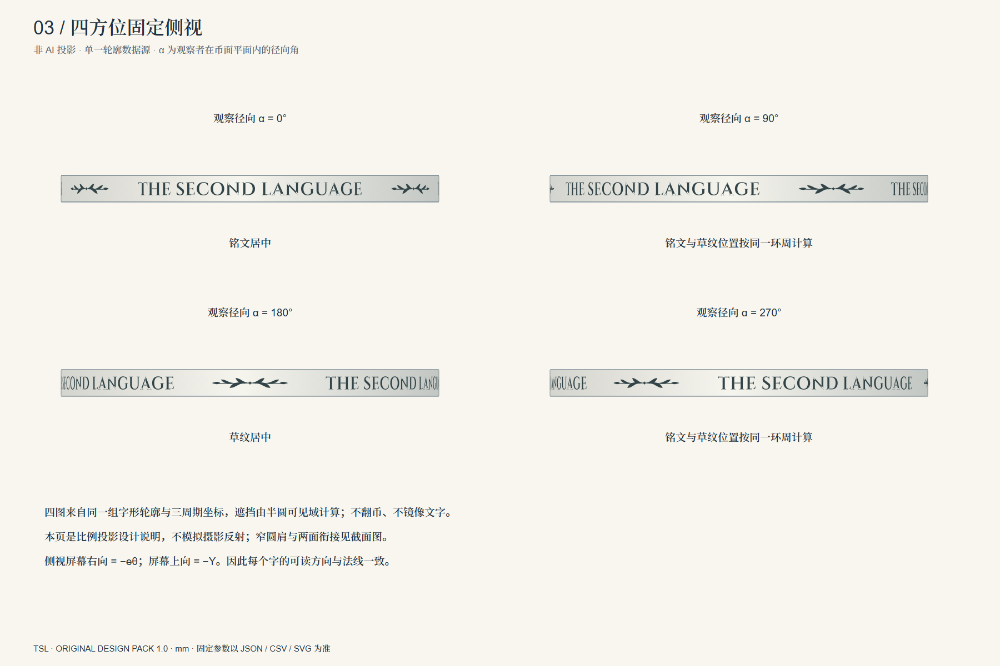
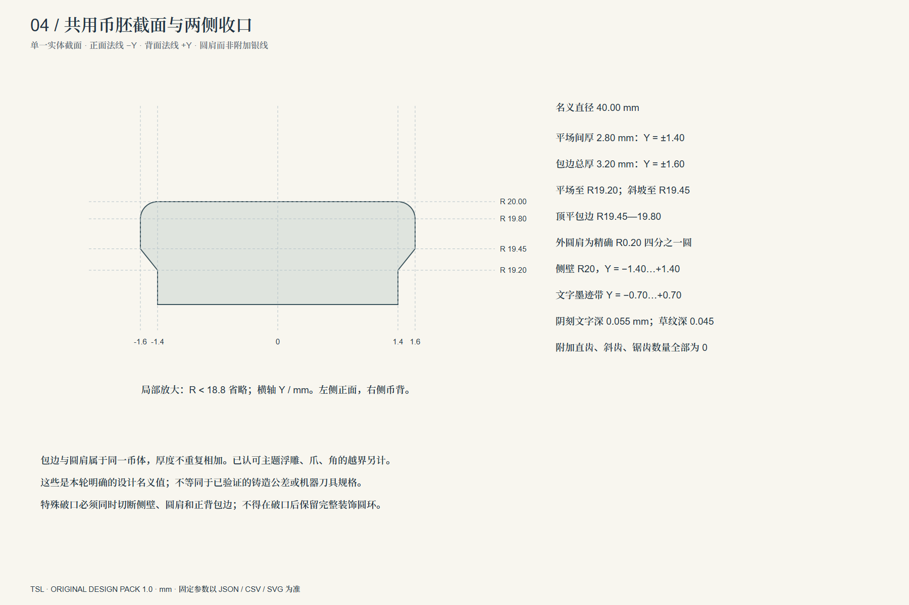
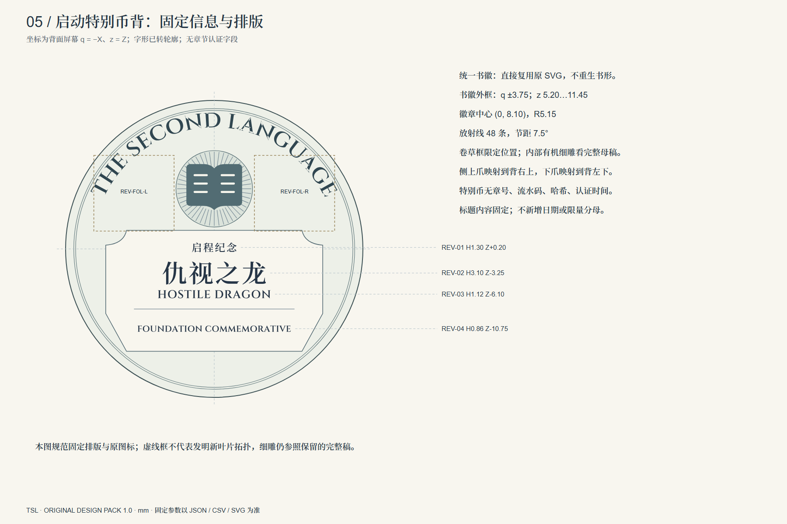
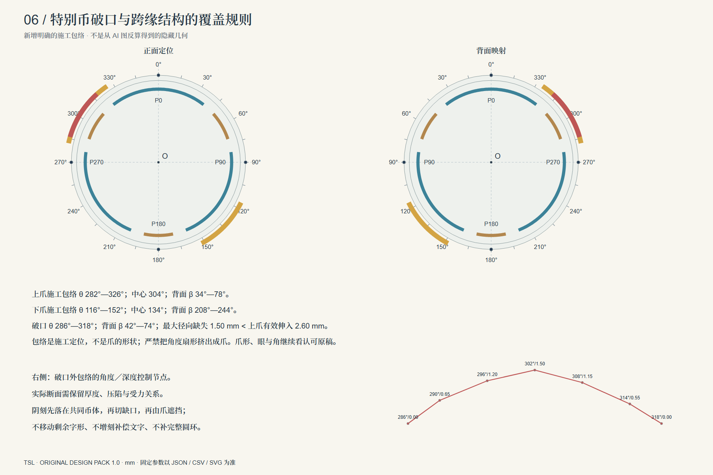
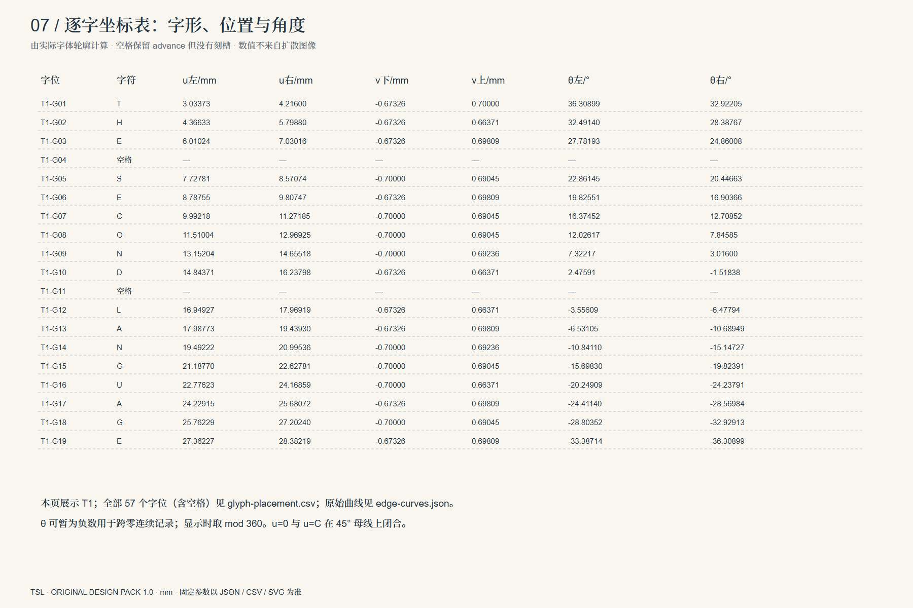
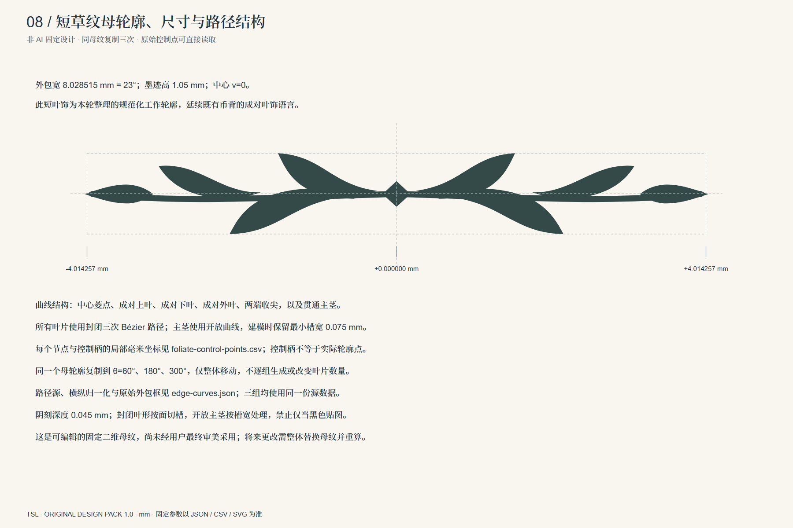

# 第二语言认证币原始设计包 · 2026-10-15

[工作入口](START_HERE.md) · [图稿总览](index.html) · [建模交接](MODEL_HANDOFF.md) · [清理记录](AUDIT.md) · [唯一设计规范](spec/design-spec.json)

已从当前版本删除八份明显错误的旧稿。保留认可龙正面与用户原图，形成一份修订观感主稿，以及八份非AI固定设计分解图。固定数据均有SVG/JSON/CSV源文件、字体及许可证、原始曲线、世界坐标导引与可重建脚本。

## 修订观感

观感图不提供精确角度或重复分布真值。以下说明图来自同一数据；新定参数是本轮设计名义值，不伪装原图实测。

## 1. 坐标、零点与正背映射

[SVG源文件](drawings/01-datum-and-orientation.svg)

## 2. 铭文、草纹与留白分区

[SVG源文件](drawings/02-edge-distribution.svg)

## 3. 同一数据生成的四方位侧视

[SVG源文件](drawings/03-four-side-elevations.svg)

## 4. 共用截面与圆肩

[SVG源文件](drawings/04-shared-section.svg)

## 5. 特别币背固定排版

[SVG源文件](drawings/05-reverse-layout.svg)

## 6. 破口、爪与背面对应

[SVG源文件](drawings/06-foundation-overrides.svg)

## 7. 逐字位置与角度

[SVG源文件](drawings/07-glyph-schedule.svg)

## 8. 短草纹母轮廓与控制点

[SVG源文件](drawings/08-foliate-master.svg)

## 直接给建模使用

- [逐字坐标CSV](spec/glyph-placement.csv)：57个字位含空格，毫米边界与角度一一给出。
- [草纹控制点CSV](spec/foliate-control-points.csv)：节点、控制柄与路径ID。
- [整圈轮廓SVG](vectors/edge-layout-mm.svg)、[曲线JSON](vectors/edge-curves.json)、[世界坐标导引](vectors/edge-world-guides.json)。
- [固定币背组件](vectors/reverse-fixed-components-mm.svg)、[币背文字](vectors/reverse-lettering-mm.svg)、[原图标](sources/project-icon.svg)。
- [字体来源与许可证](fonts/font-sources.json)、[数值检查](checks/design-checks.json)、[完整哈希清单](MANIFEST.json)。

本包关闭固定设计与资料交接的循环；不声称有机雕塑隐藏形体或最终三维已完成。用户最终审美采用尚未发生。生产应用、数据库和现有模型未改。

