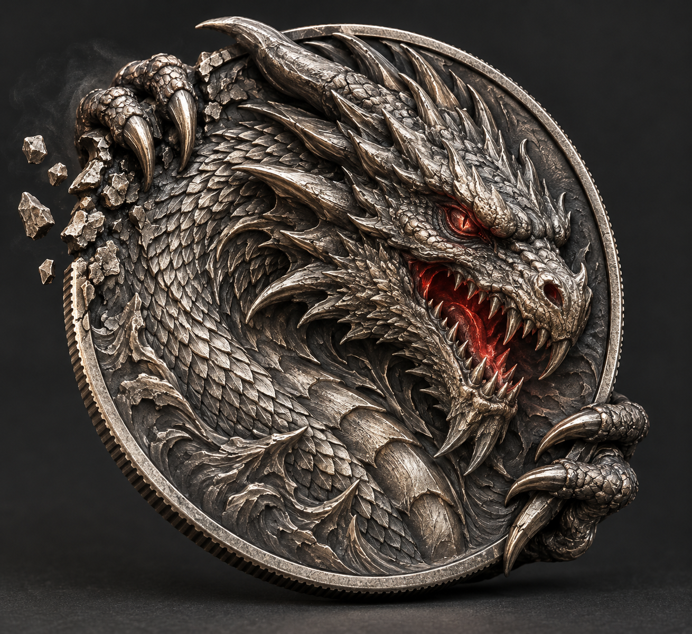
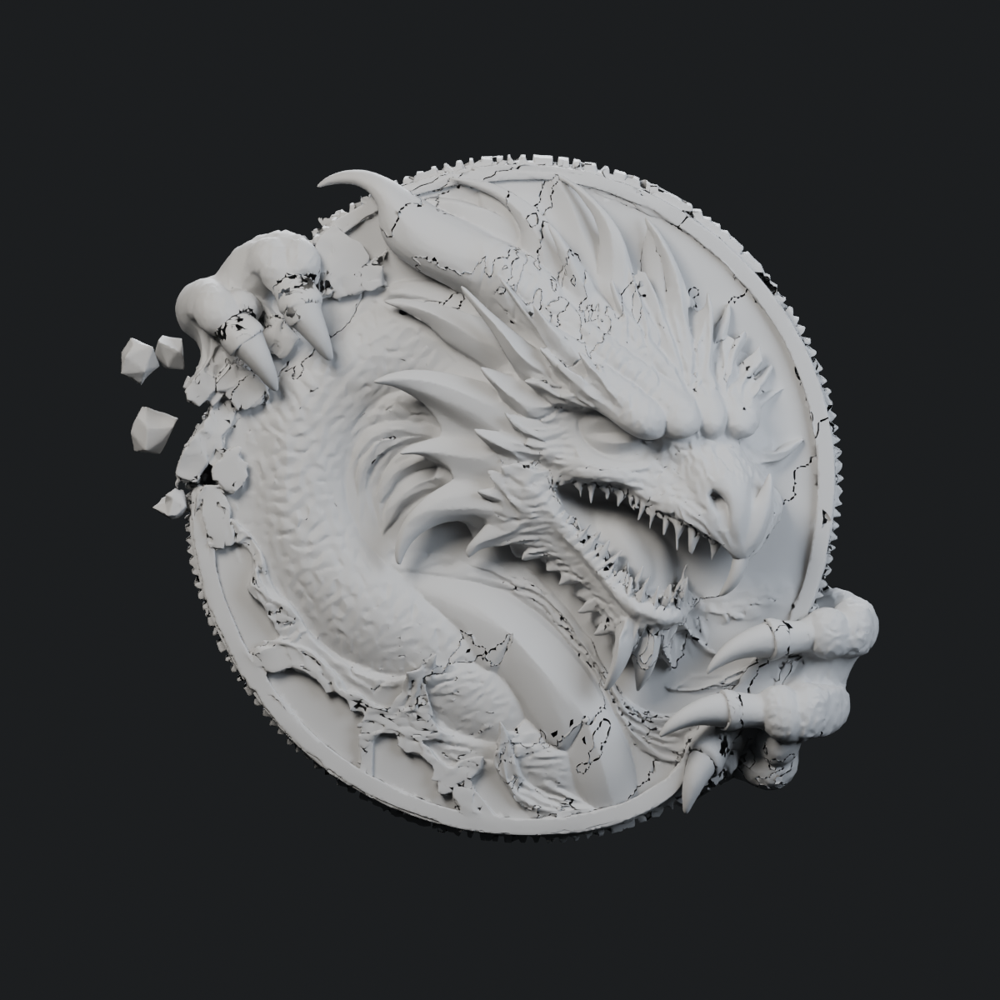
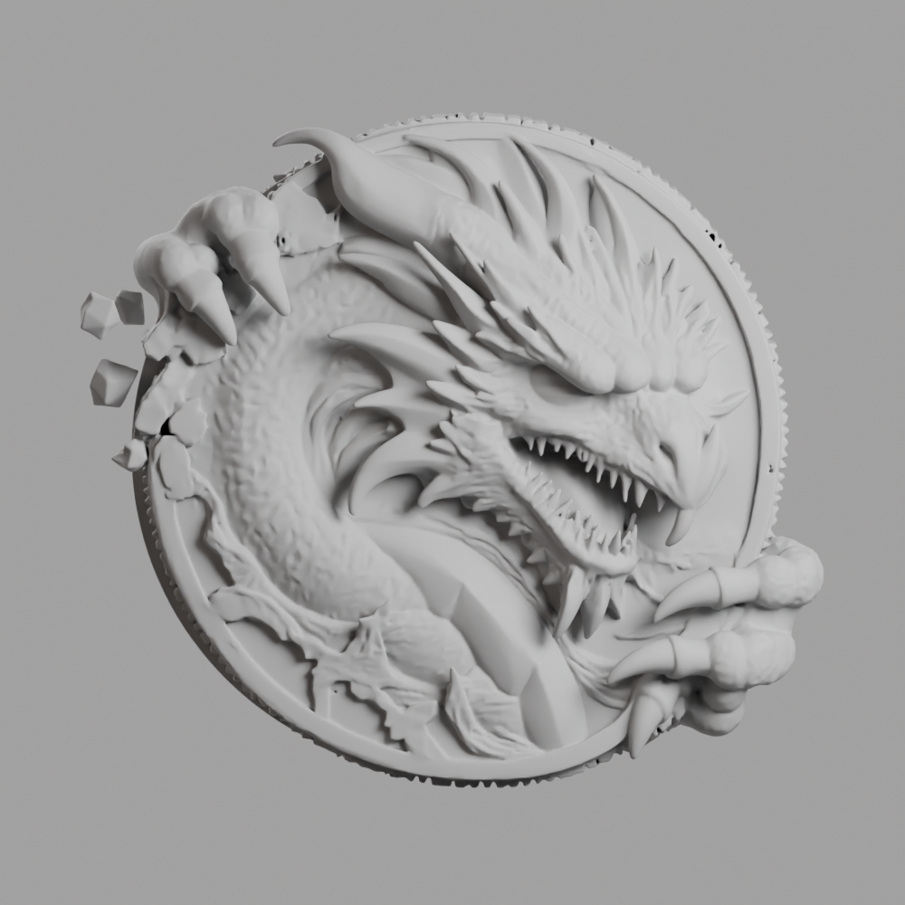

# 仇视之龙：设计与三维重建共同审阅资料

**2026-10-12 快照。当前制作暂停，等待用户参与审阅；没有任何样币通过艺术验收。**

这份资料供不了解原对话的 Chat / DIGR 研究读取。先看本文，再看源图及完整灰模。任务是找出明确设计目标、识别源图与图到三维两层问题，并研究可持续的高质量制作流程；不是把现有生成图当成正确答案，也不是宣布高面数模型已经精品化。

## 1. 项目及当前目标

第二语言是私人英语学习 PWA；纪念币拟作为未来章节认证的唯一收藏品。正式章节测试已存在，但认证与纪念币尚未正式接入。当前集中做一枚独立“仇视之龙”样币，不伪造属于某章、不写正式认证。产品约束见仓库 [COIN_CRAFT](../../protocol/COIN_CRAFT.md)，其中旧日期的“尚未建模”等状态已被这份快照更新。

用户要求：真正完整、可旋转观察的纪念器物；龙头向右转，近侧左眼仇视观看者；左上及右下爪抓币缘并跨到背面；左上局部捏碎币缘，真实对应碎片；以后独立黑雾及眼口红光。主形通过后才做材质和特效。背面承担低调的背面/背景/结构职责，不能与正面抢设计焦点。降低 AI 生成质感，提高明确的手工收藏产品质感。

完整实体、轮廓、比例、体块连接、视线、握持、正侧背衔接一起判断。用户明确要求“除了细节的不合理设计之外也要注意全局下的不合理”。

## 2. 最新用户反馈（优先于旧报告）

1. **原眼没有问题。** Agent 曾把局部灰模凹面误判为空眼眶，增补金色眼球与竖瞳，反而改坏。已经撤回两独立对象；原源网格坐标散列未变。保留原眼，先理解完整龙头的朝向、遮挡与浮雕表达，再看细节。
2. **下方龙爪有些畸形。** 需要明确掌部、指段、指节与包边路径，而不是磨平鼓包。
3. **龙头向左上的形体疑似融合旧爪。** 用户认为它像与早期疑似龙爪旧设计的畸形融合。其真实来源未证实；源图也有长角状物，但不能把含混形体命名成“角”便算成立。
4. **龙身形态不清晰、缺少明确设计方案。** 先确定姿态、头颈/躯干连接与设计对象，再处理鳞片和尖刺。Agent 提出的“盘曲颈胸龙首浮雕”仅是工作假设，未获用户批准。
5. **嘴尖向下的巨大牙不应存在。** 鼻旁向上的疑似巨大牙也不应存在。暂停前尚未切除，不得宣称已经修复。
6. **源 AI 图本身存在问题，图到三维会引入并放大问题。** 用户要求暂停，把自己纳入制作工作流，很多缺陷可由用户明确指出。

用户最新原话：“我觉得你很有必要让我进入工作流辅助中，很多东西我明确可以指出来哪些不对。因为你对照的AI生图本身就具备一些问题，以及AI图的白膜映射也带来其他问题放大。”

## 3. 先看这些图

### 源 AI 概念（自身待审，不是标准答案）

[旧背面概念](concept-back-v1.png) 已被用户否决；单图重建也没有使用它。不要把它当作背面目标。

### 原始三维灰模（映射层问题）

[原始侧面](kaggle-test/outputs/art-review-512/review/clay-side.png) · [原始背面](kaggle-test/outputs/art-review-512/review/clay-plus-y.png)

### 保留原眼的当前工作副本（仍未合格）

[当前金属正面](kaggle-test/outputs/original-eye-v5/front.png) · [克制背面试样](kaggle-test/outputs/quiet-repaired-v4/back.png) · [侧缘试样](kaggle-test/outputs/quiet-repaired-v4/side.png)

后两张来自相同背面结构的 v4；v5 只撤回新增眼球/瞳孔，未改侧背。v4 含新增眼睛的正面是失败实验，不能作为目标。

## 4. 什么真实做成了，什么没有

- **VERIFIED**：Kaggle 验证后实际得到 T4×2；单卡约14.56GiB可用，不能把两卡当一张32GB卡。CUDA/基础算子、稀疏卷积、CuMesh/O-Voxel/nvdiffrast 逐步完成兼容与导出实测。
- **VERIFIED**：TRELLIS.2 512 真正可编辑模型已取得，原 GLB SHA256 `594c78b555d39980d6ff7015acb3358239b18c36c9a1f4f04b6acf200547bbfa`。并保留 PLY、体素、采样检查点、参数与实际日志。
- **VERIFIED**：官方 CuMesh/O-Voxel remesh 真正取回，修复了一部分三角裂隙/孔洞。GLB SHA256 `2669b9d02622ba8074d83ca3ee36bcf5b0dd91f8c1214a18d1b1ace571897582`。网格修复不能自动解决设计归属、爪的解剖与构图。
- **VERIFIED**：原生 Blender 切除错误镜像背面中央形体，并制作克制背场；保留正面及指定包边区域的坐标验证通过。保留区域也留下错误残片，故整体仍未合格。
- **VERIFIED**：v4 金眼增补已撤回，v5 撤回前后原网格坐标 SHA256 `67267073e959418d72389f3a64cf2db4a68de28a15935a69045a013d8ec0dba4`。
- **VERIFIED**：原生 FP16 SDPA/GEMM 合成基准成功；部分样本比 T4 上 BF16/FP32 路线快约4–7倍。**未验证整模型生成等质，未据此自动替换生产精度。** 回收总状态里的 benchmark ERROR 是旧 v1 缺 kernelspec 的记录，真实 v2 报告已完成。
- **UNKNOWN**：更高档级联采样未取得最终高档模型；最后已读进度到纹理采样，平台状态转为 `CANCEL_ACKNOWLEDGED`。不把取消、检查点或 Notebook 成功当成艺术完成。
- **USER-DECISION**：当前暂停制作。停止本地检查渲染和等待 HF 次日免费刷新自动续作的进程；仅保全既有云端结果，不继续生成。

## 5. 失败路径与共同审阅方式

单图自动猜背面产生镜像龙头；圆鼓爪、颈胸归属含混；局部加眼破坏原设计；全息卡把完整 AI 图塞进画框、把碎片雾光画进底图，已被否决。用户曾认可某枚较简单工作样的页面实物感，但这不是复杂龙币合格证据。面数、分辨率、细节量、噪声与发光都不能证明艺术质量。

恢复制作前先共同检查：

1. **整体设计图关口**：完整图+编号区域，用户指出问题；确定姿态、对象归属、连接和构图，修源图本身的问题。
2. **三维映射关口**：完整正/侧/背灰模+旋转，检查映射新增畸形。局部特写只用于核验已经理解的整体形态。

每次修改有明确对象、保留对象和前后比较，回到整枚币复查。此前所有样品均未成为艺术基准。后续先研究行业成熟建模/雕刻/参考资源，避免不熟悉时凭程序球管拼形或盲目反复重抽整币。

## 6. 成本、平台与制作约束

本轮没有购买 HF PRO 或新增持续订阅。用户此前允许有限付费，但明确拒绝样币阶段开通 $9/月 PRO。HF 与 Kaggle 是已验证的免费试验渠道；免费额度与资格有日期，应重新查询，不据旧快照承诺稳定日生产。公开牌价/学生优惠/免费刷新细则需要研究时核实。

本机 C 盘长期空间紧张；所有新依赖、模型、缓存、日志、实验与恢复数据存 D。Windows 原生 Blender 本机 CPU 渲染可用；MX250 被枚举但实际 Cycles CUDA kernel 失败，不能说已成功 GPU 渲染。

Kaggle 是计算场，不是项目永久资产库。正式资产存储仍为 OneDrive/D1 分工。不得为研究这枚币擅自换数据库、启用正式认证或迁移线程。

## 7. 研究导航及下载

- [当前艺术方向与最新纠正](kaggle-test/outputs/COIN_ART_DIRECTION.md)
- [暂停及用户参与关口](kaggle-test/outputs/ART_REVIEW_PAUSED.md)
- [Kaggle 制作参考与踩坑](kaggle-test/PRODUCTION_REFERENCE.md)
- [实验记录索引](kaggle-test/README.md)
- [已有渠道研究](research/sculptural-coin-production-options-2026-10-10.md)
- [纪念媒介研究（历史）](research/collectible-media-study-2026-10-10.md)
- [原始生成实际报告](kaggle-test/outputs/remote-generation-recovery/dragon-generation/generation.json)
- [官方网格修复实际报告](kaggle-test/outputs/remote-mesh-repair-512/dragon-mesh-repair/repair.json)
- [原生精度合成基准](kaggle-test/outputs/remote-attention-benchmark/attention-benchmark.json)
- [源码和权重 pin](kaggle-test/sources/generation-model-pins.json)
- [全部文件大小/散列与下载分组](manifest.json)
- [完整模型与源工程下载](https://github.com/Gual-Wells/The-Second-Language/releases/tag/dragon-coin-research-2026-10-12)

完整 GLB/Blender 源工程、历史失败候选及生成检查点放 Releases 下载，解压后按与本目录相同的路径对应。可将 Git 仓库中的本目录复制出来后合并解压，以恢复实际资产布局。浏览模型使用 Blender，或在该目录运行 `kaggle-test/serve-viewer.py` 后打开本地端口8767的 coin-viewer；静态服务器不是手机可访问的公网部署。运行代码还须安装对应依赖，未承诺这份档案在任何机器一键执行。

只上传与艺术研究有关的资料；不上传用户凭据、设备授权、cookie、临时签名下载凭证、供应商模型权重、工具运行时及缓存。下载包中的 `.pt` 是生成采样产物，不是供应商训练权重。来源许可与固定版本见现有 pins、研究出处与 HDRI provenance；Poly Haven 摄影棚 HDRI 为 CC0。

## 8. 给外部研究的任务边界

研究重点：解释目前哪些问题在源设计已存在、哪些在三维映射新增；建立用户可参与且不会误修正确形体的审阅流程；为已有可编辑模型制定具体、可验证的局部返工方案和全局复核门槛；比较成熟工具/资源与免费或低成本可持续制作的实际可行性。

独立判断，不为了维护 Agent 的旧结论而忽略用户反馈；不要将候选假设写成事实。先把这枚币的设计与制作流程做对，再讨论日常章节纪念币生产。本文只提供任务资料，不复制或自造 DIGR 执行语义。
