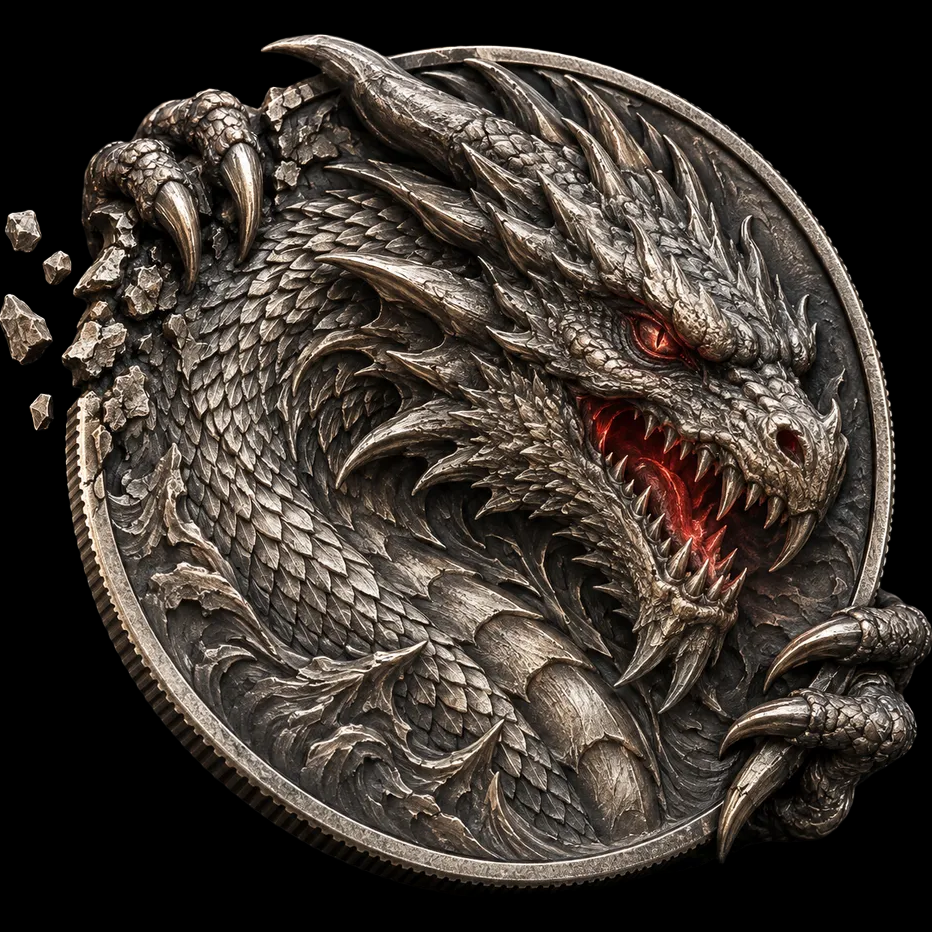

# 外部研究从这里开始

**2026-10-12：制作暂停，样币未获艺术验收。用户参与源图与三维灰模的两道审阅。**

1. 先读 [完整任务背景、用户反馈、已验证事实与失败经验](README.md)。它是主要研究说明，不需要原聊天历史。
2. 对照 [最初 AI 概念](concept-v1.png) 与下面的**实际去背景输入**。三维并非直接由带背景、烟光的完整概念图生成。
3. 查看 README 里的完整灰模正/侧/背图，再对照用户指出的下爪、龙头左上形体、龙身、两颗巨牙问题。原眼保持不动。
4. 需要实际网格时下载 [GLB、Blender 源工程、历史试样与检查点](https://github.com/Gual-Wells/The-Second-Language/releases/tag/dragon-coin-research-2026-10-12)。`manifest.json` 是首批资料及三个模型包的冻结清单；本入口与 `exact-input/` 是补充资料，实际输入散列单独保存在 [provenance.json](exact-input/provenance.json)。

## 实际三维生成输入

SHA256：`994f98db7bdf194fa4dabfbe6a3b1b1ae2e958ae31d7eb771473bd8e32d7d606`，与实际生成报告一致。该图也不是设计正确性标准；源图的含混形体与映射新增畸形要分开识别。

研究要为用户参与提供可执行的整体设计、明确部件归属、局部修复与全局复查方案。先阅读完整资料再做独立判断；不要把旧 Agent 的误诊、原 AI 图或成功导出当成艺术验收。

本资料入口不承担 DIGR 运行协议，不据此自造 DIGR 参数或执行规则。

## 新增：三维样币建模工具与生产架构重审（2026-10-13）

- [完整研究报告：停滞根因、Blender/几何库/AI 模型选型、Kaggle/T4 可用边界与局部造型验收](research/3d-sample-coin-toolchain-reassessment-2026-10-13.md)。
- **研究建议，非新运行协议、非作品验收。** 不覆盖本目录的旧模型/稿图及用户决定；建议先从旧母版副本上的左上爪与实体破口做最小能力验证，而不是继续整币 AI 重新采样。
