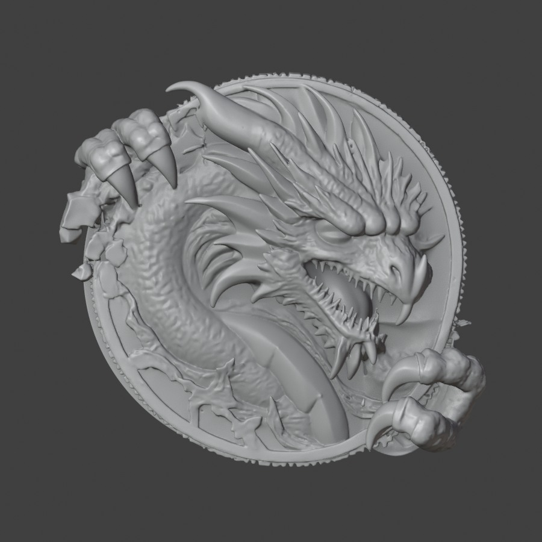
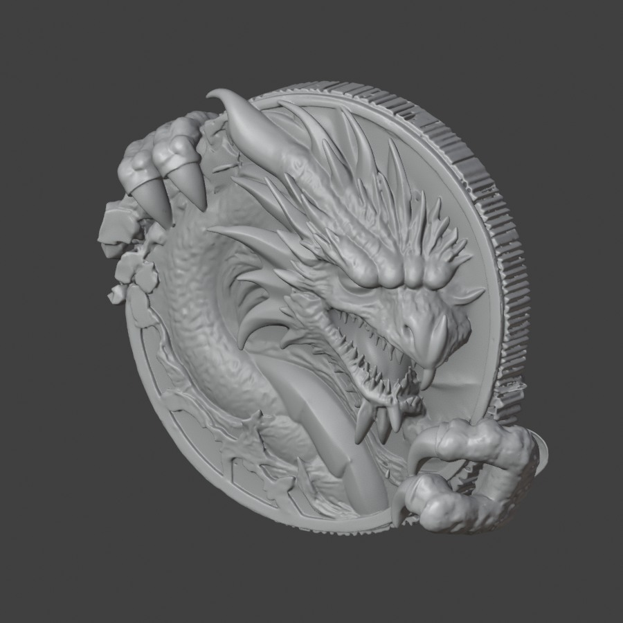
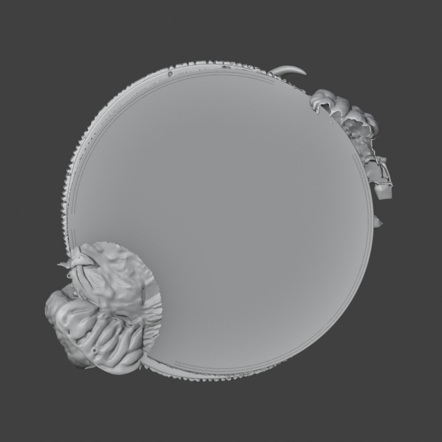

# 用户指认的局部重建分支：修复与实际审视

2026-10-13。当前为可继续编辑的工程候选，**不是正式稿图成品，不晋升 Canonical**。

## 本轮设计决定

用户附图 `318959fd` 精确对应第一轮局部重建的 `regional-ai/inspection/front.png`。用户认为其明显优于后续版本，提出在该版基础上改进。该选择是对工程方向的认可；此前已认可的完整稿 `concept-anchor-v1/assets/selected-anchor.png` 仍为正式视觉目标。

这版不是此前被否决的整币重生成废稿：它从旧作业的原始 shape latent 出发，在完整稿图条件下对两处抓握区域重采样。废稿不参与任何比对或部件提取。

## 实际结果

这三张来自真实 Blender 网格渲染，没有再生二维效果图，没有材质/烟光掩盖。

- VERIFIED：原候选 1,247,248 顶点 / 2,486,900 三角面。密集黑纹不是可采用的手工纹理；没有发现完全重复的坐标三角面，实际需要解码后几何修复。不能把它简单描述成两个整币对象叠在一起。
- VERIFIED：复用已在旧作业使用的官方 CuMesh narrow-band dual contouring（512、band=1、project_back=0），得到 468,522 顶点 / 944,988 三角面。**没有重新采样 AI 造型**；去除显示中密集表面干扰后，爪体/接触可以正常观察。
- VERIFIED：在副本中去除内侧背面的镜像浮雕，保留外缘跨越结构；该操作前后正面及保护的跨缘顶点坐标签名相同。沿用旧作业独立的平整背面基座。
- VERIFIED：已保存可编辑 Blend 和 18,756,660 字节的灰模 GLB。GLB 八个几何部件实际读取成功，顶点有限、面索引有效。首轮导出器报告并修复了网格索引有效性问题；第二次原生验证与重新导出无警告，坐标没有再变动。
- VERIFIED：旧母版文件 SHA256 仍为 `29d468975ebb83d3295f88318c3fcc505c6e73624566455c6aeded65f58b6303`。

## 不得混淆的真实性边界

旧母版没有改动，且区域外原始 latent 精确保留；这**不等于**修复候选的每个区域外 mesh 顶点已与旧作业逐点一致。解码/重建会改变网格表示。若采用区域合并，仍须保留旧作业未改区域的实际网格并核对接缝，不能用 latent 检查冒充最终合并完成。

正面的结果可以继续工作，但正式稿图中的上爪关节/鳞片层次、位置角度和明确缺口仍未完全实现。不能因为用户认为比失败稿好，就宣称新稿已完成。

## 侧背剩余真实问题

1. 上爪背向部分仍有空壳/凹陷，需明确掌部实体与包缘接触。
2. 局部侧缘有薄片、重复表层和边刻污染，不能机械复刻为最终认证币侧边。
3. 下爪后方仍有并非掌部的旧式镜像浮雕残留；应按真实对象归属剥离与补接。
4. 临时平整背面不是最终系列币背图案。

一次按半径删除下爪后侧内缘的试验（command 21）虽不改正面，但造成明显的突兀切边，**内部否决**，没有进入当前输出。下一步不能重复这种二维裁切；应处理完整抓握单元的表层归属、实体厚度与接缝。

## 已停止的路线

- 原生参考轮廓放样：得到机械锥管/关节圈，艺术不足，拒绝作为祖先。
- 第二轮大矩形前景强制轮廓：爪下币身消失，爪根空壳，拒绝。
- 第三轮语义占据实验：只准备/语法验证，**未提交 GPU**。用户转向第一轮后暂停，不能记成已运行或已成功。
- 此前整币生成废稿：持续排除；与这次区域重建不是同一个版本。

## 本机成品文件与可复核入口

本机根：`D:\CodexStorage\workspaces\hostile-dragon-coin\studio-20261013`。

- 可编辑：`outputs/user-selected-regional/deliverable/hostile-dragon-selected-working.blend`
- 灰模 GLB：`outputs/user-selected-regional/deliverable/hostile-dragon-selected-working.glb`
- GLB SHA256：`905be030b087de5dd70384f7d02f9975d59574c0fa35907cadb64f8d3c9380bd`
- 修复前后完整视图：`outputs/user-selected-regional/inspection/`
- 灰模读取核验：`deliverable/glb-check.json`
- 明确失败的背面裁切：`rear-support/`，不采用。

大型 Blend/GLB 本轮在 D 盘保留；GitHub 本目录发布研究、代码、核验记录及真实视图，**不声称二进制母版已上传**。

## 运行与成本

私有 Kaggle kernel：`gualwells/dragon-selected-regional-repair-20261013`，v1，kernelId 138457940。源文件 SHA256 与已编译 CuMesh wheel SHA256 均先核验后执行；没有模型权重下载或新造型生成。修复计算阶段 24.83 秒；实际 GPU 配额增量约 50.20 秒（含运行环境启动）。余额核查于 2026-10-13 08:08:41 UTC：GPU 剩 96,085.262 秒，刷新日 2026-10-17 UTC。无新订阅、无付费调用、无新增持续成本。

下一步以这一完整工程分支处理侧背对象归属与实体连续，再回正式整币稿校对抓握与缺口。不能回到被否决的矩形挖空或原生机械爪。
