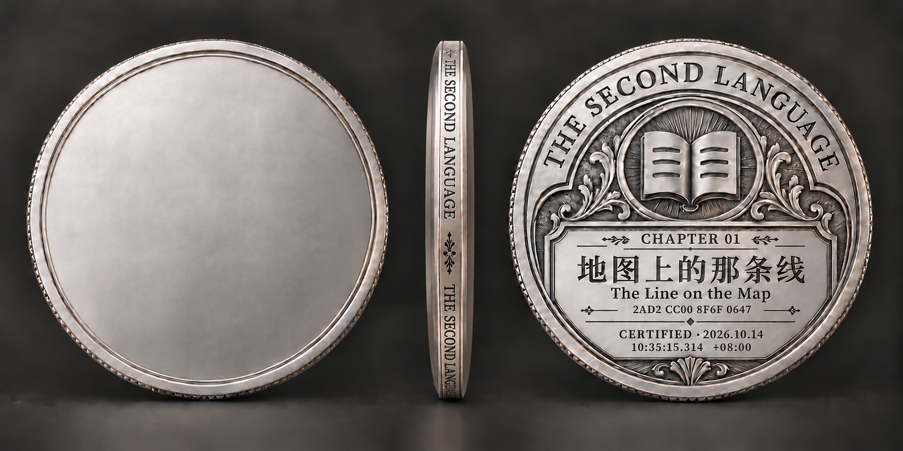
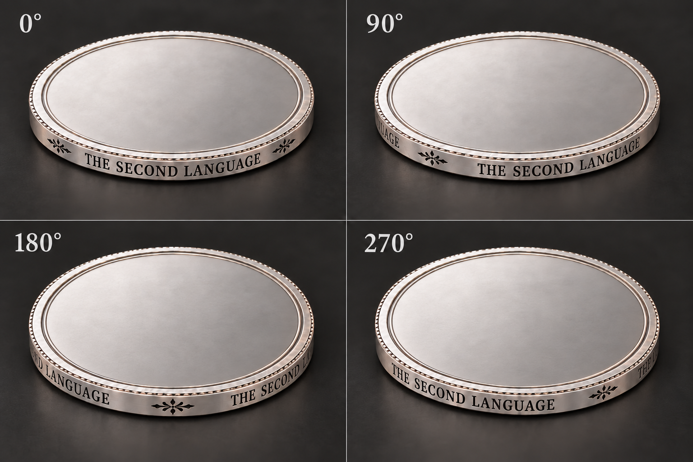
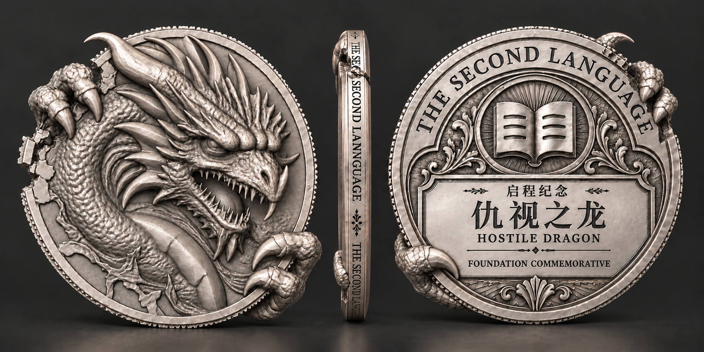
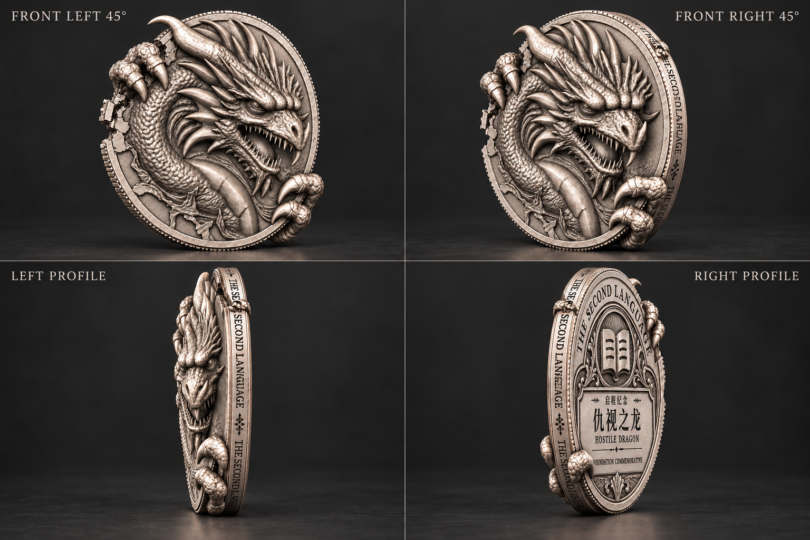
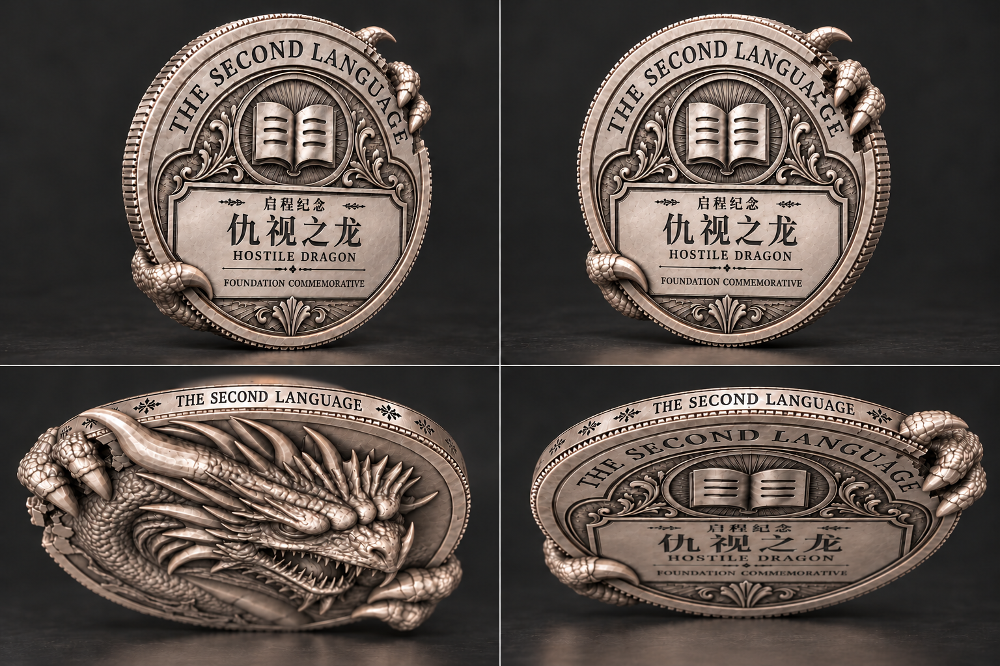

# 铭文币侧与仇视之龙启动特别纪念币：完整设计稿

开始2026-10-14，整理完成2026-10-15。当前为**待用户审阅的AI设计候选**，未晋升正式艺术母版，未生成新三维网格或实际模型转台。

[图稿总览](index.html) · [全部提示词及采用/淘汰状态](prompts.json) · [文件清单](manifest.json) · [上一轮设计研究](../edge-inscription-design-2026-10-14/README.md)

## 1. 本轮完成的五份主要图稿

| 图稿 | 用途 |
|---|---|
| [币胚整图](assets/blank-triptych-a1.png) | 在用户给定的空白正面/第一章币背稿上替换铭文侧缘，保留原信息作普通章币上下文 |
| [币侧四方位](assets/blank-four-edge-final.png) | 空白正面朝上，展示完整名称与组间短卷草在四个方位的排布意图 |
| [特别币正侧背主稿](assets/foundation-rest-master-v2.png) | 将认可龙正面、铭文币侧与专用启动纪念币背组合成一枚完整器物 |
| [特别币正面斜视与侧视](assets/foundation-front-obliques-profiles.png) | 观察浮雕投影、侧壁、上方破口与下方抓握 |
| [特别币背面斜视与上下缘](assets/foundation-rear-obliques-and-edges.png) | 观察启动纪念信息、绕背指节及两面厚度关系 |

这些图由内置imagegen依据完整父稿编辑/外推，不是已完成三维模型的渲染。图上的45°、90°和profile是视角设计意图，尚无同一网格与相机标定来证明精确角度、360°刻纹闭合或毫米级尺寸。

### 币胚与币侧

### 仇视之龙：启动特别纪念币

## 2. 设计决策及边界

### 铭文与短饰纹

沿上一轮研究优先方向：完整THE SECOND LANGUAGE为一组，全周拟重复三组；组间有留白与横向短卷草。字母内部维持正常间距。两侧用窄圆肩收口，细缎面底与刻槽形成层次。未把全部候选元素堆到同一侧壁。

文字顶部朝主题正面，底部朝统一币背，所有组同向。四方位稿的上方为留白正面，因此字顶向上。立式三视图中的中间侧影不能单独证明朝向，其版式位置不定义真实三维面轴；正式排布仍以研究中的展开布局和后续真实模型为准。

侧缘三组周期、40mm工作币径及3.2mm基底总厚是设计工作值，非从生成图反推的制造事实。两侧圆肩属于同一币体，不是多层盖壳或附加两根金属线。

### 启动特别币身份

**USER-DECISION：**仇视之龙是项目启动特殊纪念币，不能沿用正式章节奖币的各类数据。

本轮候选文字：
- 顶部系列名：THE SECOND LANGUAGE。
- 小标题：启程纪念。
- 主标题：仇视之龙。
- 英文题名：HOSTILE DRAGON。
- 下铭：FOUNDATION COMMEMORATIVE。

启程纪念与英文下铭为本轮设计提案，尚未经用户单独采用。没有CHAPTER、章节号、第一章标题、样张哈希、认证时间、CERTIFIED、流水号或限量分母，也没有捏造项目正式启动日期。

特别币不创建章节认证，不占章币身份，不改变生产应用。原第一章数据只存在普通币胚对照，不转移到特别币。

### 正侧背如何衔接

保留认可龙稿的符号主义构图：右转的头、原眼与眉睑关系、长角、盘绕龙身、左上抓握和缺口、右下抓握。材料转译为轻古银/缎面银，高点有选择地磨亮，凹部保留层次。

面向背面时，正面左上爪/缺口映射到背面右上；正面右下爪映射到背面左下。背面展示绕过币缘的同一组指节，不另做第二幅龙像。主稿v1曾保留了过完整的背面圆缘，v2已补出对应缺口。

本轮为REST静息态：没有发光、黑雾、粒子或漂浮碎块，不借效果掩盖形体。后续AWAKENED、碎裂动态、微观纹理是单独的设计工作，未称已经完成。

## 3. 输入与版本谱系

- [用户指定完整币胚](inputs/user-blank-v5.png)：精确使用本轮附件79f6bb01，保留原件。
- [认可龙正面](inputs/approved-dragon-anchor.png)：来自concept-anchor-v1的selected-anchor.png，与用户认可的完整灰色龙稿一致。
- 只基于完整币稿做变化；没有生成孤立爪、孤立书徽或孤立碎片再贴回。
- 原稿、旧模型、正式应用均未覆盖；没有恢复已经被否决的旧模型局部修补路线。

提示词中的输入角色逐一注明。所有10份实际返回的图在本目录留存；未通过版本从总览中隔离，仅作过程记录：

| 中间稿 | 状态及原因 |
|---|---|
| blank-triptych-a2-rejected.png | 铭文朝向修正未奏效，还引入拼写瑕疵，撤回 |
| blank-four-edge-v1-rejected.png | 方位重复且把完整名称拆在饰纹两侧，撤回 |
| blank-four-edge-v2-superseded.png | 改善相位，但下两图误翻成币背，已统一为空白面朝上 |
| foundation-rest-master-v1.png | 特别币主稿初版，背面破口不足，v2替代 |
| foundation-rear-edges-v1-superseded.png | 右上误放正面，已更换成背面另一斜视 |

两次调用网络/连接错误，未返回图文件；状态单独记在prompts.json，没有把失败声称为完成。当前五份是候选，用户尚未作最终审美采用。

## 4. 审阅后仍要处理的实质问题

这轮足以审阅整体气质、铭文方案、特别币身份版式和跨缘设计方向，尚不能把多视图全部提升为几何真值。

1. **精确刻字与相位：**生成图的小字、局部字距和遮挡会漂移。后续真实字体沿曲面排版以完整名称/三周期/固定朝向为准，不从某张误字图取真值。
2. **视角一致性：**同一币在独立视图中仍有浮雕投影、抓握厚度、绕背指节和局部破口形状差异。正式建模需将认可完整正面与明确跨缘意图作为约束，不以一张外推侧图默默改掉主形。
3. **残余外缘细齿：**部分斜视图把面外缘表现为细齿/切面。它不自动授权在铭文带上再加一圈满齿；面缘和侧壁的实际截面还需统一。
4. **材质：**当前银色、暗槽与轻微表面纹理是视觉提案，尚不是可复用PBR材质。保持工艺因果，不能把图上的每条暗痕都建成裂缝或把固定高光烘入基色。
5. **艺术采用：**特别币新背面文字、下铭位置、跨缘指节体量与整币气质需要用户看图决定。未宣布成品三维已通过，也不为“符合参数”忽略审美。

下一步是依据用户对这组完整稿的反馈收敛候选；后续需要三维时，继续遵守此前已定的一轮成型路线，先完整视觉锚点，再真实建模校正。不会以本轮AI视图假装已经消除了三维映射风险。

## 5. 产物、保存与实际消耗

内置imagegen共12次调用，10次返回图，2次网络失败未返回文件。提示词、父本、结果及撤回原因完整保存。没有新Hugging Face/Kaggle任务、模型订阅、外部API付款、工具安装或后台弹窗进程。

所有新增实际文件位于D盘。本目录是研究与设计资产；未修改正式前端、数据库、正式认证或部署服务。GitHub保存图稿和研究包，不宣称已向生产网页部署纪念币功能。

