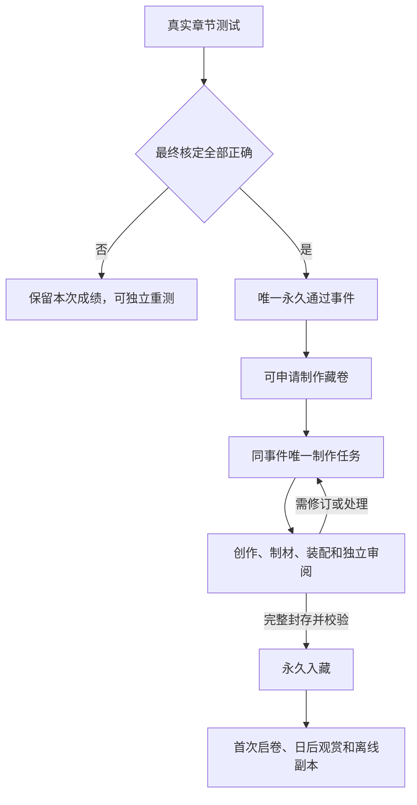

# 纪念卷轴实装：保存、展示、通过资格与申领的讨论方案

2026-10-21。本文为设计建议，不修改现行制作规范或启用正式认证。工艺基准继续按[CHARTER](../../protocol/CHARTER.md)；本轮未改运行器/素材、生成新作品或调用付费服务。

## 1. 当前代码边界

卷轴实验树基线`0bc3cbc31476017f47a90b73701f75e89747bd33`；另只读核对较新maintenance工作副本`318472ac87efcf60e01b2b6a35d253c487adbf64`。后者主壳为v35，实验树为v33；维护树还有其他业务的未提交工作，本轮不修改或混入。没有核实当前线上主壳的部署版本，实装须以届时正式主线为落点，不把整份旧lab外壳覆盖回去。

已确认：

- 现有主壳有章节册、临时页、雅思练习、章节答疑、设置；较新壳另有章节质检。没有正式档案馆、藏卷、认证或申领入口，旧monthly-gallery只是币实验。
- chapter-tests仍关闭certification/coin；真实口答疑义处理完才有最终成绩，提交不是通过。
- v20是独立样品；通用创作、独立审阅、首次通过事件、作品领取和私有展示读取还没有接线。
- 私人storage响应no-store且普通用户没有通用对象读权限；现有SW没有藏卷离线通路，新缓存还会被现有activate白名单清理。
- 主PWA在standalone下全局阻止多指缩放；独立样品细看能力不能直接假定集成后仍可用。

源码入口：`web/{index.html,chapters.js,chapter-tests.js,app.js,sw.js,audio-library.js}`，`worker/src/{chapter-tests.js,auth.js,storage.js}`。

## 2. 推荐的业务含义

将四件事分开：服务器认定的通过资格、艺术制作任务、完整作品永久入藏、第一次观赏。资格不依赖模型是否在线；收藏不依赖是否看完动画；后来的考试分数不改写首次事实。

推荐初版：**首次有效满分自动取得资格 → 用户申请制作 → 后续创作/审阅/封存自动执行 → 完整作品自动入藏 → 用户首次启卷。**

理由是让用户决定何时启动较耗额度的艺术制作，避免上线时把历史满分一口气全部送去生成，同时保留完整自动制作流程。申请页明确已知费用/额度范围及预算规则，不为每个内部步骤反复确认。以后可启用“通过后自动制作”，数据结构不需要重做；这是产品选择，不冒称用户已经决定手动或自动。

不建议再建一个具有资格门槛的“作品做好后才能确认领藏”步骤。ready已经是完整可恢复的用户资产；首次启卷仅完成体验。用户离开、断网、没看完解扣都不使作品丢失或重复收费。

排队阶段可以讨论允许取消；已发生生成时只能停止尚未发生的后续动作，保留成功原件/费用状态，不能承诺撤销已发生费用。未知计费不得靠换请求绕过保护。

自动制作模式只是让E直接入J；不会改变通过规则、原件身份、质量标准或付费保护。

## 3. 怎样储藏

| 层次 | 保存内容 | 职责 |
| --- | --- | --- |
| D1紧凑索引 | 首次事件、任务状态、作品/清单摘要、归属及必要时间 | 找到同一件资产，管理幂等和恢复；不塞正文/贴图/Blend |
| OneDrive权威原件 | 最终纸面分层、英文/译文、完整方案/审阅、展示清单、模型/材质、原始素材及原生工艺引用 | 永久作品及可恢复制作资料，共用内容按摘要只存一次 |
| 手机展示副本 | 索引/小图、共用基座、选中作品的完整展示资产 | 可清理、可重下；不决定认证/收藏身份，不是唯一备份 |

同一套扣具、材质、字体和运行器跨章共享。原生制作资料与展示派生物分别封存；作品完整清单锁定依赖，不能只存一张PNG，也不能把PNG/GLB/短哈希混作完整作品身份。

建议提供“保存纸面原件”及同源英文/译文和记录导出。完整交互备份还需运行器、shader、动作、资源和清单，仅一个GLB不包含现有纸膜和雾场。PWA离线包与可导出的备份包也不是一回事：不承诺在iPhone文件应用里双击一个HTML/ZIP就能完整运行三维观赏。

当前单对象24MiB，展示资源按独立文件准备；大母版可用离线归档分块，但现有API不是通用multipart/浏览器重组服务。公开共用库和个人通过记录/藏卷分别管理权限，默认不把个人资产放到公开Pages。

### 体量：实测文件与估算分开

按当前v20加载闭包统计，正常资源约34.23MiB：共用约31.34MiB，第五章独有配方素材约2.89MiB。这是本机文件字节，不是实网压缩传输或GPU内存。

本轮直接解析GLB复核：文件16,144,276字节，内嵌旧扫描图13,706,507字节；v19又加载13,364,988字节新六图并替换旧材质。发布用派生模型可研究去掉被替换旧图，但须保留当前加载器依赖的材料坐标、UV、展平形态及必要结构。没有实施或验证该派生物，也不能直接删除所有骨骼/形态键。

| 容量情景 | 400章 | 500章 |
| --- | ---: | ---: |
| 共享一次，独有配方约2.89MiB/章 | 约1.16GiB | 约1.44GiB |
| 每章错误复制完整34.23MiB | 约13.37GiB | 约16.71GiB |
| 完整章节档案暂按15–40MiB/章 | 约6–16GiB | 约7–20GiB |

第一行只算现有素材配方，不等于未来冻结展示包：现有最终front PNG本身10,764,392字节，纸胚源3,352,830字节，小画1,561,703字节，另有back/ink/relief、审阅等。完整原件的15–40MiB是初始预算，需用多份实际冻结包校准；共用母版及其他日课音频/雅思/答卷另算。

可沿用现有OneDrive订阅，不新增数据库订阅。当前账户实际容量/剩余仍需按最近有效核验值核算，不能由上述情景推断全项目一定够用。免费5GB不能据此承诺500章完整制作档案。

## 4. 收藏入口和视觉组织

首选在“章节册”增加“我的藏卷”分区，沿用蓝银外壳，不给已拥挤顶栏再加第六个常驻按钮。已有章节目录继续一章一条阅读入口；藏卷目录自行搜索和浏览。测试最终成绩页提供该章“制作藏卷/制作中/查看藏卷”直接入口；阅读正文不再堆奖励控件。

收藏以已入藏作品为主，制作中的申请集中简洁展示，可制作资格另有入口。不放未获得的锁住藏卷矩阵，不把无学习日期做封条，不恢复已取消的币展厅/日历空间。

封面从冻结的完整手稿派生小图，不另生风格无关的封面。闭卷外形相似，故初版建议单列“完整纸叶缩略图＋章号/正式中文章名/艺术英文题名/日期”，按章序分组、最新在前；可检索。双列图面陈列是值得比较的替代选择，不必初版同时维护两套。

外壳按钮、搜索、状态和错误用清楚中文及现有2008蓝银语言；古旧艺术留给器物内部。无需把整个PWA变成中世纪皮革界面，也无需增加大型三维展厅。

## 5. 单件观赏

推荐主视图为独立的全可用区域：顶部返回/章名，中央完整藏卷，底部清楚的启卷/收卷、细看入口；释读/记录/重播/离线保存作为次级功能。返回恢复原目录位置或原测试复盘，不叠多层模态。

第一次从闭卷开始，真实解扣—取下—开纸形成仪式。后续默认恢复上次观赏状态，另有“重新启卷”；每次从闭卷开始也可讨论，但不应把重复播放当作第二次领取。若不希望记录进度，可选择以后直接展开，三者需最终取舍。

观赏、细看、释读、记录各有职责：

- 观赏保留现有材质/立体感/雾染；一时只运行一件，离开释放GPU资源而保留磁盘副本。
- 细看读取冻结高分辨率纸面，平移/缩放、清楚看纸损/字迹/章印；不让任意背景点击误触收卷。主壳全局禁缩放需限定豁免或专用缩放控件，不只改CSS就宣称手势可用。
- 释读为同源完整英文及中文，包含所有题头、题辞、归属、印文和状态，不重新编文。
- 记录收首次通过时间/来源、制作完成时间、姓名快照、版本和完整摘要；可回首次通过试卷/历次测试，成绩表不塞满艺术页。

数字手稿已有成熟参考：[Mirador](https://projectmirador.org/)与[IIIF Presentation](https://iiif.io/api/presentation/3.0/)提供馆藏/图像/元数据的分工；[OpenSeadragon](https://openseadragon.github.io/)和[Panzoom](https://github.com/timmywil/panzoom)提供高分辨率/移动缩放能力。此处只作设计和候选选型参考，没有实际适配验证；现有约6MP纸面不需要为了“专业”强制引入整套IIIF/切片服务器或Mirador工作台。

主操作保留真实按钮，不要求精确拖动。触控目标可按44×44 CSS px设计，这是[W3C增强目标尺寸AAA](https://www.w3.org/WAI/WCAG22/Understanding/target-size-enhanced.html)的参考目标，非声称所有现有控件已满足。状态提示按[W3C状态消息](https://www.w3.org/WAI/WCAG22/Understanding/status-messages.html)可被辅助技术读取，不逐帧播报或抢焦点；减少动态时保留静态整页/释读。

## 6. 首载、按卷预载与离线

不沿用当前“等完整三维准备好才准细看”的样品门槛。进入作品页先提供封存静态预览/释读，同时准备高保真动态；最终材质/预热未完成不开放会跳变的启卷。低分辨率预览不能冒充原件或成为最终画质。

以一卷为准备单位，不按词/句/小碎片造大量请求；列表只读元数据/缩略图，不预取全库。共享基座按摘要复用，进入作品页后并行准备已知资源。优先测真实资源瀑布、去掉旧扫描重复、推迟隐藏详情截图/导出，不以撤预热或降纸面清晰度换数字。

提供“离线保存本卷”“移除本机副本”；普通已看缓存可按预算淘汰，主动离线保存与普通缓存区别显示。完整清单文件全齐且摘要核对后才标离线可用；中断保留已验证文件，继续同卷，不重生成。登出清个人副本，不删除云端作品。

手机缓存总量可讨论250–500MiB起点，与音频共同看空间；此为设计建议，不是Safari承诺。不要一开始就维护复杂跨产品精细LRU，先做好按卷清理、已下载体量及容量错误；固定离线作品不得被应用无声当普通缓存淘汰。

[WebKit官方存储政策](https://webkit.org/blog/14403/updates-to-storage-policy/)明确本机存储可能被淘汰，estimate是估计，persist是申请，不保证实际可写上限。PWA缓存不能充当唯一永久藏库。[MDN Cache](https://developer.mozilla.org/en-US/docs/Web/API/Cache)说明Cache API由应用显式管理，不能把现有no-store接口当作已经支持私人离线。

[MDN兼容数据](https://raw.githubusercontent.com/mdn/browser-compat-data/main/api/BackgroundFetchManager.json)目前Safari不支持Background Fetch；下载应为可中断的前台队列，不承诺锁屏/关闭PWA后继续完成。新藏卷cache还需纳入SW保留/升级/登出规则。

## 7. 认证、历史补领和错误语义

不另造第二套考试。正式章节理解测试最终核定全对后产生唯一事件；仍可不限次独立重测，后续低分不撤销已存通过。章节修订不自动把旧作品改为新正文，记录固定当时chapterDigest。

历史正式满分建议允许补领，但需全量回读真实试卷、答卷、结果和必要口答解释，确定性复核正确键，排除validation、temporary、演示章和实验认证；不能只扫最近50份列表。旧v1二十道文字卷若当时有效，不以后来的七道口答规则追溯否定，也不补改旧卷。

历史时刻须诚实：纯文字旧结果有submittedAt，口答另有reviewedAt，没有统一不可变首次passed_at；updated_at不能用。保留历史证据时间/timeBasis及本次recognizedAt，缺可靠毫秒证据不补造；新正式事件以后记录真实首次核定完成时刻。旧姓名也没有历史快照，不能用今天Gual Wells冒称当时存有该字段。本轮没有查询生产成绩数量，不声称已经发现多少可补领作品。

| 情况 | 用户应看到/系统应保持 |
| --- | --- |
| 口答尚未核定或需补录 | 正在核对/仅补未听清题；不提前显示通过 |
| 电脑离线但已申请制作 | 等待制作服务，资格/申请已保存，不承诺即时完成 |
| 制作失败/未知计费 | 制作暂未完成，通过保留；复用成功阶段，未知结果不自动再发 |
| 重复点击/网络丢响应 | 同事件同任务/作品，回读真实状态，不重复收费 |
| 原件存在但当前取回失败 | 暂时无法取出；不变未领取、不重新制作 |
| 清缓存/换手机/重装PWA | 联网恢复同一件作品；本机副本状态重建，不重发通过 |
| 作品错误需修订 | 可讨论同作品下显式新版本，保留原版/通过时间，不以模板升级覆盖原件 |

## 8. 最小工程接线和通知

沿现有D1/OneDrive/本机执行器增加三类紧凑对象即可：首次事件、eventId唯一制作任务、eventId唯一作品/manifest指针。收藏列表从作品索引读取，不另建“展厅数据库”；首次观赏状态通常本机即可，若要跨设备通知已读才存紧凑回执。

建议接口职责为自己的列表/状态、申请或恢复制作、归属作品manifest及成员资产私有读取、publisher的领取/心跳/完成/失败。不接受客户端自报满分/passedAt/姓名或任意云盘路径；服务端由有效会话映射稳定owner。作品准备完成先校验存储再发布指针，后台任务共用既有监测，空队列不调用模型。

目录一次读取轻量索引，打开才取对应包；不逐帧/开合/拖动写后台。制作状态仅可见页面有限刷新、回前台再核；不建全天高频轮询。完成推送是可选提醒，不能代替状态读取。

红点只表示新作品已就绪且通知未读，不表示未通过章节、制作排队或“欠领取”。进入相关新到内容可清已读，作品永久保留。当前push深链只处理章节/临时页/余额，系统角标登录会清；藏卷就绪事件、深链及已读规则需实际接线，不能直接借用答疑红点的语义。

实装顺序建议：封存母版/展示包并测重复资源 → 当前主线接私有读、资格/任务 → 收藏/单件/释读/记录 → 离线/通知与iPhone实际验证 → 历史成绩补领。新服务先以未颁发验证样品走通；未经对应授权不自动制造一批历史作品。

## 9. 尚待产品取舍

推荐默认“手动申请制作、完成即入藏、首次启卷、以后恢复状态”。可改为通过后自动制作、双列图面陈列或每次闭卷，但应分别决定，不能用一个“领取”按钮含糊承担生成、扣费、认证、收藏和动画全部职责。

本轮仅讨论和记录方案，没有更改CHARTER、生产数据、界面、资产、自动生成规则或新建订阅。
