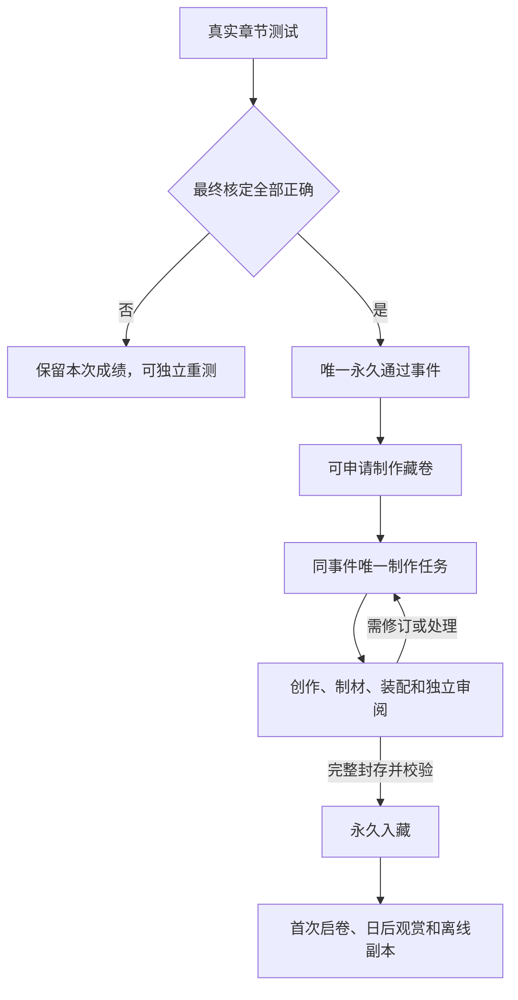

# 纪念卷轴实装：保存、展示、通过资格与申领的讨论方案

2026-10-21。本文为设计建议，不启用正式认证。工艺基准继续按[CHARTER](../../protocol/CHARTER.md)；未改运行器/素材、生成新作品或调用付费服务。

同日用户补充（USER-DECISION）：本人尚未考试，不需要历史成绩补领；收藏应设计为与卷轴审美协调的藏馆场景，卷轴有结构/顺序地陈列，取出、展示、收展与归藏一并设计，并配置相适应的背景音乐及动作声音。以下柜段、镜头、乐器、数量和交互细节仍是研究建议，未经样品验收。

## 1. 当前代码边界

卷轴实验树基线`0bc3cbc31476017f47a90b73701f75e89747bd33`；另只读核对较新maintenance工作副本`318472ac87efcf60e01b2b6a35d253c487adbf64`。后者主壳为v35，实验树为v33；维护树还有其他业务的未提交工作，本轮不修改或混入。没有核实当前线上主壳的部署版本，实装须以届时正式主线为落点，不把整份旧lab外壳覆盖回去。

已确认：

- 现有主壳有章节册、临时页、雅思练习、章节答疑、设置；较新壳另有章节质检。没有正式档案馆、藏卷、认证或申领入口，旧monthly-gallery只是币实验。
- chapter-tests仍关闭certification/coin；真实口答疑义处理完才有最终成绩，提交不是通过。
- v20是独立样品；通用创作、独立审阅、首次通过事件、作品领取和私有展示读取还没有接线。
- 私人storage响应no-store且普通用户没有通用对象读权限；现有SW没有藏卷离线通路，新缓存还会被现有activate白名单清理。
- 主PWA在standalone下全局阻止多指缩放；独立样品细看能力不能直接假定集成后仍可用。

源码入口：`web/{index.html,chapters.js,chapter-tests.js,app.js,sw.js,audio-library.js}`，`worker/src/{chapter-tests.js,auth.js,storage.js}`。

## 2. 推荐的业务含义

将四件事分开：服务器认定的通过资格、艺术制作任务、完整作品永久入藏、第一次观赏。资格不依赖模型是否在线；收藏不依赖是否看完动画；后来的考试分数不改写首次事实。

推荐初版：**首次有效满分自动取得资格 → 用户申请制作 → 后续创作/审阅/封存自动执行 → 完整作品自动入藏 → 用户首次启卷。**

理由是让用户决定何时启动较耗额度的艺术制作，同时保留完整自动制作流程。申请页明确已知费用/额度范围及预算规则，不为每个内部步骤反复确认。以后可启用“通过后自动制作”，数据结构不需要重做；这是产品选择，不冒称用户已经决定手动或自动。不再建设历史成绩补领分支。

不建议再建一个具有资格门槛的“作品做好后才能确认领藏”步骤。ready已经是完整可恢复的用户资产；首次启卷仅完成体验。用户离开、断网、没看完解扣都不使作品丢失或重复收费。

排队阶段可以讨论允许取消；已发生生成时只能停止尚未发生的后续动作，保留成功原件/费用状态，不能承诺撤销已发生费用。未知计费不得靠换请求绕过保护。

自动制作模式只是让E直接入J；不会改变通过规则、原件身份、质量标准或付费保护。

## 3. 怎样储藏

| 层次 | 保存内容 | 职责 |
| --- | --- | --- |
| D1紧凑索引 | 首次事件、任务状态、作品/清单摘要、归属及必要时间 | 找到同一件资产，管理幂等和恢复；不塞正文/贴图/Blend |
| OneDrive权威原件 | 最终纸面分层、英文/译文、完整方案/审阅、展示清单、模型/材质、原始素材及原生工艺引用 | 永久作品及可恢复制作资料，共用内容按摘要只存一次 |
| 手机展示副本 | 索引/小图、共用基座、选中作品的完整展示资产 | 可清理、可重下；不决定认证/收藏身份，不是唯一备份 |

同一套扣具、材质、字体和运行器跨章共享。原生制作资料与展示派生物分别封存；作品完整清单锁定依赖，不能只存一张PNG，也不能把PNG/GLB/短哈希混作完整作品身份。

建议提供“保存纸面原件”及同源英文/译文和记录导出。完整交互备份还需运行器、shader、动作、资源和清单，仅一个GLB不包含现有纸膜和雾场。PWA离线包与可导出的备份包也不是一回事：不承诺在iPhone文件应用里双击一个HTML/ZIP就能完整运行三维观赏。

当前单对象24MiB，展示资源按独立文件准备；大母版可用离线归档分块，但现有API不是通用multipart/浏览器重组服务。公开共用库和个人通过记录/藏卷分别管理权限，默认不把个人资产放到公开Pages。

### 体量：实测文件与估算分开

按当前v20加载闭包统计，正常资源约34.23MiB：共用约31.34MiB，第五章独有配方素材约2.89MiB。这是本机文件字节，不是实网压缩传输或GPU内存。

本轮直接解析GLB复核：文件16,144,276字节，内嵌旧扫描图13,706,507字节；v19又加载13,364,988字节新六图并替换旧材质。发布用派生模型可研究去掉被替换旧图，但须保留当前加载器依赖的材料坐标、UV、展平形态及必要结构。没有实施或验证该派生物，也不能直接删除所有骨骼/形态键。

| 容量情景 | 400章 | 500章 |
| --- | ---: | ---: |
| 共享一次，独有配方约2.89MiB/章 | 约1.16GiB | 约1.44GiB |
| 每章错误复制完整34.23MiB | 约13.37GiB | 约16.71GiB |
| 完整章节档案暂按15–40MiB/章 | 约6–16GiB | 约7–20GiB |

第一行只算现有素材配方，不等于未来冻结展示包：现有最终front PNG本身10,764,392字节，纸胚源3,352,830字节，小画1,561,703字节，另有back/ink/relief、审阅等。完整原件的15–40MiB是初始预算，需用多份实际冻结包校准；共用母版及其他日课音频/雅思/答卷另算。

可沿用现有OneDrive订阅，不新增数据库订阅。当前账户实际容量/剩余仍需按最近有效核验值核算，不能由上述情景推断全项目一定够用。免费5GB不能据此承诺500章完整制作档案。

## 4. 藏馆空间与陈列（替代初稿的列表主展示）

藏馆是独立的沉浸观赏空间；列表保留为检索/定位工具。入口位置尚待实际主壳布局决定，可从章节册到达；测试结果页也直达本卷。进入场景收起学习工具条，返回恢复原阅读或测试位置。外部中文控件和错误状态沿用蓝银语言，馆内以器物、建筑和克制的藏签表达中古气质。

推荐美术方向为“中古私人卷藏馆”：旧石墙、重复拱廊/木梁、深色橡木或胡桃木藏柜、氧化铜小件、窗侧柔光及同室观卷案。材质年龄按接触磨损、木纹/色差、修补和边缘变化组织，不用统一污斑或霉变。灯光要显现木、铜、皮革、纸的区别；不可用泛黄滤镜、强泛光或满屏雾替代环境设计。

卷轴本体横卧浅托/分格，卷口、皮扣和纸色可见；藏位旁有独立小牌，点选后显示清楚的中文章名/艺术题名。作品文字和受誉者信息不为远景辨识而重排。每柜12或24份只能作构图试算，须按iPhone屏幕的可见细节和点选尺寸试样后定规格，不能先定密度再无限缩物件。

空间顺序建议为“馆 → 柜段 → 层/藏位 → 卷轴”。按固定章序/稳定chapterId绑定藏位，认证顺序不改变位置；补做前面的章节只填原位。年份、日期、最近查看和关键词用于搜索定位，不随筛选重排实体柜位。自然空格可以存在，不造锁住奖励/封条墙，也不摆虚构正式藏卷充场。

建筑从设计上允许延长柜段/翼廊，500份只是容量验证情景，不是产品硬上限。进入当前柜区才载入附近陈列；远处用轻量环境与闭卷轮廓。仅选中的一件启用完整纸面、皮扣机构、材质与动作。新柜段复用经过艺术验收的建筑母材，但不能把低质量重复摆放当作完成场馆美术。

导航以点选靠近、轻扫切柜、明确返回和直接选章定位为主，不要求双摇杆自由漫游；搜到第437章可直接到所在柜前。竖屏应可完整完成，横屏可扩展馆内视野，不强制设备旋转。有限镜头路线的三维柜/案与烘焙静态环境为优先验证方案；全自由漫游或纯2.5D均未选定，不能把平面背景包装成已完成立体藏馆。

## 5. 单件观赏

推荐连贯路径为“馆内 → 柜前 → 选藏位 → 取出闭卷 → 同室观卷近景 → 解扣/展开 → 收卷/复扣 → 归原位”。近景保留案面/木柜/窗光线索，镜头逐步转为作品正对观者；顶部返回/章名，底部清楚的启卷/收卷、细看、归藏入口，释读/记录/重播/离线保存为次级功能。

取放用刚体移动和旋转，不拉伸皮扣；柜中闭卷与近景作品须核纸色、尺寸、扣具位置、朝向和光照连续。托盘支承或无手镜头编排是候选，抓握/托举方式尚需分镜与实际接触试样；不先引入写实人手，也不把无支承漂移冒称物理真实。不能用柜内卷突然消失、另一背景放大出现冒充完成空间衔接。

第一次从闭卷开始，真实解扣—取下—开纸形成仪式。以后从馆内取卷时同样遵循取出/开合的物件关系；“快速查看/直接细看”可提供捷径，不强迫每次完整重播。中途返回建议完成可中断的归置；锁屏/刷新不能让藏卷永久消失。是否恢复上次展开状态仍待体验取舍。

新作已在后台永久入藏，再播放入藏仪式：可在新到案上首次启卷，或直接收存归架，跳过仪式不影响归属。柜位的暂时空缺、取出/放回、首次启卷属于本机展示状态，不把多设备观看做成真实借阅互斥；一台手机观卷不阻止另一台查看。

观赏、细看、释读、记录各有职责：

- 观赏保留现有材质/立体感/雾染；一时只运行一件，离开释放GPU资源而保留磁盘副本。
- 细看读取冻结高分辨率纸面，平移/缩放、清楚看纸损/字迹/章印；不让任意背景点击误触收卷。主壳全局禁缩放需限定豁免或专用缩放控件，不只改CSS就宣称手势可用。
- 释读为同源完整英文及中文，包含所有题头、题辞、归属、印文和状态，不重新编文。
- 记录收首次通过时间/来源、制作完成时间、姓名快照、版本和完整摘要；可回首次通过试卷/历次测试，成绩表不塞满艺术页。

数字手稿已有成熟参考：[Mirador](https://projectmirador.org/)与[IIIF Presentation](https://iiif.io/api/presentation/3.0/)提供馆藏/图像/元数据的分工；[OpenSeadragon](https://openseadragon.github.io/)和[Panzoom](https://github.com/timmywil/panzoom)提供高分辨率/移动缩放能力。此处只作设计和候选选型参考，没有实际适配验证；现有约6MP纸面不需要为了“专业”强制引入整套IIIF/切片服务器或Mirador工作台。

主操作保留真实按钮，不要求精确拖动。触控目标可按44×44 CSS px设计，这是[W3C增强目标尺寸AAA](https://www.w3.org/WAI/WCAG22/Understanding/target-size-enhanced.html)的参考目标，非声称所有现有控件已满足。状态提示按[W3C状态消息](https://www.w3.org/WAI/WCAG22/Understanding/status-messages.html)可被辅助技术读取，不逐帧播报或抢焦点；减少动态时保留静态整页/释读。

## 6. 首载、按卷预载与离线

不沿用当前“等完整三维准备好才准细看”的样品门槛。进入作品页先提供封存静态预览/释读，同时准备高保真动态；最终材质/预热未完成不开放会跳变的启卷。低分辨率预览不能冒充原件或成为最终画质。

以一卷为准备单位，不按词/句/小碎片造大量请求；列表只读元数据/缩略图，不预取全库。共享基座按摘要复用，进入作品页后并行准备已知资源。优先测真实资源瀑布、去掉旧扫描重复、推迟隐藏详情截图/导出，不以撤预热或降纸面清晰度换数字。

提供“离线保存本卷”“移除本机副本”；普通已看缓存可按预算淘汰，主动离线保存与普通缓存区别显示。完整清单文件全齐且摘要核对后才标离线可用；中断保留已验证文件，继续同卷，不重生成。登出清个人副本，不删除云端作品。

手机缓存总量可讨论250–500MiB起点，与音频共同看空间；此为设计建议，不是Safari承诺。不要一开始就维护复杂跨产品精细LRU，先做好按卷清理、已下载体量及容量错误；固定离线作品不得被应用无声当普通缓存淘汰。

[WebKit官方存储政策](https://webkit.org/blog/14403/updates-to-storage-policy/)明确本机存储可能被淘汰，estimate是估计，persist是申请，不保证实际可写上限。PWA缓存不能充当唯一永久藏库。[MDN Cache](https://developer.mozilla.org/en-US/docs/Web/API/Cache)说明Cache API由应用显式管理，不能把现有no-store接口当作已经支持私人离线。

[MDN兼容数据](https://raw.githubusercontent.com/mdn/browser-compat-data/main/api/BackgroundFetchManager.json)目前Safari不支持Background Fetch；下载应为可中断的前台队列，不承诺锁屏/关闭PWA后继续完成。新藏卷cache还需纳入SW保留/升级/登出规则。

## 7. 后续认证和错误语义

不另造第二套考试。正式章节理解测试最终核定全对后产生唯一事件；仍可不限次独立重测，后续低分不撤销已存通过。章节修订不自动把旧作品改为新正文，记录固定当时chapterDigest。

用户尚未进行正式考试，本方案不需要历史成绩读取/补领、旧试卷政策兼容迁移或历史通过时间推断。新正式事件记录服务器首次最终核定完成时刻和姓名快照，按CHARTER保留毫秒/时区，不能取作品制作或首次启卷时刻冒充通过时刻。

| 情况 | 用户应看到/系统应保持 |
| --- | --- |
| 口答尚未核定或需补录 | 正在核对/仅补未听清题；不提前显示通过 |
| 电脑离线但已申请制作 | 等待制作服务，资格/申请已保存，不承诺即时完成 |
| 制作失败/未知计费 | 制作暂未完成，通过保留；复用成功阶段，未知结果不自动再发 |
| 重复点击/网络丢响应 | 同事件同任务/作品，回读真实状态，不重复收费 |
| 原件存在但当前取回失败 | 暂时无法取出；不变未领取、不重新制作 |
| 清缓存/换手机/重装PWA | 联网恢复同一件作品；本机副本状态重建，不重发通过 |
| 作品错误需修订 | 可讨论同作品下显式新版本，保留原版/通过时间，不以模板升级覆盖原件 |

## 8. 最小工程接线和通知

沿现有D1/OneDrive/本机执行器增加三类紧凑对象即可：首次事件、eventId唯一制作任务、eventId唯一作品/manifest指针。收藏列表从作品索引读取，不另建“展厅数据库”；首次观赏状态通常本机即可，若要跨设备通知已读才存紧凑回执。

建议接口职责为自己的列表/状态、申请或恢复制作、归属作品manifest及成员资产私有读取、publisher的领取/心跳/完成/失败。不接受客户端自报满分/passedAt/姓名或任意云盘路径；服务端由有效会话映射稳定owner。作品准备完成先校验存储再发布指针，后台任务共用既有监测，空队列不调用模型。

目录一次读取轻量索引，打开才取对应包；不逐帧/开合/拖动写后台。制作状态仅可见页面有限刷新、回前台再核；不建全天高频轮询。完成推送是可选提醒，不能代替状态读取。

红点只表示新作品已就绪且通知未读，不表示未通过章节、制作排队或“欠领取”。进入相关新到内容可清已读，作品永久保留。当前push深链只处理章节/临时页/余额，系统角标登录会清；藏卷就绪事件、深链及已读规则需实际接线，不能直接借用答疑红点的语义。

实装顺序建议：先做一个柜段/观卷案的完整视听取藏试样，验证与现有作品的衔接 → 封存基座/展示包并处理重复资源 → 当前主线接私有读、资格/任务 → 藏馆/释读/记录 → 离线/通知与iPhone实际验证。新服务先以未颁发验证样品走通，不生成虚构正式作品。

## 9. 尚待产品取舍

推荐默认“手动申请制作、完成即入藏、首次启卷”。实体藏馆与适配音乐已为用户要求；具体柜段密度、镜头、托举动作、音色及重复观看状态仍待设计/样品判断。通过后自动制作也可选，但不能用一个“领取”按钮含糊承担生成、扣费、认证、收藏和动画全部职责。

## 10. 场馆与作品的工程接缝

VERIFIED：v20 `app.js`创建独立ScrollObject和Atmosphere，共用Motion调度；没有音乐/拟音模块。`v6/scroll-object.js`保留正交构图、NoToneMapping、specularIntensity=0及源色保真混合；`v17/scroll-object.js`将解扣阶段后才接纸膜，`interaction()`把纸缘/扣具投影到屏幕坐标；v20雾为屏幕二维流体。馆内镜头、坐标、光线与全局雾不能直接套用这些对象。

推荐：馆内使用闭卷派生物/实例化，取出阶段先做刚体路径；转入观卷近景时匹配世界锚点、投影轮廓、尺度、方向、曝光和阴影，再进入原动作进度0。优先验证“同一renderer中的分区场景”；现有封装未解耦前也可试宿主切换，但必须核过渡接缝和双GPU峰值，不能只靠透明淡化掩盖跳变。远景烘焙与近景PBR按材料实际选择，不把全馆ACES/bloom强加到纸面，避免再次洗掉岁月痕迹。

场景状态最少为 `browsing → approaching → retrieving → closed/opening/open/closing → returning → browsing`。取放与既有纸/皮扣进度分开，纸未收好不能回塞藏格。锁屏不追赶一大段动画；退出/丢上下文回稳定状态，作品身份不变。藏位为表现映射，不逐帧写D1，不为每柜/每卷部署新站。

Three的[InstancedMesh](https://threejs.org/docs/pages/InstancedMesh.html)、[LOD](https://threejs.org/docs/pages/LOD.html)和[KTX2Loader](https://threejs.org/docs/pages/KTX2Loader.html)是可用工具候选；[Khronos KTX2说明](https://www.khronos.org/ktx/)支持研究下载/显存压缩。它们未在本馆验证，不代表任何压缩都无损适用。纸面细字、墨迹、旧裂及皮扣微表面需实际对照，不能一键压整包后仅看文件变小。

多次入馆/出馆还需核完整dispose链、光照环境图/贴图/渲染目标释放及预热复用；当前存在closure.dispose但未证明父对象退出必调用。也没有iPhone馆景GPU/内存/帧率实测，不预先宣称500份同时高保真已可行。

## 11. 音乐、空间声与动作拟音

推荐同一藏馆的声音家族：馆内曲目、亲密阅卷变体、短首次入藏乐句、真实材质拟音。初版不要求每章单独生成完整音乐；每卷可按艺术情绪选同族编制/曲目，特殊系列另增乐组。音乐由用户进入藏馆后持续组织，不因点中另一个藏位就重头播放。

| 环节 | 音乐/环境 | 动作声音 |
| --- | --- | --- |
| 入馆/浏览 | 安静室内底声，稀疏拨弦/弓弦或古乐器音色，弱节奏 | 有实际移动才有局部物件声，不凭空播放脚步 |
| 选卷/取出 | 同一曲目过渡，空间距离逐渐拉近 | 浅托/卷体接触，皮革与纸轻摩擦 |
| 观卷近景 | 亲密、留白多，馆内混响收敛 | 解松、脱针、退带的皮革/金属分层 |
| 展开/收起 | 配乐克制，让材质声音可辨 | 厚羊皮纸摩擦随真实速度变化，停手即回落 |
| 归位 | 配乐/空间回到馆内，不突切 | 复扣、托放、回架各有接触声 |

这是一种中古气质的当代艺术声景，不冒称历史原声。避免欢快酒馆舞曲、史诗鼓点、持续宗教合唱、闪光奖励铃和全场风噪。雾多数无声，不能每团雾都配风声或把开纸做成喷气。

[Audiokinetic交互音乐方法](https://www.audiokinetic.com/en/public-library/2024.1.8_8893/?id=creating_interactive_music&source=Help)可学习状态、片段及过渡的分工，不表示引入Wwise运行时。只有取得同拍/同调分轨才用增减声部；普通完整混音先做高质量循环及交叉淡化。候选[Howler.js](https://github.com/goldfire/howler.js)提供MIT播放/循环/淡化和移动解锁封装，是否加入需和现有WebAudio合并判断，不并列造数个音频上下文。

拟音绑定真实动作阶段/接触，不能按钮后setTimeout播放固定录音：`pickUp/pinReleased/tailSlides/keeperClearsScroll/paperUnroll/paperSettles/placedBack`为拟议事件。快速反向时取消尚未发生音，已经听见的音不倒放；收卷有自己的素材编排。摩擦段按速度控制，短触点防连发，2–4份优质变体足够，不靠大范围随机变调冒充材质差异。

VERIFIED：当前reader-speech自建WebAudio并监听`tsl-stop-speech`，雅思/章节录音有局部pauseOthers；没有统一藏馆音频仲裁。建议优先级“麦克风/考试 > 学习音频 > 馆内配乐/拟音”；录音时馆音全停，学习音频结束且用户仍在馆内并先前启声时才允许恢复。

[MDN自动播放说明](https://developer.mozilla.org/en-US/docs/Web/Media/Guides/Autoplay)要求处理有声播放限制；“进入藏馆”点击可用于音频解锁，但实际play/resume失败需可见恢复入口。用户已静音不因换卷重开；音乐与拟音分别可控。[AudioContext状态说明](https://developer.mozilla.org/en-US/docs/Web/API/BaseAudioContext/state)包含iOS切后台/锁屏的interrupted情况；动画、馆音一起暂停，回来不集中补播。静音、音源缺失或系统拦截不阻断收藏/细看。

母带和许可只存一次，作品清单锁声音组/混音版本；短拟音可预解码，长曲按实际需要准备，不把所有曲目全部解码驻留。共用音乐可用合法免费资源起步，不新增订阅或每卷生成费；实际母带编码、循环无缝和试听质量还未选定。

## 12. 已查资源与下一份试样

以下是候选与方法核查，不是素材采购/试听/艺术验收完成；本轮未下载模型、录音或整包音效。

| 来源 | 可借鉴或利用 | 当前限制 |
| --- | --- | --- |
| [Merton旧图书馆](https://www.merton.ox.ac.uk/library-and-archives/visiting-the-library)、[Bodleian空间](https://visit.bodleian.ox.ac.uk/plan-your-visit/our-spaces) | 木质分区、窗光、建筑节律及真实阅览位置 | 家具跨时代，Merton现有直立书架改装在1589–1623；不能把所有可见木作都称中古原貌，照片不自动变可用贴图 |
| [Met胡桃木箱](https://www.metmuseum.org/art/collection/search/463014) | 15世纪末至16世纪初木作、线脚、纹样比例及尺寸参考 | 不是现成可动画藏柜；馆藏图像须核具体Public Domain标记 |
| [Poly Haven旧木桌](https://polyhaven.com/a/WoodenTable_01)、[CC0说明](https://docs.polyhaven.com/en/faq) | 已有952三角面模型、木材和PBR可作案面/物料试验 | 这款是coffee table候选，不直接原样宣布中世纪阅卷案；现代/殖民式柜也不能只因做旧就选用 |
| [ambientCG许可](https://docs.ambientcg.com/license/) | CC0木、石、灰泥等材质，可改/归档原件 | 仍要挑实际纹理/尺度，统一色彩、磨损和照明；不是现成完整藏馆 |
| [Fireproof/The Room](https://www.fireproofgames.com/about) | 移动镜头、点选近看、器物连续动作与声音协作的成熟产品方向 | 学交互和艺术组织，不复用其版权模型/音乐或假称其代码可取得 |
| [Kenney RPG Audio](https://kenney.nl/assets/rpg-audio) | 官方50项CC0拟音候选 | 未试听各文件，不能说已适合羊皮纸/旧铜/扣具 |
| [Vendarro旧皮革录音](https://freesound.org/people/Vendarro/sounds/399540/) | 作者CC0、两件旧皮革摩擦，23秒实录 | 网页可查，下载需要账户；只是素材层，未剪辑成解扣声 |
| [RandomMind/The Bard’s Tale](https://opengameart.org/content/medieval-the-bards-tale)、[The Old Tower Inn](https://opengameart.org/content/medieval-the-old-tower-inn) | 作者CC0，完整曲/loop可作试听候选 | 尚未试听，可能偏酒馆/村庄，不能据题名定为正式馆曲 |

下一份研究样品建议先做完整视听分镜，再制作“一个柜段＋同室观卷案＋一件正式标注未颁发的卷轴”的闭环：从馆内定位到取卷、解扣、展卷、收卷复扣、归原位。馆级空间骨架先确定可扩展；首轮不把500卷做全后才发现取放接缝与审美不成立。

验收看：场馆/卷轴风格是否同属一件产品；材质可分辨且年龄有依据；取放/镜头无穿插和物件替换跳变；近景纸面保真不回退；配乐与拟音真实协调；反向/中断可恢复；iPhone竖屏可完成、横屏合理、实际首载与持续观赏可接受。工程数值辅助定位问题，不取代视听验收。

本轮仅更新研究及用户方向说明，没有改生产数据、运行界面/素材、自动生成规则或新建订阅。

收尾已实际运行`check-balances.mjs`：本研究副本缺发布凭据，余额/容量未成功更新，保留旧记录；脚本报告永久归档已排队，尚未核实归档完成。
