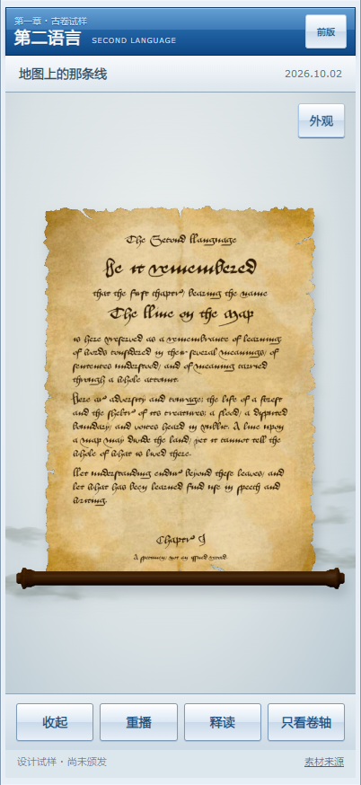

# 第一章古卷增强样品

2026-10-16。基于用户认可的第一版，制作可并列比较的工程试样；不覆盖原版，不接正式章节认证。

## 入口与当前状态

- 新版 `/labs/chapter-scroll-v2/`；原版 `/labs/chapter-scroll/`。
- 保持前版真实第一章数据、英文正文、Aboensis 字形、正视角与独立器物展示，增加协调旧化、真实木纹木轴、先收束后收展的动作与低密度动态雾染。
- 页面“外观”可分别控制雾染、木轴、收束带；“前版”直达已认可样品。不是自动颁发证书或生成真实通过记录。
- 运行源、许可与文件散列见 `web/labs/chapter-scroll-v2/CREDITS.md` 和 `asset-manifest.json`。

## 研究怎样改变实现

### 旧化应有原因与分布

[Codex Sinaiticus 皮膜保护研究](https://www.codexsinaiticus.org/en/project/conservation_parchment.aspx) 将制皮留下的结构、使用痕迹与后期损伤区分开；[芝加哥大学铁胆墨保护说明](https://www.lib.uchicago.edu/collex/exhibits/under-covers/research-conservation/iron-gall-ink/) 指向墨周边局部扩散及腐蚀，不能概括成整页同幅度退色。

据此将基底颜色、细纤维凹凸和文字分层：边缘较强的触摸/暴露色差，靠边淡水痕，短而不规则的边缘褶线；中心留出可读面。墨迹略带暖色扩散，独立细微磨损。没有添加随机大孔、烧焦边或通篇相同噪声。

**素材筛选失败也保留结论：**Luke.RUSTLTD 的 Large Parchment Texture（CC0）虽有高分辨率，实际看更像织物，未采用为皮膜；没有以高分辨率数字代替目视适配判断。cron 原纹理仍有自身外观限制，此轮未伪装成扫描皮膜。

### 实物结构参考，不混淆年代

[大英图书馆15世纪意大利祈祷卷目录](https://searcharchives.bl.uk/catalog/032-003371888) 记载木滚轴，但仅此记录不能证明所有木件年代；[Lincoln College 修复藏品](https://lincoln.ox.ac.uk/discover/lincoln-unlocked/online-exhibitions/treasures-restored/) 中19世纪 Esther roll 可见单木轴结构。后者只能用来理解轴、卷芯、端头关系，不能据此声称本样品是英国中古公文复原。参考照片没有随许可不明的图片进入发布包。

采用单木轴与小型车削端头，Wood Table Worn 实扫木纹的 diffuse / normal / roughness 配合照明。木轴位姿与卷绕中心同源；完全打开也留 0.20 世界单位纸膜卷在轴芯附近，避免挂空的木杆。

未找到足够支持“通用中古英国绑绳结”的证据。因此当前窄带只作明确的艺术收束方案，不虚构历史名称。先松开成一条可见带，向左下抽离，再展开纸；闭合反序。它没有碰撞与真实结法，未来若需要真正绳结，应另用有实物指导的建模与烘焙动作，而非扩写当前运动近似。

### 雾效采用现成体积与现成组件，原生负责导演

使用 Drei Vanilla 已有 Cloud 的实例化/深度排序，用 JangaFX 官方 CC0 VDB 预烘焙 alpha 密度。自有 shader 增加低频 UV 流动与密度扰动；前景以实际页边界保护正文，后景由纸面深度遮挡。卷芯移动与开合速度驱动短时扰动，停止后指数衰减，不把每次动作重播为相同预录视频。

首次目视发现：高密度云团像积云，两侧排布像护栏；已经否决。第二次发现过长压扁的云片像横向条带；改低密度烘焙、减少实例、增加不规则密度流动、跟随卷芯重新布置。保留可关雾入口，效果是否采用仍由实际观感决定。

[SideFX 成熟布料/带结方案](https://www.sidefx.com/tutorials/live-stream-on-vellum-clothing-creation-part-1-belts-tie-knots/)、Three Quarks 等作为研究备选，没有安装或购买。没有把付费编辑器、许可未明的云贴图或不必要的新引擎带进项目。

## 工程组织与限制

```text
chapter-sample.json + templates.js
  → document.js：已认可纹理 + 分布旧化 + 独立墨层/微凹凸
  → ScrollObject：同一纸膜 + 共用卷芯位姿的木轴 + 可逆收束
  → ScrollMist：CC0 密度烘焙 + Drei 云实例 + 字区保护
  → app.js：唯一时钟、原生控件、可见性/减少动态效果/回退
```

- 仍沿用 Paperlab 近似卷绕，不是布料碰撞求解；带的展开也不是解绳求解。
- 两批雾共12个实例，运行时只传约151 KiB密度PNG；新增三张木纹约2.06 MiB。手机不加载VDB、ZIP或Blender。
- 空闲雾效最多24fps；收展时跟浏览器帧。静态纸膜不反复变形；关雾时无持续绘制。后台暂停，减少动态效果时直接打开静态页。不是实体iPhone上已经保证的24fps。
- 前版文件不修改；新增外观样式仍在项目唯一 `web/styles.css`，限定 `.scroll-lab-v2`。无新全局主题、正式页面导航或Service Worker。
- `exportObject()` 临时隐藏环境雾，导出透明器物PNG后恢复。可替换章节数据与系列资源，不把整个卷轴烘焙为不可更改的大图/视频。
- 浏览器运行完全同源，无写API、无生成模型、无订阅。此轮下载与CPU烘焙全部存D盘。

## 核对与可复现入口

本地：`node scripts/serve-scroll-lab.mjs`，打开新版路径。

交互检查：`node scripts/check-scroll-lab-v2.mjs`，`BROWSER_TOOLS_MODULE` 可指向已有 Playwright 安装；前版 `check-scroll-lab.mjs` 仍独立运行。输出 `.cache/scroll-v2/check/` 的JSON与实际闭合、松带、半开、展开截图。测试覆盖独立收束阶段、完整反向收起、外观开关、静置雾不重做纸膜、关雾停止绘制、减少动态效果、失去WebGL回退、字体与真实章节、无外域请求/后台写入。

图像烘焙：`blender --background --factory-startup --python research/scroll-lab-v2/bake_cloud.py -- <CloudPack的cloud_04_variant_0000.vdb> <输出PNG>`。程序从实际density通道烘焙，不另做流体模拟。

**验收边界：**以上手机截图与检查是 Chromium 402×874 触摸模拟、软件WebGL；实体iPhone/Safari上的色彩、触感、发热与流畅度仍待实测。工程通过不能替代用户审美验收。

## 实际发布与收尾

工程代码 `5b54bf8df04b8462413a236fe1d51c7f3173e34d` 已推送 `codex/medieval-scroll-lab-2026-10-16`。

- [新版预览](https://scroll-lab.the-second-language.pages.dev/labs/chapter-scroll-v2/)
- [固定部署](https://82583ce1.the-second-language.pages.dev/labs/chapter-scroll-v2/)
- [已认可前版](https://scroll-lab.the-second-language.pages.dev/labs/chapter-scroll/)



[闭合](sample-closed-iphone.png) · [松带](sample-band-release-iphone.png) · [半开](sample-half-open-iphone.png)。展开截图来自公网实际浏览器，其余来自同版本本地浏览器，均非概念图。

新版19项交互检查、前版14项回归检查通过，未捕获脚本/着色器错误。线上已另查实际字体、材质、组件加载、收展及静置雾染；保留原Pages网关，会话API返回200 JSON、受保护练习API仍返回401。`check-results.json`、`live-verification.json` 保存结果，未将许可不明照片或源VDB加入仓库。

仅发布独立预览分支，没有以旧基线覆盖生产main。任务末尾通过原通路更新额度与容量并排入永久归档队列。新增持续成本为零。
