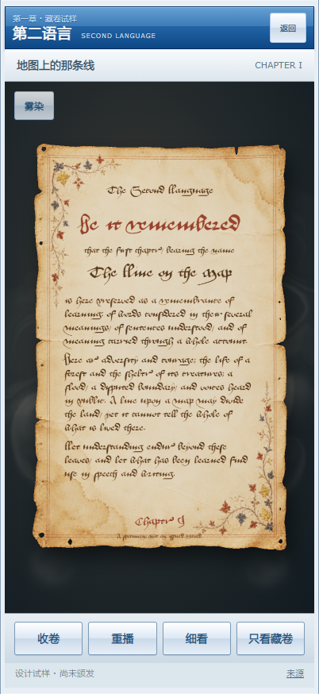

# 第一章藏卷 · 可运行制作试样

2026-10-17。基于 `codex/medieval-scroll-lab-2026-10-16` / `8f16161` 开始，本轮初始工作树干净。承接[完整资产与效果重评估](../scroll-resource-reassessment-2026-10-17.md)，用户授权深度研究和实际制作，并允许必要时使用Kaggle；本轮实际没有调用Kaggle、购买素材或新增订阅。

**预览：** https://scroll-lab.the-second-language.pages.dev/labs/chapter-scroll-v3/ 。[仅看器物](https://scroll-lab.the-second-language.pages.dev/labs/chapter-scroll-v3/?view=object)。固定部署地址见 `deployment.json`（部署后生成）。保留[原基础版](https://scroll-lab.the-second-language.pages.dev/labs/chapter-scroll/)及已否决的v2入口。



## 研究落实为哪些制作决定

1. **对象形制先协调。** 选择无轴的卷藏文书，配可整体抽退的皮环；没有把木轴下端固定当成历史定制，也没有继续改善上一版被否决的简陋轴形。固定正视镜头是既定产品要求，故精细皮扣采用独立2.5D美术资产，纸膜仍为连续三维卷绕。该选择主动减少不可控的完整道具建模，而非声称已经获得可绕看的皮扣模型。
2. **材料资产与真实字迹分工。** 内置imagegen分别制作无字正面、无字背面、独立皮环；英文由已有Aboensis实际字库排版。旧化包括局部水痕、薄损、折线、边缘积色与褪色细花饰；没有靠全页随机噪声替代材质。它是艺术设计，不是实物扫描或严格文物复原。
3. **采用完整流体作品的核心效果。** 使用Pavel Dobryakov的MIT WebGL Fluid Simulation，保留求解器与shader，去除演示宿主。将彩色高亮改为外围淡灰金雾染；两侧连续输入，卷展边界额外扰动。它是二维流体，不冒称体积烟雾。由于对象始终正视，这种层合方式足以做独立流动；流体在纸后，不覆盖真实文字。
4. **光线服务材料。** Three物理材质配Poly Haven CC0摄影棚HDR采样、暖主光与冷补光，给卷层、纸唇和边缘曲率提供明暗。背景不贴摄影棚照片。皮环明暗是其美术资产的一部分，不能据此宣称完整PBR光照响应。
5. **不为GPU而引入GPU。** 固定视角的纸膜、二维流体与独立美术资产已可在现有浏览器运行；本轮没有需要Kaggle求解的训练或高分辨率离线模拟，故没有消耗其额度。以后确需烘焙复杂布料/真实三维附件时再决定。

## 实际交互

- 初始横置闭卷；轻触启卷，先退皮环，再展同一张纸；再次轻触或用按钮收起。纵向拖动可查看中途，途中可反向。
- “雾染”单独开关；“细看”展示高清文书并可展开现代字体释读；“只看藏卷”隐藏应用外壳。
- `?view=object`直接进入器物视图，仍可返回完整样品控件。
- 减少动态效果时初始即完整文书，不分配流体。页面隐藏暂停调度，雾染关闭时静态无持续绘制。
- 透明PNG可通过只读调试接口导出，背景雾染与应用外壳不进入对象导出。
- 无正式认证接入、无学习状态写入、无模型运行请求；第一章仍为未颁发试样。

## 可复用组织

```text
chapter-sample.json → templates.js（已知系列：字体、材质、尺寸、卷绕参数）
    ↓                     ↓
document.js → 正面真实排字 / 空白背面
    ↓
ScrollObject（Three + Paperlab，连续变形、独立皮环、HDR）
    ↑
app.js（按钮 / 手势 / 生命周期 / 单一RAF）
    └→ Atmosphere（既有流体核心，二维独立背景）
```

`ScrollObject`不查询章节或认证后端。数据改变无须重新生成整张文书图片；模板由已知本地配置选择，不允许正文传入任意脚本或远程资源。当前只实现一个系列，不能说多个系列均已验收。独立2.5D收束件和二维雾染意味着这不是任意镜头资产；若未来引入转视，需要重新处理这两层。

## 验证与已知边界

`node scripts/check-scroll-lab-v3.mjs`：闭卷、皮环先退、真实变形、反向收起、字体、手机尺寸、不间断正视镜头、透明导出、详情、减少动态效果、WebGL回退和同源只读均检查。`checks.json`保留实际结果；**并不以通过项数判定美术质量**。

额外检查流体实际彩色像素，避免只看帧数误报成功：曾在透明背景适配中清错帧缓冲，导致流体运行而画面空白，现已修正。未加入新求解器或重写流体算法。截图来自Chromium 402×874手机模拟、软件WebGL；不是实体iPhone17/Safari性能及触摸验收。艺术效果最终由用户实际观看判断。

## 复现与素材

- 网页：`web/labs/chapter-scroll-v3/`；运行 `node scripts/serve-scroll-lab.mjs` 后打开对应实验入口。
- [`PROMPTS.md`](PROMPTS.md)：三次实际生成指令，原始PNG在`source-art/`，网页使用WebP派生。
- [`asset-manifest.json`](asset-manifest.json)：实际文件大小和SHA256。不是仅保存无法重现的远程临时链接。
- [网页来源说明](../../web/labs/chapter-scroll-v3/CREDITS.md)：上游固定版本、许可与实施边界。
- 后续若被否决，保留此版并记录原因，不覆盖原基础版。

未新增持续费用；内置图像生成的产品额度未提供可查询费用读数，不虚构为外部免费GPU额度或现金零成本。
