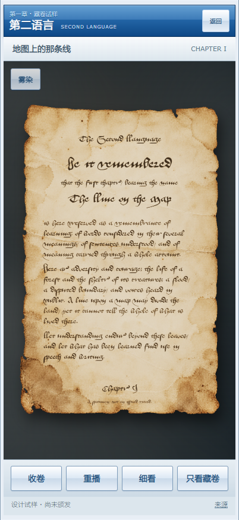

# 正式古旧文书：做旧与弱气流修订

2026-10-17。基线 `codex/medieval-scroll-lab-2026-10-16` / `3d28725`，开始时工作树干净。用户明确指出第三版过分花哨、做旧不足；认可其流体优于第二版，但否决固定双喷口及过强卷展气流；要求皮革和金属共同呈现古旧感。

## 本轮设计依据

**USER-DECISION：**本系列以庄严、朴素的中世纪正式文书为目标。去花饰是本项目的艺术决定，不宣称历史正式文书一概没有装饰。保留第三版流体路线，不恢复第二版的云片外观。皮扣结构暂列次要，先统一整件器物年代感。

**资料核对：**

- [历史羊皮文书对比研究](https://pmc.ncbi.nlm.nih.gov/articles/PMC7662666/)记述暴露区的黄灰变化、折线积尘、折角脆弱处的材料损失，以及墨层微损。本版采用这些损伤与位置的关系，纸面由独立美术资产承载，不把整圈烧边作为旧化。不是对论文样本的逐件复制。
- [加拿大保护研究所 CCI 8/2](https://www.canada.ca/en/conservation-institute/services/conservation-preservation-publications/canadian-conservation-institute-notes/care-alum-vegetable-mineral-leather.html)说明闲置旧皮材可变硬、失去柔韧性；湿度变化、积尘和受力影响表面，铜合金与皮革接触处还可出现绿色腐蚀产物。用于安排皮带弯折处、切边、扣件凹处和接触区的磨损；未把整件做成均匀裂纹或满布铜绿的废墟。
- [NVIDIA GPU Gems 38](https://developer.nvidia.com/gpugems/gpugems/part-vi-beyond-triangles/chapter-38-fast-fluid-dynamics-simulation-gpu)区分流体速度场、外力与被携带的烟雾/染料。这直接对应本轮将“环境雾量输入”和“卷展扰动”拆成两个通道，求解器继续复用成熟上游。
- 另核对了纸张风洞flutter及开门诱导气流研究；其边界条件、尺度和运动不等于本项目卷展，不据此冒称已得到实测羊皮卷气动系数。国家档案馆部分图像页访问403，未声称已取得可复用实物扫描。

## 制作改动

### 纸膜、字迹与扣件

第三版原图分别进行两次内置imagegen编辑。纸膜取消全部花卉、彩饰和装饰线，增强局部水痕、灰褐积色、折线脏污、薄损和边缘磨耗，避免几段纸拼接的视觉。正文以褐黑色真实字体排版，去掉大红题首，保持书写秩序。另借鉴第二版的独立墨层做旧思路：细小不规则墨层缺失、轻微行间墨量差异，折线区增加微损；不是不可读的均匀噪声。

皮环的轮廓与扣件布局保留，主要修订材质：退红、失光、干裂、切边磨耗、弯折压暗，铜扣由明亮金色改为暗铜氧化，少量绿色变化集中在接触区。`细看 → 皮扣细节`提供放大观察入口。

去掉把背面颜色直接当高度的凹凸。低强度复用Poly Haven皮材扫描normal与roughness，保持纸膜偏哑光；该扫描只是微观肌理参考，不是对羊皮纸全部物性的测量。

### 雾效的实际问题与修正

第三版代码每0.22秒从两侧固定位置喷入染料与速度；卷展又在纸边增加染料，且力度未随实际速度缩放，因此形成规律喷口和夸张涡环。

本版保留原流体求解器，调整宿主输入：

1. 模拟场域扩至可见区宽的1.6倍、高的1.3倍，显示区域只取中央；连续输入区域在画面外。初始便有少量弥散环境雾，不从画面内突然点火。
2. 宽域染料按秒连续加入，并由较慢环境流带入画面；不再用0.22秒定时脉冲，也没有两端对称向内喷射。保留自然持续流动，不以完全隐藏雾气代替修正。
3. 卷展只给已有雾气施加速度扰动，不额外产生染料；多个宽域作用区替代两个点。
4. 扰动取纸张上下可见边界位移除以真实经过时间，再转换到模拟网格速度；按时间步积分。不再把每帧的进度差直接作为固定喷射开关。
5. 暂以卷轴宽0.30m作为视觉尺度假设，空气跟随系数0.08，**卷展引入的局部目标速度上限0.015m/s**。这是限制夸张程度的制作标定，不是整个流体速度上限或实测物理数据；环境流仍有独立输入。
6. 直接跳进度、视口变化与长暂停不制造突发冲击。降低旋度强化，继续保留纸后的流动和正文清晰。

## 已有能力与未解决项

保留原三版入口，当前修订在 `/labs/chapter-scroll-v4/`。复用第三版卷展组件、宿主交互和基础资源；没有改正式学习流程。章节仍为第一章未颁发试样。

皮环仍是固定正视2.5D，动作仍为整环退下；未实现真实解扣、皮革受力和任意镜头。纸膜仍为三维连续曲面配美术损伤，不是有体积的每处裂口；同一无字皮膜用于两面。新版本不等于真实文物复原。无新订阅或付费外部API调用，未使用Kaggle。

## 验证与入口

- `scripts/check-scroll-motion-v4.mjs`：慢/快扰动关系、速度尺度上限、帧率一致性、长暂停、卷展不增雾量、画外来源和关闭停算。
- `scripts/check-scroll-lab-v4.mjs`：实际WebGL染料、卷展与反向、字体/详情、透明导出、减少动态效果、失去WebGL时回退、同源只读和脚本/shader错误。
- 浏览器截图为Chromium 402×874手机模拟，尚非实体iPhone17/Safari实测；检查通过不等于用户审美验收。
- [本版预览](https://scroll-lab.the-second-language.pages.dev/labs/chapter-scroll-v4/) · [第三版对照](https://scroll-lab.the-second-language.pages.dev/labs/chapter-scroll-v3/)。固定部署及公网结果保存于 `deployment.json`。
- `PROMPTS.md`记录本轮两次编辑，`source-art/`保存PNG原件；网页WebP只做编码转换。`asset-manifest.json`记录来源、大小和SHA256。

