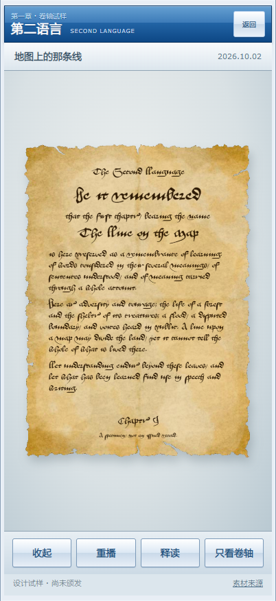

# 项目内羊皮卷轴样品与实现研究

2026-10-16。用户恢复工程工作：结合原生能力与外部资源，以第一章展示可运行样品。此次授权替代上一轮“只研究、不制作”的任务范围；此前全部设计稿仍为否决状态，不恢复其美术母版。

**实际预览：** https://scroll-lab.the-second-language.pages.dev/labs/chapter-scroll/ 。固定部署：https://fbce8985.the-second-language.pages.dev/labs/chapter-scroll/ 。已从公网打开，字体/材质/正文与收展正常，未捕获脚本错误。下图来自实际浏览器，不是视觉概念稿。



[闭合态](sample-closed-iphone.png) · [展开中途](sample-half-open-iphone.png)。实际触摸、色彩与流畅度仍待实体iPhone评价。

## 当前产物与边界

- 独立实验入口：`/labs/chapter-scroll/`。第一章实际标题、日期、编号与摘要来自`chapters/2026-10-02/chapter.json`，英文标题也与第三部分标题一致。
- 真正可运行的单卷闭合、展开、收起、重播与拖动进度；正面相机；正文随同一表面变形；反面无镜像文字；透明对象可独立导出。
- 全英文器物、真实字库排字、现成带透明边缘的旧化材料、原生清晰释读；外壳继续原项目蓝灰2008样式。
- 明确是设计试样，未颁发认证、写答卷、改变学习状态或接收真实通过事件。没有认证接口、数据库迁移或模型调用。
- 本版没有绑绳/解绳、系列切换UI或正式认证申领；不拿尚未核实的结法冒称时代正确。已具备系列配置入口，当前只实现一个皮肤，未宣称已经生产多个系列。
- 美术是否采用由用户看实际样品判断；代码检查不等于审美验收。

## 资源决定

| 层 | 实际采用 | 原生部分与理由 |
|---|---|---|
| 字形 | Tommi Syrjänen Aboensis，OFL | 手稿依据优于自行画假中古字形；原生排版保持每一词为真实英文。属晚期中古瑞典书写传统，不冒称英国特定年代公文复原 |
| 材料外观 | cron Old Parchment Paper，CC0 | 保留作者原件、原有裂口/色斑/褶痕，动态排字与墨损独立。原图分辨率有限，外观也并非扫描级皮膜物性，后续可替换 |
| 卷绕 | Paperlab固定版本纯函数，Apache-2.0 | 采用已有卷绕映射与长度/卷径关系，移植普通ES模块；避免重新试错或把React引入整个PWA |
| 渲染 | 项目已有Three.js 0.186.1，MIT | 不再装第二个引擎。固定正视相机，以曲率/凹凸/光照呈现卷层 |
| 界面与内容 | 项目原生模块与单一styles.css | 按钮、状态、释读、前后台暂停、减少动态效果与失去WebGL时的回退，服从现有产品习惯 |

确切来源、许可、版权与文件散列见`web/labs/chapter-scroll/CREDITS.md`。没有使用被拒绝AI稿，没有重新生成图片，没有采购。上一轮检查的Blender文件许可未充分核明，因此没有带入产品。

## 组件关系

```text
chapter-sample.json（章节数据／specimen身份）
  ├─ templates.js（系列：字体、皮膜、尺寸、卷绕参数）
  └─ document.js（真实字形排版 → 正面／空白背面画布）
       └─ ScrollObject(canvas, surfaces, template)
            ├─ Three.js渲染
            └─ Paperlab卷绕 → 同一网格／同一UV
                 └─ app.js（宿主控件、手势、释读和生命周期）
```

`ScrollObject`不访问章节API、认证API或页面DOM；宿主提供画布和内容表面。`setProgress/resize/render/exportObject/dispose`可由将来的宿主调用。`document.js`正文独立，可更换章节数据而不重新生成纹理图片或重做模型。系列配置限制为本机已知资源，不让记录任意注入代码或远程素材。

本轮网格23,569顶点，原生渲染上限DPR2。底纹在GPU中使用独立前后画布；文字、材质和皮膜表面共同卷曲。纸膜采用双面表面与可见层间距，不宣称实体厚度封闭网格或碰撞布料模拟。上游卷绕是近似映射，不把其说明提升为本项目已证明的精确物理。

## 交互与生命周期

- 初始横卷闭合；点按卷轴或“展开”打开；可收起和重播。拖动改变进度，松手收敛到开/合端态。
- 全过程相机沿纸面法线，闭合态也不转为斜拍。
- “只看卷轴”隐藏应用外壳；有明确返回。透明导出保留器物，不带场景背景或按钮。
- “释读”以清晰英文显示同一份正文，不擅自用现代印刷体替换器物字迹。
- 无交互时停止持续绘制；后台暂停，回来续播。减少动态效果模式直接显示展开页。
- WebGL不可用/丢失时保留静态卷页与释读；不清空内容、不反复申请任务。
- 独立样品不注册新的Service Worker、不预缓存到正式阅读器、不加入主导航。所有运行资源同源，无外部CDN与字体请求，没有接口写入。

初次目视发现接收平面投影边界过硬，已去掉接收平面，改为按真实对象透明轮廓计算柔和投影；物体内部卷曲仍由三维照明表现。不能把柔和轮廓投影误称为离线真实路径追踪。

## 验证与展示

本轮使用现有Playwright与Chrome，402×874触摸视口、DPR2、软件WebGL；不是实体iPhone或Safari验收。

命令：`node scripts/check-scroll-lab.mjs`。可用`BROWSER_TOOLS_MODULE`指定已经安装的Playwright入口；不需要为此装另一套浏览器。检查实际加载字体、章节身份、移动端无溢出、动画真正推进、结束状态、相机不转向、静态停止渲染、释读、独立器物展示、减少动态效果和WebGL回退，并确认没有后台写入/外域请求/未捕获错误。

截图和透明PNG在`.cache/scroll-lab/check/`，结果`results.json`；缓存不入Git。`node scripts/serve-scroll-lab.mjs`可在本机8137端口预览。

## 发布边界与工程状态

开发基线：`dbb9bd3257648d98283f13d85105aa7c038c2e23`，独立D盘工作树`second-language-scroll-lab`，分支`codex/medieval-scroll-lab-2026-10-16`。原维护树含独立音频任务未跟踪文件，未改动它们。

只发布独立预览分支，保留原Pages API网关；不以较旧开发基线覆盖已经前进的生产main。样品验收后是否接入正式通过体验是后续产品决定，不在本轮偷偷打开认证。新增实体、依赖复用、构建与日志均在D盘；未新增素材购买、API调用或持续订阅成本。

实际代码提交`d7ffdc7`已推送GitHub；Pages预览完成，线上字体/纹理/章节JSON返回200，会话API保持JSON，私有练习API保持401。14项模拟检查通过、零未捕获错误。对象PNG已检查为RGBA、含完全透明背景。任务末尾已按现有通路更新服务额度与存储用量，归档排入原服务；没有重新合成声音或调用模型。
