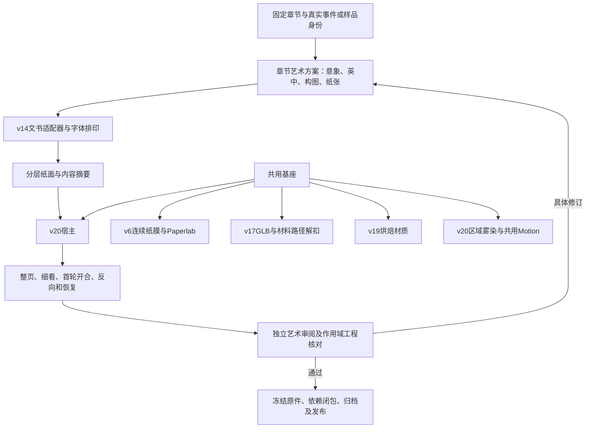

# 卷轴纪念项目：制作工艺复盘与自动生产可行性

2026-10-20。基线`codex/medieval-scroll-lab-2026-10-16@72da09fc9d2bedf4c5805f9517dcfa7736cd7d7c`，开始前干净。实际仓库为`D:/CodexStorage/workspaces/second-language-scroll-lab`；启动提供的C盘目录是另一处无HEAD的占位仓库，本轮没有修改它或搬迁其他任务。

本轮读取卷轴各代研究、用户反馈及实际源码，分艺术内容、物件/材料、自动化底座分别核对，再统一结论。没有新制艺术品、重跑建模/烘焙、付费调用或接通认证。现行制作准则和未来契约集中在[CHARTER](../../protocol/CHARTER.md)，本文保留形成它的依据，不建立第二套规范。

## 一、复盘结论

真正成功的路线是：**有依据的独立章节创作，加上经反复验收的共用器物工艺，再用确定性工具完成排印、装配、检查与封存。**既不是一张整图，也不是所有章同一模板换字；不是每章重新建模、造雾或做扣具。

现在已有可复用的高完成度样品工艺。未来自动化最缺的是把创作、素材、成品审阅、原件归档接到一个可恢复任务中，而非再发明渲染/流体平台。仍有三个实质缺口：样品渲染器不通用；部分制作母版只在忽略缓存；正式首次通过事件/领取尚未存在。

用户最新“可以了”发生在v20雾染交付后，可作为该雾染版本接受依据；不扩大为所有旧版、所有未来作品或后台自动发放已获验收。既有结构接受、工程检查记录和待真机验证的结论分别保留。

## 二、全过程中哪些成果留了下来

| 阶段 | 发现/制作与失败经验 | 最后保留的贡献及证据 |
| --- | --- | --- |
| 初始卷轴v1 | 从平面证书/整幅AI视觉稿转为可替换正文的真实网页器物 | Three、固定Paperlab卷绕、Aboensis、分层正文、透明器物与释读；`research/scroll-lab/README.md` |
| 附件与雾v2 | 借用库和扫描素材后，轴、带、雾的导演/美术仍临时拼装；多项检查通过仍被否决 | 先运行完整成熟作品再适配，不以库名、星数或game-ready标签证明质量；`scroll-resource-reassessment-2026-10-17.md` |
| 材料/动作v3–v5 | 从幻想花饰转向旧文书；喷嘴式雾、过强空气动力、果冻皮扣、脏污/过分洁净来回摆动 | 独立雾层、旧皮/铜材质参考、形体/动作/材质分别判断；各`scroll-lab-v3`至`v5`研究 |
| 纸面保真v6 | 高光洗掉年龄痕迹；残余卷边分支使最后一圈出现白色断线；霉点稿被否决 | 连续纸膜位移/法线/阴影，正视保真、合理裁边、无霉变；`scroll-lab-v6/README.md`及连续性/保真脚本 |
| 章印/文案v7–v10 | 现代图标、细线/浅墨贴纸、规则平滑余墨及教学故事水句先后失败 | 真字体印模、深褐黑、局部缺墨/伤痕、越模肩墨、纸纹/压痕分层；`v10/ink-transfer.js`与各TEXT_REVIEW |
| 官方证书v11 | 大姓名、大正方Attested印及授予条款过度强调机构权威，排版和章节联系不成立 | 真实身份/时间/摘要契约、样品隔离及受限位置数组编码；旧文案/坐标不作为新规范 |
| 私人纪念手稿v12 | 重新定位艺术纪念，研究小长方/圆形藏记，与原创题辞和尾记合排 | 第一章长方藏记/文书获用户肯定；`scroll-lab-v12`、`scroll-lab-v12-sample` |
| 第五章v13 | 横向小画、居中双节题辞形成第二种真实构图；但纸胚仅镜像，被指出敷衍 | art-plan声明式方案与摘要绑定；不能把镜像当独立纸张；`scroll-lab-v13-sample`及`v13/art-plan.json` |
| 第五章材料v14 | 独立纸胚、几何折痕和新物件研究；程序皮扣仍只实现逻辑，艺术/机构不够 | 独立纸面、明确图文构想、微表面与折痕职责，后续版本继续用此文书；`scroll-lab-v14` |
| 扣具工具链探索 | Kaggle/TRELLIS/Pixal等整图重建和v15网页拼装，无法可靠保持完整真实带尾/针轴关系；输出过闭死环加前扣装饰 | 输入必须先明确实物机构；更强模型不能代替结构纠错；参考/资源/物件各研究目录，v15已移出发布路径 |
| 实体机构与v16实装 | 普通针扣皮带关系纠正后独立建分件；用户接受结构/审美，但轴向滑脱仍不是完整解扣 | 连续两端带坯、孔/折返/铆件、独立框/完整针轴、UV/材料坐标/原生工程；`scroll-keeper-physical-2026-10-19`及integration研究 |
| v17适配/真实解扣 | 单轴1.8倍拉伸被否决；旧雾场因无效半径产生NaN；仅称有骨骼并不能保证真实动作 | 原生30mm环径派生、刚性件不拉伸，材料曲线路径退带再开纸；正确投影/数值保护；`scroll-keeper-unfastening-2026-10-20` |
| v18–v19多道做旧 | 通用扫描上零星程序污斑不足；大金黑迷彩、切面拉纹、伪WebP输出均被发现纠正 | 现存艺术基色+CC0微表面+结构相关工艺，原生节点/遮罩、联合烘焙、切面分离、无损打包；两份aging研究 |
| v20雾染 | v17修异常时把动作大幅削弱、环境旋度增强；v18/19并未逐轮再削弱；全场细涡和均匀节奏仍不自然 | 狭长区域输运、局部快慢/聚散、清楚且有限的开合带动；用户最新接受；`scroll-mist-v20-2026-10-20` |

历史记录中“候选/待验收”是当时状态。当前状态由较新的实际用户反馈及实现核定，不能拿旧段落撤销后来接受，也不能因接受了某项技术扩大成整套艺术全通过。

## 三、工艺经验，而非版本号崇拜

### 1. 为什么第一章与第五章能形成独立作品

第一章由地图墨线与真实水域的关系写成简短散文：`Upon the map, a river lies in ink.`与后续雨、根和水路。少量边饰与留白共同表达“图示/真实”。第五章由reed的声学义、手迹/标本和萌发等材料重组为气息、旧墨、折页与种子，采用横画和双节题辞。来源定位见`scroll-lab-v13-sample/source-evidence.json`。

二者没有直接复述教学故事，也没有因为避免堆词而切断章节联系。文学体裁及构图共同变化，姓名收进尾记，作品仍具有个人归属。由此可以提炼创作流程，不能提炼成每章固定“诗两节、图一幅、纹样换皮”。

### 2. 陈旧感是材料与显示共同成立

纸张先有可解释的轮廓、折痕、手持/折谷/接触差异，再处理微表面和落墨。v6证明即便母稿做旧充分，重复打光、强高光和再调色也会把痕迹洗掉；放大排字画布并不等于更高母材分辨率。连续卷绕的位移、法线和阴影必须一致，否则细节修复会破坏整体连接。

印迹并非“把线条画得不完美”就完成。稳定印模、随机但冻结的接触差异、墨肩外溢、纸纹透出和独立压痕是不同层。深墨与纸面融合保留字形，不能用模糊、浅色或发光边假装岁月。历史参考支持风格语言，不替项目虚构考古原型。

### 3. 真实机构必须先于动作和表面美化

扣具的关键不是面数，而是从带坯一端到另一端、折返固定端、针轴/轴眼到搭框点都能连续解释。用户多次纠正前后穿梭，最终以普通针扣皮带为准。早期整图AI重建只保住正面观感，丢了物件连续性；程序环加装饰虽然“可运行”，仍不是真实皮扣。

当前原生工程有76骨骼，但网页皮革通过材料长度坐标和数据纹理沿MaterialPath变形，金属独立刚性。正确的工程解释是这套混合流程，而不是宣称“骨骼动画已自动解决”。v16滑脱的价值是适配，v17退带才补齐真实解扣；二者不能混称。

### 4. 几何与材质各做擅长的工作

机构、孔和轮廓由几何承担；皮革粒面/压磨、铜件细坑/包浆与高光由离线PBR工艺承担。v19使用现存艺术基色和扫描微表面，不再把所有外观细节雕进网格，也不在每章前端层叠昂贵噪声。

扫描与生成基色并非一件实物的逐像素反演，必须如实标来源。可编辑节点工程便于修工序，PNG母版保障原件，无损WebP负责部署；三者不是同一个职责。纯表面变化不重跑全部接触检查，但需要看真实动态光照。

### 5. 雾的复杂度不是自然感

旧版所有区域共享同一旋度规则，区域差异主要是浓淡；细噪声求导及涡量补偿又强化全场小涡。v20把宽域输运、局部卷动、不同速度时钟及源区聚散分开，恢复物体速度带动并保留NaN保护。调试还曾从过分柔软的大模糊块，再修到保留细节的狭长雾带。

对照测试用同种子新场与关闭动作耦合的新场，确认动作前相同、开合后有差异；这只能证明耦合真实存在。自然感最终依靠实际运动和用户审阅，像素差异、参数数量都不能代替。

## 四、当前系统及真实自动化边界

上图是现有组件与拟议流程的整合，不表示整个后台已经接通。

| 能力 | 现状证据 | 通用生产还需补什么 |
| --- | --- | --- |
| 来源/文书摘要/排印 | v12与v14 charter/document；v14计划摘要已纳入memento.v3 | 统一输入与完整实际资源校验；保留旧编码兼容 |
| 多章构图 | 第一章v12硬编码；第五章v14有声明式计划 | 泛化节点/内容映射；目前固定两节、单图/印、固定画幅和对齐，不支持任意新体裁 |
| 纸张/物件参数 | v14模板/折痕、v17路径与接触、v19材质 | 受验证profile及兼容范围，不能只换计划就换任意物理纸张 |
| 创作及审阅 | 对话内模型、提示词、英中审核和真实画面 | 卷轴专用xhigh执行器、生图异步桥、独立成品审阅与修订接线 |
| 任务恢复 | chapter-tests领取/租约；question-worker本机工作目录/心跳 | 卷轴阶段及产物契约；不能继承旧worker模型配置 |
| 防重复付费 | pronunciation的calling/outcome_unknown及成功原件复用 | 每个外部生成步骤采用同等保护，租约过期不等于未收费 |
| 永久存储 | storage.js内容寻址、长度/回读SHA，24MiB对象限制 | 明确原生母版/完整作品包归档类别和依赖闭包 |
| 正式资格/领取 | 正式能力标志仍不发认证；实验有同章唯一认证做法 | 正式首次服务器核定事件、姓名/来源快照、权限、唯一性及私有领取 |

### 两个必须纠正的“已经自动化”错觉

**声明式不等于通用。**v14的createDocument只接受2048×2868、固定block id、两节题辞、单图/长方印和left/center；折痕在addFolds内，实际资源又从templates加载。计划中的路径/摘要并不是唯一执行入口，加载图像/字库时也没逐一重算字节SHA。后续需要抽接口，不能给模型一个JSON就承诺任意构图。

**内容摘要不等于整套器物摘要。**v17–v20沿用v14纸面身份，新的皮扣/材质/雾场并未全部进入该内容数组。未来需要单独完整包清单，锁实际文件、运行器与依赖；不应为了补齐清单改写旧纸面摘要。封存的最终文件优先于跨浏览器/GPU字节级重算。

## 五、原生恢复与资源资产化

### 当前可以恢复到哪一层

| 恢复目标 | 当前情况 |
| --- | --- |
| 看见、展开、播放已提交样品 | Git有bundle、GLB、WebP、字体与源码；可静态恢复 |
| 修改现有原生皮扣/材质 | 本机有v17 Blend、v19 workshop、扫描源/PNG等，关键字节本轮核对见baseline-inventory |
| 从全新机器复建全部原生过程 | 尚未验证；脚本依赖忽略缓存及外工作区安装，不应称完全可复现 |
| 灾难后从永久库取回全部制作母版 | 尚未核实，归档排队不等于覆盖并验证这些目录 |

扣具/材质的原生重建依赖：七张许可扫描源 → physical builder及其烘焙铜法线 → v17环径派生 → v18接触/曲率/外露遮罩 → v19节点工艺/PNG → WebP核对。纸面另有独立分支：优先取封存纸面原件；需重建时，从已存v14纸胚源与build-scroll-v14-assets.py、字体/独立插画/艺术方案进入排印。两支最后才共同进入v20构建/作用域检查。

关键命令源为keeper-physical-build.py、derive-keeper-scroll-fit.py、bake-keeper-age-masks.py、bake-keeper-v19-materials.py、pack-keeper-v19-materials.py与build-scroll-v20.mjs。它们目前硬编码版本/输出目录，直接批量调用会覆写样品文件；应先参数化，不为复盘重跑。

derive脚本硬pin原builder SHA；重新导出的Blend字节也可能不同。正确恢复优先取封存确切母版，重建新派生物则重新核对并赋新版本，不为通过旧pin绕过检查。展示可复现、参数可恢复、文件字节相同是三种不同结论。

### 归档和工具的具体缺口

- archiveWorking目前只枚举runs/questions、expression及缓存白名单，不自动包含research/scroll-*、.cache/keeper-*或未来work/scroll。
- 当前通用数据库快照枚举main/practice，实验库不在该循环；不能据“项目有备份”推断实验/原生资料已全保住。
- build-scroll-v20借maintenance工作区的Wrangler/esbuild；浏览器检查借该处Playwright包及本机Chrome/代理，Blender为D盘5.1.2。这是可用本机环境，不是自包含依赖包。
- Kaggle/Pixal/TRELLIS的历史kernel、潜变量/体素和私有日志只作研究档案；当前已接受实体机构与v19/v20展示无需再跑它们。

### 成熟方案的采用边界

本轮再次核对[Blender Library Overrides官方说明](https://docs.blender.org/manual/en/latest/files/linked_libraries/library_overrides.html?highlight=library+override)：链接资产可编辑覆盖，但存在层级依赖和同步成本。设计判断是建立**版本化母版与受控派生物**；可编辑工作库可用链接/覆盖，发布原件锁实际依赖，不追随latest。本轮未实施资产库，也不假定最新手册所有功能都已在本机5.1.2验证。

[glTF 2.0规范](https://registry.khronos.org/glTF/specs/2.0/glTF-2.0.html)继续作为几何/材质/纹理/动画交换依据；[官方Validator](https://github.com/KhronosGroup/glTF-Validator)可在新增/修改GLB时辅助核格式、引用和非法数值。它不能判断穿带方向、艺术设计或解扣是否真实，不为文档整理安装新工具、重验未变模型。

许可源以各代CREDITS和material-sources为准。Paperlab固定版Apache-2.0/NOTICE、Three/GLTFLoader/Pavel/Ashima MIT、Aboensis OFL、扫描/HDR CC0分别保留；独立生图原稿不是历史扫描。参考用馆藏/厂家照片不自动拥有再分发许可。原件和公开部署包遵守各自许可，不一股脑把付费/私有资料推Git。

## 六、未来执行协议应怎样落地

先把共用工艺封为一个可恢复profile，再让每章制作任务输出自己的artPlan和冻结package。一个任务记录加阶段原件已经足够，使用现有D1/OneDrive与本机执行器，不需要再建独立编排平台。

资格与制作分离：服务器首先核定首次全部正确的真实时刻，保存唯一事件及姓名/章节/试卷/结果快照；后来生成、领取或重考不改该时刻。艺术制作可以失败和续作，不能使通过者重考。当前正式事件尚未存在，本轮不补造。

成本由新题辞/图像/纸张与必要修订决定，机构、动画、材质母版和雾效可共享。不能因为共用工艺就宣称每章无需Codex/生图额度，也不能为了“独一无二”每章都烧GPU重建相同皮扣。无实测账本前不报伪精确单章价格；未来一次配置自动规则/预算后正常执行，未知收费或预算外新购买才停在需处理状态。

建议里程碑：

1. 封存并试恢复当前基座，补未覆盖的原生资料归档。
2. 泛化作品输入/资源和渲染入口，以既有第一章/第五章验证不同构图，保留原件。
3. 用指定模型接未颁发样品的创作、独立审阅及封存，验证失败恢复/费用边界。
4. 完成正式首次事件、权限/唯一性、领取和整包归档后再启用；同时解决首载实网约33s的体验问题，真机测试不以Chromium代替。

本轮只形成协议与证据，没有启用自动颁发或后台持续生成，没有新增持续费用。

## 七、本轮整理与核对结果

- CHARTER改为单一现行入口；AGENTS、项目README及CERTIFICATION_RESEARCH清理过时“当前”状态并指向它。各代研究和原件不回写，旧协议可从基线提交恢复。
- 艺术、器物/材料及自动化三方面分别对照源码后进行反向审阅。补齐同事件跨requestId并发去重、候选审阅失效条件、候选清单/review/最终清单的无循环关系、姓名事件快照时点及离线分块/在线资源的边界。
- `scripts/inspect-scroll-production-baseline.mjs`只读检查32个所选关键文件：全部存在，所有可对照预期摘要均吻合，16项不在Git。清单不是完整依赖闭包，也没有证明已永久归档、全新机器重建或艺术验收。
- 已核变更文档的本地链接和Git补丁格式。运行器/素材没有改动，本轮没有为文档重新跑全套图形回归或生成艺术品。
- 任务末尾实际运行余额/存储核对：本机缺发布凭据，更新失败并保留旧记录；普通永久归档请求已排队，但不能据此声称卷轴母版已归档。
