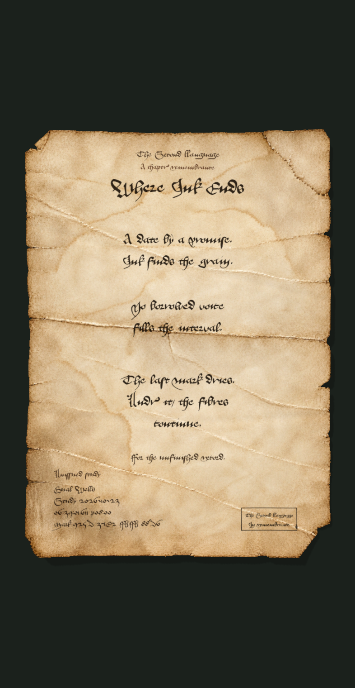
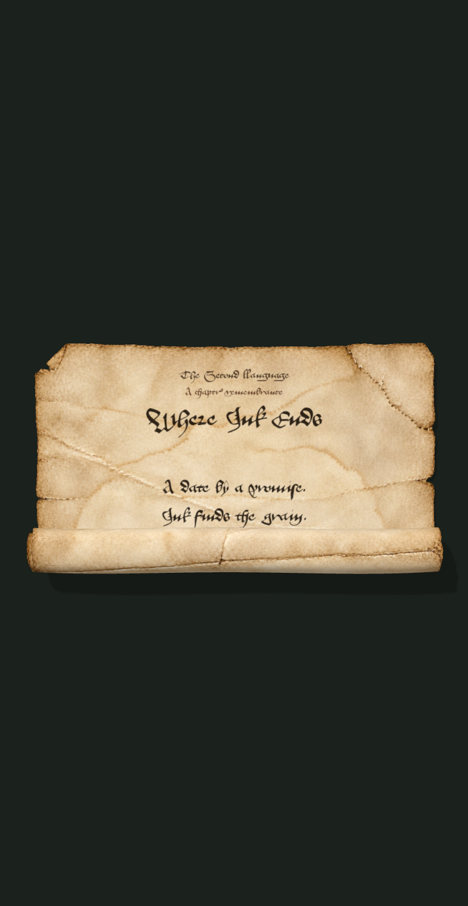
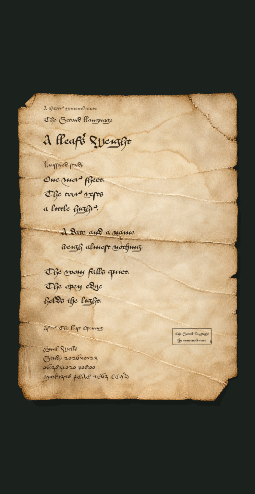
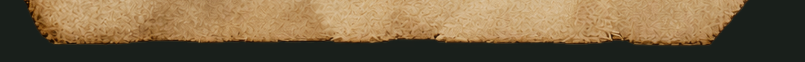
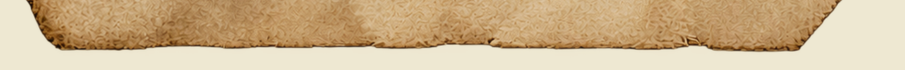

# 真实章节卷轴生产接线核验

2026-10-23。范围是新的按章创作、排印、实际图审、冻结、分卷恢复契约；没有制造用户考试成绩、首次通过或正式申领。真实发布与共享基座登记由本轮部署记录另证。

## 实际产物与决定

### 第12章：未颁发工艺样品，完整生产包通过

真实章节 `2026-10-23`，《无法开出的处方》。原创题辞 **Where Ink Ends**，七行按二／二／三分节，居中轴、明显留白和收窄末行；从真实章内承诺日期、沉默及未完记录提炼，不复述教学剧情。英中全文在 `accepted-art-plan.json`。实际 Aboensis 量测发现初稿误将居中坐标写作左边界、随后顶端baseline越界；经定向修正才排印成功，未通过压小字体遮盖。

在合格无字母材上复用原生墨迹／小长方印／压痕和v42器物，不复制第一章有字成品、不镜像第五章。保留既有材质/机构/雾/声音工艺，当前新profile可产生新无字母材，但没有任意插画图层接口。不是宣称所有后续章节都应无画。

- 六张冻结PNG、固定原稿／身份／方案、实际GPU展开及中间态。
- 创作与新上下文独立审阅均实际调用 `gpt-6.1-sol` / `xhigh`，独立runId及输入/输出摘要见 `accepted-review.json`。后端不回显模型时如实标记未暴露；这些是实际运行证据，不是密码学模型证明。
- 完整包为 `.cache/scroll-volume-verification-2026-10-23/package.json`；成功内容SHA `925d37e2fbfb88d63137ef7ae3ff2b686fc2e59c108ee9cbce6a9e7a6f9adb48`。完整文件摘要、candidate/review绑定与工艺限制见 `verification.json`。
- 两个普通独立ZIP分别12,025,071和11,398,489字节，均低于20MiB。实际用Python zipfile打开、CRC检查、解压全部24成员并逐一SHA核对。恢复索引 `work-recovery.json`，并非将一个ZIP原始字节任意切片。
- 新分卷candidate经独立实际图审七项全部true。它仍是 **unissued specimen**；独立审阅通过不替代用户审美认可，不能进入正式目录。

### 第11章：保留被拦截的真实失败

真实章节 `2026-10-22`，《最后一次开门》。**A Leaf's Weight** 的八行三／二／三分节和偏置布局，与第12章实质不同。原稿、译文、主题、排版、动态及工程在最后独立审阅中通过；当时透明输入审阅反复报告剪影红／黄绿污染，使材料项为false。第一次方法只处理部分alpha接触像素，第二次确实改变了交付字节并用邻域暖纸颜色处理，但审阅仍报告污染；没有把改动像素数或哈希变化当作视觉成功。后续原始PNG/WebP实测发现两者alpha完全相同，彩色嫌疑仅在PNG alpha1..18、WebP alpha1..19的近透明像素。正确深/浅背景合成与GPU显示才是可见缺陷的依据；原透明预览存在暴露隐藏RGB而误判的可能，不能将这些旧审阅直接写成已确认的WebP材料缺陷。原未采用决定和审阅记录保持，不追改历史为已通过。

按本轮停止边界，保留 `not-adopted-review.json` 和下图，不继续循环消耗，不为凑“两份通过”强制放行。这个失败同时验证了服务可以拦下艺术/材质未完成候选，而不是任何脚本运行都变成正式资产。

## 内置图像工具桥接

实际调用Codex CLI内置image generation，不走需要API key的独立付费Image API。首次探测配置错误关闭code host，工具未发出；按明确错误恢复host后只提交了一次实际图像调用。已从确切session日志提取调用 `call_123d989eed984bd288380743d0eeaff2`，`exec` 包含 `image_gen__imagegen` 且请求透明背景；真实PNG2,846,592字节已保存，本目录 `image-bridge-unlettered-paper.png` 为原件，摘要见 `verification.json`。提示见 `image-bridge-prompt.txt`。

该图仅证明可真实提交、取回、保存的有用母材候选；没有自动取得系列审美采用资格。实际image model/quality未暴露，不写成推理模型名称。不另买订阅、不读取API key静默切付费生成。

## 原始PNG材料入口收尾

进一步找到第一章原始无字PNG，SHA `cf442d74c5372dd0d9871d4faa0e727194d0f89f4020cf3d4988e47eeb3d3ac5`、3,374,608字节。它与旧WebP的alpha字节摘要相同，RGB有编码差异；原PNG的彩色嫌疑只在alpha1..18，WebP只在alpha1..19，均无实色嫌疑像素。正确深/浅背景合成和实际GPU未显示透明预览中报告的亮彩边。因此保留旧审阅失败记录，同时限定其结论：可能是透明预览/缩放暴露近不可见RGB，不能把旧审阅说法直接当已确定的WebP可见材料缺陷。

新增独立 `first-v6-lossless` 资源，优先给**以后新作品**使用；它是原PNG的逐字节复用，不是另一轮AI生图或像素修边。旧first-v6含义及所有既有冻结作品不变。新工单把该原图作为source-paper.png连同复用来源写进普通恢复卷及CAS，按摘要共享，不必重传完整工艺基座。

只用已成功第12章文稿/布局做了一次材料路由核验，没有重新创作正文；源字节和alpha不改，`cleanedFringePixels=0`。实际GPU、四张深/浅背景底边诊断和唯一一轮独立图审全部完成，七项true；24文件实包跨后端只读校验通过，原PNG/provenance/诊断均在两ZIP恢复闭包中，最大卷14,941,267字节。详细记录 [lossless-verification.json](lossless-verification.json)，审阅 [lossless-review.json](lossless-review.json)。内容SHA保持原值，未发证/未入正式目录。

## 制作与服务工程

执行入口、恢复和明确能力范围见 [SCROLL_PRODUCTION](../../protocol/SCROLL_PRODUCTION.md)。创作/审阅schema只有数据，不接受模型JS/shader/远程资源。字体缺失、实际排字越界、独立审阅否决、未完整封存都会阻止ready。艺术已知缺陷最多两轮定向返修；工具未知结果留attention，普通resume不能绕过。

内容身份、纸面、方案、候选、独立审阅及恢复包分别摘要；不把含印出短码的PNG放进自身内容摘要。真正首次通过时间只来自服务端，不取章节发布日期或部署时刻。正式版只从真实工单+固定通过事件完成，并待本人领取；本轮样品没有这些事件。

核验是393×852、dpr2的真实Chromium WebGL，不冒称实体iPhone/Safari、连续高帧真机或新拟音听审。器物基座、声音及原项目特别作品保持既有采用范围。所有新数据、缓存、原件及原生工作存D盘；raw CLI日志、秘密及无关历史不入本证据目录。

最后对真实完整未颁发样包做无模型故障注入（`scripts/check-scroll-resume.mjs`）：完成review后第三次上传中断，重领后逐字节复用相同本机包完成；verify中断后，用archive检查点的远端manifest在本机目录完全不存在的情况下完成；缺完整封存包时在调用模型前进入attention；变动status/stage/checkpoint/updatedAt不改变art/review提示。模型、生图、重渲染和external新调用均为0，未写DB、未发证。结果见 [resume-verification.json](resume-verification.json)。
