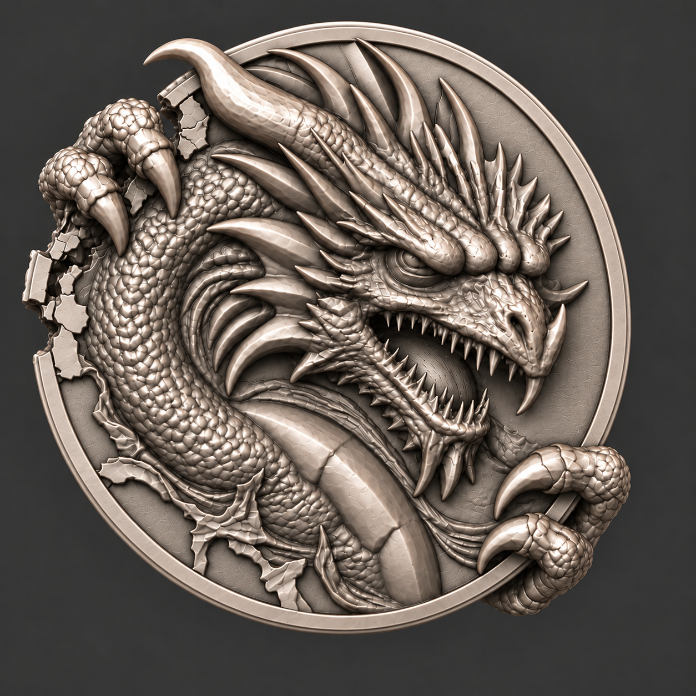

# 仇视之龙：整币共同生成、后规范化与稿图结构清理

2026-10-15 · 本轮只做调查与二维稿图编辑；未创建或修改三维网格，未启动Kaggle/HF推理，未新增订阅或付款。

## 1. 结论与本轮边界

**建议把“正背与跨缘艺术形体共同生成 → 保住艺术形体的尺寸校准 → 保持平滑侧壁 → 材质校准”作为下一轮主要实验方向。** 它更接近已有成功模型的整体形体来源，也能避开上轮人为制造的许多接合问题。还没有本币的对照试验，不能报告成功率提升多少，不能保证一次通过。

这里的一体成型指同一个三维形体在多个视图条件下共同生成，不是把模型真的扫描出来，也不是必须把所有部件布尔融合成一个网格。嘴内、爪下留空、浮游碎片和独立装饰可以保持各自正确拓扑。

USER-DECISION：

- 这轮只处理可行性问题、优化图稿；不进行建模。
- 最新决定：本币侧边改为平滑侧壁，不做齿纹或侧铭；这取代本轮稍早的全齿探索，也取代旧三组侧铭方案。正/背分别作正对相机的干净单物体稿，不再展示斜视侧壁。
- 第一张双面稿是造型/币背视觉依据；第二张是光、粒子、雾参考，不能把它不同的鳞片、爪、嘴或浮片无意并入新几何。
- 仇视之龙是启动特别纪念币，保留专用文字，不添加章号、认证时间或身份码。

本币平滑侧壁决定是否也扩展至所有系列币：用户本轮未明确区分适用范围，本轮只落实到本样币，不静默批改系列规范。

## 2. “是不是二次编辑导致”的实际证据

查阅 foundation-production-20261015/scripts：

1. remote_art.py 遍历正/背任务，分别采样结构与形状；不是一份共同受两面控制的全币采样。
2. 该脚本在 decode_shape_slat 后保存 vertices/faces；没有执行 sample_tex_slat 或保存生成PBR属性。最近一版不能称“同时生成并保留了稿图材质”。
3. fit_coin.py 后来裁取正面/爪、映射厚度、加入规则币体，再拼装背面。此前研究已查到2.25mm闭合半径带来约526.22mm³增加体积；这是显著形体变化，不能只叫微小补洞。
4. assemble_blender.py 为各部件指定近似统一银色Base Color和常数roughness，增加人工凹槽氧化；并没有还原稿图各处的真实材质分布。
5. 币背框线仍从参数路径变形而来，不能归咎于“生成模型不理解视觉稿”。

**推断：**问题很大一部分来自这套分开生成和再装配/修形的方法；不意味着所有编辑都差。整体尺寸、规则刻槽、字体等明确几何操作通常比重新设计掌指关系简单。若整币生成本身错了掌根、缺口或背面，后置“规范化”也不会自动将它纠正。

历史旧版 original-eye-v5 是完整旧概念条件化的原生形体，再官方修复和有限处理；其可用主形提供了整体生成路线的项目内证据。但它的背面与抓握也没最终通过，不能由此推出任何新稿必然成功。

## 3. 双面共同建模：真实可用资源

本轮实际获取源码并固定SHA，见 sources.json。已获取、已读源码与在本币跑通是不同状态。

| 路线 | 当前核查所得 | 对本币的判断 |
|---|---|---|
| 官方TRELLIS.2 | 固定版本run只接收一张image；完整流程可生成形状与PBR，另有给定网格的材质生成 | 现有单图环境不能宣称原生双面支持。get_cond接收list不等于已经按正背相机融合 |
| VisualBruno ComfyUI-Trellis2 | 内置run_multiview、front/back/left/right和空间混合采样；可只传front/back并选材质阶段 | 已有代码候选，比临时自写跨模型拟合更值得调查；它是社区多视图融合，不是微软新增专用多视图训练能力。本币/现环境未运行 |
| Pixal3D | 官方inference_mv.py，专用pipeline_mv.json与多视图权重，输入相机矩阵/FOV并共同生成 | 下一轮优先核查的实验候选；显式相机与像素投影更符合本问题。没有证明它在此币的艺术质量优于TRELLIS.2，也未安装/下载权重 |
| Hunyuan3D-2mv | 官方模型与MVImageProcessorV2具有命名视角及索引，支持输入字典 | 原生多视角形状备选；本轮未在币上验证质量或运行兼容 |
| 原版TRELLIS多图 | 官方示例run_multi_image，作者提醒其无专项训练的多图算法并非所有图都理想 | 方法参照，不因为版本早就替代当前形体模型 |

关键来源：
- [TRELLIS.2固定源码](https://github.com/microsoft/TRELLIS.2/blob/75fbf0183001ed9876c8dbb35de6b68552ee08bd/trellis2/pipelines/trellis2_image_to_3d.py)
- [社区多视图实际实现](https://github.com/visualbruno/ComfyUI-Trellis2/blob/b0e84c0f29857a444e8bcb5b9be2ea218e96efd0/trellis2/pipelines/trellis2_image_to_3d.py)
- [Pixal3D实际多视图入口](https://github.com/TencentARC/Pixal3D/blob/f7cf38429b0bd264f1995f0f8743a88b1c728b94/inference_mv.py)
- [Hunyuan3D-2mv作者模型说明](https://huggingface.co/tencent/Hunyuan3D-2mv)
- [Hunyuan视角处理实现](https://github.com/Tencent-Hunyuan/Hunyuan3D-2/blob/f8db63096c8282cb27354314d896feba5ba6ff8a/hy3dgen/shapegen/preprocessors.py)
- [原版TRELLIS作者说明](https://github.com/microsoft/TRELLIS)

不要把双面排在一张图片里直接交给单图模型：它可能将其理解成两个物件，而不是一个物件的前后。实际输入应为分开的单物体图，具有一致尺度和已知/估计的拍摄关系。

两面能用于首次试验，不必为形式补出十几张猜测视图。但仍缺侧面深度信息。若两个视图本身不一致，模型会在缺口、爪根、厚度处折中。多生成互不一致的“全角度图”也可能更糟。

Pixal3D的相机矩阵不能随便抄默认值后声称测绘正确。当前近正面的艺术双面稿并没有真实相机参数；后续应估计投影/取景，或准备明确拍摄关系的输入。其代码特别要求保持与相机对应的画幅，第一视图为规范正面；任意单独紧裁两张图会破坏假设。

## 4. 后置规范化：哪些确实容易，哪些仍是艺术编辑

### 4.1 尺度先取币芯，不能用龙角/龙爪总包围盒
以完整圆缘的可靠弧段拟合币芯圆，取半径r；目标半径R时统一缩放s=R/r。先恢复中心/方向，所有形体用同一s。40mm是既有工作直径，不把伸出币缘的龙角/爪也强行塞进40mm。

### 4.2 “币面面积不变”要明确是哪种面积
固定X/Z平面坐标、仅修改轴向Y时，正投影轮廓和投影面积可以保持。透视画面、实际曲面面积、斜视的视觉厚度不会都保持不变。这里建议保护的是正面构图与投影尺寸，而不是宣称完整曲面面积数学不变。

### 4.3 不能对全币简单Y乘系数
全局轴向压缩会压扁牙、嘴腔、爪腹、鳞片与跨缘扣握。比较可控的做法：
- 识别币芯前/后基准面，估计芯厚t；
- 正背浮雕以各自基准面为参考，主要做整体平移并保持浮雕自身高度；
- 只在确属币芯/侧壁的区域将t调到目标t*；
- 抓握与受损边缘作为共同过渡区，复核指腹接触、负空间、反面指根和实际厚度，不用统一“填实”抹掉缝隙。

这仍需要区域归属。差别在于它不应重新发明主要有机造型，编辑范围通常小于上一轮。若需要厚度改动很大，优先选择生成时比例更合适的整币候选，而不是坚持把它强压到旧数值。

本币艺术全厚=芯厚+正背浮雕突出+跨缘爪最大突出，不能让艺术全厚与币芯2.8mm混为一谈。旧2.8/3.2mm仅为历史币胚工作规格；这轮不是实体铸币，后续允许依艺术结果判断适配性，不擅自先冻结新厚度。

### 4.4 最新改为平滑侧面、正背各自正视

用户后续明确取消全齿，改为平滑侧面。旧全齿研究作为被替代方向保留，不作为这轮目标。
- 正面、背面各是一张完整单币正视图：圆形芯体不倾斜、不故意暴露侧壁；不把二联图直接当单图模型的一张物体输入。
- 微小自然遮挡仍需保留。正视不等于所有形体共面，也不等于不能有侧向曲面；原有浮雕高度、爪下空隙、鳞甲搭接仍应成立。
- 平滑侧壁没有额外规则齿/铭文，不需要为满足侧纹重制整圈币缘。狭窄圆肩/边唇保留器物过渡。
- 缺口处仍有真实断面，爪仍跨侧。不能为了圆滑把破口填回、把跨缘爪切齐。
- 正视图减少倾斜透视与混合边缘的输入歧义；它仍未提供隐藏面和精确厚度，也无法证明一定比原有少量侧视条件更好。
- 对相机感知模型，生成的“正视风格图”仍不是校准照片；后续必须用匹配其尺度/取景的相机假设。不得只改文件名为ortho便宣称真实正交。
- 本轮只优化这组基础正背稿，后续若实际生成出现厚度/抓握歧义，再补最少的有价值侧面信息，不提前生成互相矛盾的全套多视图。

## 5. 一体生成能否同时高度拟合材质

**可以同时生成材质，也可以形状稳定后再给定网格生成材质；不能由此保证材质与原图完全相同。**
TRELLIS.2具有基础色、金属度、粗糙度和透明属性；本项目上次选择形状流程后未保留这些能力。官方还提供给现有网格上材质的入口，说明不必为了材质重新抽取整币形状。
- [完整能力说明](https://github.com/microsoft/TRELLIS.2)
- [给定网格材质示例](https://github.com/microsoft/TRELLIS.2/blob/75fbf0183001ed9876c8dbb35de6b68552ee08bd/example_texturing.py)

本币材质的实际目标应拆开：
1. 基材：暖银而非黄色涂层或灰塑料，裸金属区保持金属属性；
2. 平场：细缎面/轻微方向性手工痕，不是满面龟裂；
3. 高浮雕与甲尖：局部柔和抛光，随灯光变化的高光；
4. 深凹：有限氧化，避免把所有黑线变成厚黑油漆；
5. 新断面：可见材质厚度和粗糙断面，与旧表面区分；
6. 光照/曝光/色调映射：另行匹配，不能把固定白亮边、投影和红光烘进银色基础贴图。

单张金属视觉稿无法唯一分解出材质和光照。PBR参数能表达这些差异，但有PBR不等于生成结果已拟合。需要在相近灯光比较观感，再转灯/转币检查高光能否合理移动。[Khronos PBR](https://www.khronos.org/gltf/pbr)

流程取舍：整体生成时保存材质latent和原始纹理，不再无故扔掉；尺寸调整保留UV。若最后修面改变拓扑，平滑侧壁单独赋工艺材质，对改区转贴图或重烘焙；不为局部规则边缘重生成整个龙的材质。

雾、粒子和动态光不属于银色贴图。REST稿用于形状/材质判断；用户第二张AWAKENED参考只控制红眼/口腔发光、周边黑雾、微屑动效。真实碎片另有母体与独立网格职责。把这些一起输入形体重建可能生成烟块或冻结光斑，本轮不这样做。

## 6. 当前图稿的空间解释与清理方向

图稿不是扫描真值。下表是逐对象的设计解释与待落实点，不声称每个像素已经被二维编辑修好。编号只用于说明，不增加币面内容。

| 编号/区域 | 可建模的设计解释 | 本轮处理/后续核查 |
|---|---|---|
| F01 圆形母币 | 单一芯体，正背浮雕附于同一芯体 | 最新输入改为两面各自正视、平滑侧壁；实际同半径/厚度待三维证明 |
| F02 大角 | 主角自头冠根部向左上延伸，不是币缘的一部分 | 保护原轮廓；不因高光分裂另造角 |
| F03 冠刺 | 各自从冠骨起，根部有归属和前后遮挡 | 保留主布局，不将全部明亮尖线都增建为刺 |
| F04 原眼/眉 | 眼睑夹住近侧凝视眼，眉压制造仇视 | 不补新眼球/改眼神；亮暗不是空洞证据 |
| F05 鼻/鼻角 | 鼻梁连续，前端钩状结构属鼻角，不属牙列 | 保护轮廓；按所属表面区分而不是见尖就删 |
| F06 上牙列 | 各牙从上颌牙弓生出，根部藏于牙龈 | 保护主要牙形，去重/连根需模型近看 |
| F07 下牙列 | 自下颌弧生出，与上牙错列；非嘴外碎片 | 不用暗纹虚构重复齿，避免牙根穿面 |
| F08 嘴内 | 一条有后壁/凹深的口腔，而非透明黑洞贴图 | 背面不能冒出镜像牙口；本轮不凭图量口腔深度 |
| F09 下颌垂刺 | 下颌/颏部的象征性尖突 | 与牙和颈刺区分；不补完整动物喉部 |
| F10 颈部 | 弯曲的象征性高浮雕，不是独立完整龙雕像 | 保留原构图，不把背景削成光滑圆孔 |
| F11 大腹甲 | 连续承接颈部的宽甲板，板缝是边界而非贯穿裂缝 | 保留宽窄节奏，避免统一挤压压平 |
| F12 小鳞 | 覆在主形上的搭接浅浮雕，有根有尖 | v1–v3鳞纹更规整，属于须用户审美比较的变化，未自动晋升 |
| F13 颈后鳍 | 由同一颈部脊线接出，有明确前后次序 | 尖端间留负空间，不将阴影填成实体 |
| F14 左上主指 | 两个主要外露弯指，鳞板包在指节上 | 保留原比例/位置，确认每个指甲有对应指体 |
| F15 左上指甲 | 从有边界的甲根长出，钩向受压币缘 | 不用装饰圆环分离指体，不加第三主指 |
| F16 左上缺口 | 真正母币缺失，残边/新断面/指腹彼此可辨 | v3局部强化背向缺口；二维仍不能证明同一贯穿空缺 |
| F17 压接关系 | 指腹压边，局部压陷/短撕裂唇，部分空气间隙 | 不把爪/币熔为同一鼓包；不拿填洞算法代替动作 |
| F18 右下两指 | 两个主指通过合理隐藏根部共同抓边 | 不凭空添第三指；原下指根深度仍未测得 |
| F19 左/左下裂纹 | 有意残币破裂与表层剥裂，留作设计 | 不按“清洗噪声”全部删；原用户明确允许暂留 |
| F20 浮片 | REST本稿未新增漂浮片；FX参考有独立碎片 | 后续须真实独立体块，不把烟雾亮斑当石片 |
| S01 平滑侧壁 | 无侧齿/侧铭的连续金属壁，区分于破口断面和跨缘指腹 | 最新决定覆盖v1–v3全齿稿；正视输入不刻意暴露侧壁 |
| S02 圆肩/边唇 | 正侧、背侧的窄过渡，区别于齿底 | 不是三条任意亮线；厚度由未来真实截面决定 |
| R01 对应方位 | 正左上↔背右上；正右下↔背左下 | 以竖直轴翻转理解；不要独立移动背爪追求对称 |
| R02 背右上额外钩 | 原图有一处无法可靠归属的突出钩形 | v2已去除，避免读成第三爪/额外角；这是新候选改动，待用户采用 |
| R03 背右上指根 | 来自正左上同一握爪的背向部分 | 不将其另做一个装饰手；v3仍待三维衔接验证 |
| R04 背左下掌根 | 正右下握爪的回扣/掌根延续，非镜像龙颈 | 保留两指关系，不能把镜像鳞刺当手掌 |
| R05 字带 | 与整体碑铭外轮廓衔接的上部字带 | 保留视觉稿的非整圆字带，不用同心圆环替换 |
| R06 书徽 | 原开卷标识，两页各三条阴刻，书页是实心浅拱面 | 六道暗槽不解释成穿孔；沿用项目身份，不重新发明书标 |
| R07 放射线 | 书徽后方的浅刻/低浮雕背景 | 不能穿过书页，不能撑成深尖锥林 |
| R08 卷草 | 主茎—分枝—叶尖有层级，覆于背景浅层 | 接根不等于到处粘连；叶尖与框留清楚间隔 |
| R09 碑铭牌 | 完整实心浅牌面，四周包框/短转角服从视觉稿 | 不再以旧参数矩形拉伸覆盖此轮视觉外形 |
| R10 中英文字 | 清晰阴刻于牌面；不是深洞或黑浮贴纸 | 内容逐项核对，后续允许只校正字形这种规范细节 |
| R11 底饰 | 下方主叶饰接同一中轴根，不是裂纹集合 | 保留视觉主形；不以盒/圆裁掉叶尖来“修齐” |
| M01 平场 | 细缎面金属，微小工具痕属于表面层 | v2减杂痕但仍有残留龟裂；未宣称全清 |
| M02 亮边/凹暗 | 随光变化的金属反射/遮蔽，局部氧化可保留 | 不能把每一道亮暗都当几何台阶 |
| A01 红光 | 眼/口局部光源与附近弱返照 | 用户第二张仅作方向参考，不改变REST眼形 |
| A02 黑雾/粒子 | 独立动态层，离开实体、可关闭 | 不参与形体输入；不以雾遮接缝 |

### 本轮二维输出的真实状态

- inputs/rest-source.png、inputs/aura-reference.png：用户原图副本，未覆盖。
- outputs/rest-v1.png：完整双面编辑；原构图、文字与主要形体保留，侧缘改直齿。并未可靠移除背右上额外钩，故不是最后候选。
- outputs/rest-v2.png：局部清理额外钩与平场；突出钩已去，主要布局保留。
- outputs/rest-v3.png：继续明确背右上缺口/遮挡，作为被后续正视/平滑要求取代的中间稿。该项改善较有限，不能说贯穿破口已被图像证明。
- 三版均内置imagegen生成的二维设计图，不是新三维或扫描。提示词与原件均留存。
- 目视核查五项碑铭保留、两页各三条标识仍在、前爪两组各两主要指、眼/角/嘴主布局未重设计。
- 鳞纹/细牙/微裂纹有生成漂移：候选鳞纹比原图更规整且部分更圆凸；平场仍有少量不具工艺依据的龟裂。不能把其全体升级为强制建模细节，仍以原用户认可形体和本表解释为约束。
- 大范围主形未重新设计；正背精确对应、隐藏掌部、厚度、同一缺口尚未几何验收。后续若看图还发生歧义，先标注/说明，不用再堆图把猜测掩盖过去。
- 本轮没有另生AWAKENED图；保留用户给的FX参考，避免追加扩散把结构又改掉。

## 7. 下一轮实际试验建议（本轮未执行）

1. 先由用户审阅最新正/背正视候选：额外背钩、鳞片变化、背向抓握/缺口和光照是否清楚。v1–v3全齿二联稿不再是最终输入方向。
2. 在新工作副本准备同一尺度/方向的正背单物体输入，保留完整艺术和相机依据；不再将新正背分别抽形再拼。
3. 优先小规模核查Pixal3D的多视图运行兼容和同一整币结果；如果依赖/资源成本不合适，再试已核查的TRELLIS.2社区多视图。先用全币低分辨率验证两面是否落在同一个物体，不把低分辨率当艺术成品。
4. 首次看到结果即看正/侧/背/爪下，没有足够完整体块则拒绝，不先做材质美化。输入稿不出斜视不等于三维验收不看斜视。
5. 有可用整体才做比例/芯厚/局部规范处理；所有用户原件和旧成功模型保留。
6. 平滑侧壁清理与必要字体校正可以后做；不再雕齿纹。需要实际三维修改的主形缺陷仍须如实说明，不能改名“规范化”来降低难度。
7. 保存形体与材质中间结果；最终材质在同光及转光下复核。特效最后独立叠加。

## 8. 文件和证据

sources.json记录实际获取源码的仓库SHA、URL与文件SHA256；sources/是调查快照，不是已安装新环境。
README、原图、中间二联稿、最新正视候选、逐步提示词和图稿谱系共同构成本轮设计研究资料；旧v1.2封存包不改写。
本轮不动模型、不创建正式认证、不改生产前端/数据库，不消耗外部三维GPU配额。内置图像编辑调用记录见图稿谱系，未新增持续成本。

## 9. 最新平滑侧壁正视候选

最新正面：[front-frontal-smooth.png](outputs/front-frontal-smooth.png)。

这份输出保留主构图、两组各两主要外露指及原眼方向，取消齿状外缘和地面展示，作单物体正视风格输入。生成图仍有局部微裂纹与细节变动；“正视风格”不等于真实校准的正交渲染，不声称隐藏结构已解决。

背面前两次请求网络失败，第三次简短请求取得了正视中间稿：[reverse-frontal-intermediate.png](outputs/reverse-frontal-intermediate.png)。目视发现它仍保留两处上方长甲与一处下方长甲，未落实“同一握爪的指背/根部”解释。随后对三个区域的完整币内局部清理请求再次网络失败，未取得修正版。该图不能作为空间关系已清楚的建模输入；背面清理尚未完成。下一次只需恢复这一项，不需重跑研究或正面。
